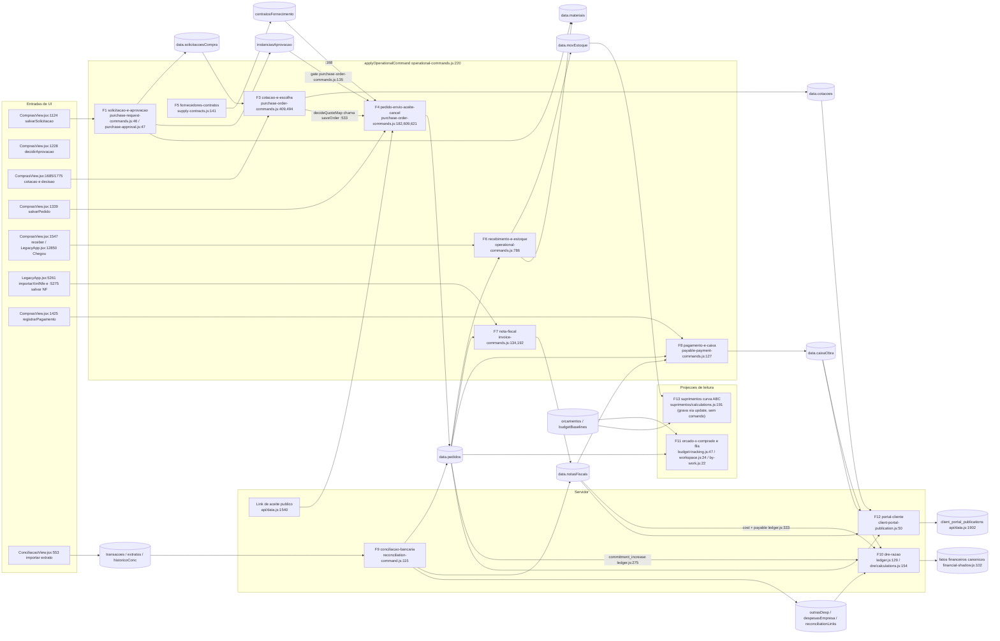

# Pathfinder · Compras e Suprimentos (ARCD) · 26/10/2026

Escopo: fluxo completo de uma compra de obra e tudo que ela toca: solicitação, aprovação, cotação e escolha do fornecedor, pedido, aceite, recebimento e estoque, nota fiscal, pagamento, conciliação com o extrato bancário, DRE e transparência para o cliente (portal), mais suprimentos (curva ABC, planos) e o catálogo de insumos.

Estado do código: `origin/main` em `f284525` + PR #131 (R1 do roadmap de Compras). Fases 0 a 2 descrevem o que **é**; a Fase 3 descreve o que **deveria ser**.

Convenção do projeto: toda escrita de compras passa por `applyOperationalCommand` (`src/domains/sync/operational-commands.js:220`), um reducer puro usado no navegador e em `api/data.js:2183`. Papéis por comando em `api/data.js:168-284`. Não existe `src/features/suprimentos`: o código está em `src/domains/suprimentos`, montado em `src/LegacyApp.jsx:18364` (aba `plan_suprimentos`).

## Funcionalidades (13)

Revisão do orquestrador: a descoberta propôs 14; a aprovação (F2) foi unida à solicitação (F1) por ser um passo curto da mesma cadeia e disparado no mesmo comando.

| # | Funcionalidade | Propósito | Entradas principais (arquivo:linha) | Conversa com |
|---|---|---|---|---|
| F1 | `solicitacao-e-aprovacao` | Engenharia formaliza a necessidade; o servidor numera (SC-nnnn), valida a conversão de unidade, grava insumos novos no catálogo e dispara a alçada (até R$ 5.000 o engenheiro da obra; acima, o Administrador). Pedido só nasce de solicitação aprovada. | `purchase-request-commands.js:46,116,153`; `purchase-approval.js:12,47,84`; `approval-commands.js:51`; `ComprasView.jsx:82,1124,1228,1262`; `workspace.js:42-47`; papéis `api/data.js:219-220`; normalização `LegacyApp.jsx:2028` | F3, F4, F14, orçamento |
| F3 | `cotacao-e-escolha-fornecedor` | Mapa de cotação com vários itens e propostas; a decisão escolhe o vencedor por item (justificativa se não for o mais barato) e gera um pedido por fornecedor. | `purchase-order-commands.js:259,333,409,494,646,694`; `quote-map.js:43,81`; `ComprasView.jsx:595,1323,1685,1775,2596` | F1, F4, F11, F12 |
| F4 | `pedido-envio-aceite-cancelamento` | Ciclo de vida do pedido: criar/editar, enviar (WhatsApp, e-mail, impresso), aceite do fornecedor (inclusive por link público assinado), cancelamento em cascata. | `purchase-order-commands.js:117,182,569,609,621`; `order-dispatch.js:20,42`; `supplier-acceptance-link.js:37,104,116`; `api/data.js:1540,2469`; `purchase-cancellation-command.js:39`; `ComprasView.jsx:292,1339,1609,1652,1809,1841,2327`; `LegacyApp.jsx:5225` (Modo IA) | F1, F3, F5, F6, F7, F8, F9 |
| F5 | `fornecedores-contratos-avaliacao` | Cadastro, contratos de fornecimento (preço, quantidade e vigência por insumo, saldo derivado) e nota 0-10 (pontualidade 50%, notas 30%, cancelamentos 20%). | `supplier-commands.js:10`; `supply-contracts.js:60,141,164,181`; `supplier-rating.js:23`; `delivery-schedule.js`; `ComprasView.jsx:1095,2669,2671` | F3, F4, F7, F11 |
| F6 | `recebimento-e-estoque` | Recebimento parcial/total vira entrada em `movEstoque`; atualiza `qtdRecebida`, custo médio e unidade canônica. | `operational-commands.js:786-839`; `ComprasView.jsx:676,1547`; `LegacyApp.jsx:12850` ("Chegou"); `estoque/commands.js:27`; `estoque/calculations.js:15,31,56`; `delivery-schedule.js:13,50,67`; `unit-conversion.js` | F4, F7, F8, F10, F14 |
| F7 | `nota-fiscal-e-conferencia-3-vias` | Lançar NF (manual, XML NF-e, Modo IA), casar itens do XML com o pedido, calcular divergências (pedido × recebido × faturado) e aprovar. | `invoice-commands.js:134,192`; `nfe-xml.js:23,58,75,105,121`; `LegacyApp.jsx:5246,5261,5275,5312`; `financeiro/workflows.js` (`analyzePurchaseThreeWayMatch`); papéis `api/data.js:213-214` | F4, F6, F8, F10, F12 |
| F8 | `pagamento-e-caixa-obra` | Registrar, reclassificar e estornar pagamento de pedido ou nota; origens empresa, caixa da obra, cliente direto; confere até o conferido (recebido e com nota); adiantamento só financeiro/admin; espelha em `caixaObra`. | `payable-payment-commands.js:127,222,305`; `purchase-payment-validation.js:6`; `payment-conference.js:24,41`; `calculations.js:40-51`; `ComprasView.jsx:1425,1479,1515,2125,2150`; `LegacyApp.jsx:5467` | F4, F7, F9, F10 |
| F9 | `conciliacao-bancaria` | Importar extrato, gerar candidatos e conciliar a saída bancária com pedido, nota ou pagamento (ou criar o pagamento e conciliar); rateios, transferências, estornos. | `server/reconciliation-command.js:115`; `conciliacao/mutations.js:48,81,285,474`; `transaction-commands.js:204`; `engine.js:48,105`; `ConciliacaoView.jsx:553,733,751`; rotas `api/data.js:1968`, `src/api.js:194` | F8, F7, F10 |
| F10 | `dre-comprometido-e-razao` | O razão deriva tudo do blob: pedido gera compromisso, NF reconhecida gera custo, pagamento gera caixa; a projeção persiste fatos de compras no Supabase e o gate de DRE compara com o razão. | `ledger.js:129,262-295,297-354,519-554`; `dre/calculations.js:154,158`; `procurement-financial-facts.js:5,57`; `financial-shadow.js:102`; `api/data.js:419`; `dre-projection.js:59,88` | F4, F7, F8, F9, F11, F12 |
| F11 | `orcado-x-comprado-e-fila` | Projeções de leitura: fila, mapa gerencial, orçado × comprometido × recebido por etapa, alerta de 90% e estouro, comparativo "Compras por obra". | `workspace.js:24`; `budget-tracking.js:47,92`; `by-work.js:22`; `calculations.js:104`; `PurchaseWorkspace.jsx:35`; `PurchasesByWork.jsx:30`; `ComprasView.jsx:1968,2013,2474` | orçamento, F1-F4, F10 |
| F12 | `portal-do-cliente-transparencia` | Publicar ao cliente, por obra e com opt-in (`publicarCompras`, `publicarCotacoes`, `publicarNotasFiscais`, `publicarCaixaObra`), pedidos, cotações, NFs e caixa da obra; sem pagamentos, banco ou conciliação. | `client-portal-publication.js:50,178,208,231,263`; `api/data.js:1589-1633,1902-1910`; `api/client.js`; `client-portal-projection.js:68-70,103-105`; `src/client-portal/*` | F3, F4, F7, F8 |
| F13 | `suprimentos-curva-abc-e-planos` | A partir do orçamento aprovado: demanda de insumos, curva ABC (80/95), planos de suprimento dos itens "A" com lead time reverso, estoque livre, risco e marcos. Não escreve em F1-F4. | `suprimentos/calculations.js:81,119,137,146,191`; `MarcosCurvaASuprimentos.jsx:40,47,53`; `migration.js:5`; `section-authorizations.js:9` | F4, F6, F14, orçamento |
| F14 | `catalogo-materiais-e-bases-referencia` | Catálogo de insumos com conversão de unidade, histórico/análise de preço e bases SINAPI/ORSE para sugerir insumos. | `material-commands.js:6`; `unit-conversion.js`; `calculations.js:75-102`; `api/references.js`; `orcamentos/reference-bases.js`; `ComprasView.jsx:215,421,2732` | F1, F4, F6, F13 |

Transversal (cada fluxograma cita): persistência (`company_app_data` é a fonte da verdade; comandos sob trava em `api/data.js:2197-2243`; espelho em `purchase_requests`, `core_quotations`, `core_purchase_orders` por `api/data.js:771-832`), integridade da cadeia (`server/procurement-chain-policy.js:14`, só nas rotas genéricas `save` e `save-sections`) e autorização por seção (`server/section-authorizations.js`).

## Mapa de dados

## Hipóteses iniciais a verificar (da Fase 0, ainda não confirmadas)

Identificadas por leitura estática; cada uma será confirmada ou refutada na Fase 1/2 e, quando possível, por execução do fluxo real.

| ID | Suspeita | Onde olhar |
|---|---|---|
| S1 | Solicitação nova nasce `"aberta"` (servidor sobrescreve o `"enviada"` da UI) enquanto consumidores testam `"enviada"`/`"em_analise"`. | `purchase-request-commands.js:82`; `workspace.js:50`; `calculations.js:152`; `ComprasView.jsx:857,2237-2246` |
| S2 | Portal do cliente publica cotação cancelada e NF cancelada/estornada. | `client-portal-publication.js:7,210,265`; `invoice-commands.js:26-28` |
| S3 | Portal mostra `unidadeRef` com quantidade/preço na unidade de compra. | `client-portal-publication.js:241-244` |
| S4 | Dois portais (link ao vivo × autenticado com foto estática só atualizada em `publish`/`provision`). | `api/data.js:1618,1902-1910` |
| S5 | Duas definições de "comprometido" (bruto dos pedidos × compromisso reduzido pelas NFs). | `budget-tracking.js:15,65-71`; `ledger.js:275-278`; `by-work.js` |
| S6 | NF reconhece custo no DRE antes de aprovada (status "recebida"/vazio é reconhecível). | `ledger.js:22,61-65`; `invoice-commands.js:146,192` |
| S7 | `calcObraComprasCost` injetado no DRE do servidor é código morto. | `dre-projection.js:59-61,88`; `dre/calculations.js:154` |
| S8 | Pagamento criado pela conciliação grava `origem:"banco"` (fora do enum), sem teto de saldo e sem `notaFiscalId`. | `conciliacao/mutations.js:128,148-152`; `payable-payment-commands.js:27,171-179`; `purchase-cancellation-command.js:60-64,80,113` |
| S9 | Suprimentos desconectado: grava por `update()`, sem comando; `alertasSuprimento` e `reservasEstoque` sem escritor; rascunho conta como pedido aberto. | `MarcosCurvaASuprimentos.jsx:44-65`; `suprimentos/calculations.js:145-157,198` |
| S10 | Escritas diretas fora dos comandos versionados; `saveQuote` não verifica a aprovação da solicitação. | `ComprasView.jsx:1256-1294`; `purchase-order-commands.js:409-443` |
| S11 | Modo IA cria rascunho com numeração própria (`PC-IA-n`), duplicável. | `LegacyApp.jsx:5225`; `purchase-order-commands.js:170-174,186` |
| S12 | Casamento de itens da NF-e ignora conversão de unidade. | `nfe-xml.js:95-101` |
| S13 | Fonte de verdade fragmentada; caminho sem `POSTGRES_URL_NON_POOLING` não espelha compras. | `api/data.js:2209,2275-2292,771-832`; `migrations/20260725_financial_engine.sql:51-75` |
| S14 | Regra de negócio fixa no domínio (id de transação e obra B2-04). | `conciliacao/cash-allocations.js:5-7` |
| S15 | Nomes e campos remanescentes do gate de pagamento sobre recebimento. | `calculations.js:51`; `payable-payment-commands.js:110,334,352` |
| S16 | Comando legado `PURCHASE_ORDER_CREATED_FROM_QUOTE` sem chamador na UI. | `purchase-order-commands.js:445-487` |
| S17 | `validateProcurementChain` não roda no caminho `operational-command`; coleções de compras ainda graváveis por `save`/`save-sections`. | `api/data.js:2183-2301,2876,2946,3050`; `section-authorizations.js:16,20,66-69` |
| S18 | Avaliação de fornecedor perde NF sem `fornecedorId` e não exclui `rejeitada`. | `supplier-rating.js:25,30,31`; `LegacyApp.jsx:5269` |

## Lacunas da descoberta (a cobrir na Fase 1)

`financeiro/workflows.js` (`analyzePurchaseThreeWayMatch`), `work-cash-commands.js`, `payables.js`, `ConciliacaoView.jsx`, `conciliacao/matching.js`, `selectors.js`, `existing-payment-link.js`, `identity.js`, `aprovacoes/engine.js`, o render de `ComprasView.jsx` (~1950-2760), `EstoqueView.jsx`, `ContratosFornecimentoView.jsx`, `server/procurement-registry-shadow*.js`, `purchase-request-live-write.js`, `api/client.js`, `api/references.js` e os trechos de `api/data.js` fora de 120-310, 760-860, 1536-1636, 1864-1933, 2183-2301.
