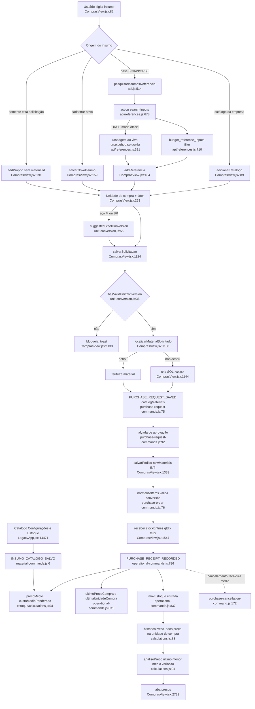

# F14 · catalogo-materiais-e-bases-referencia

Catálogo de insumos, conversão de unidade, preço médio/histórico e bases SINAPI/ORSE (Fase 1, somente leitura; nada executado). Caminhos relativos à raiz do worktree.

## (a) Fontes consultadas
- `PATHFINDER-2026-10-26/00-features.md` 1-146.
- `src/domains/compras/material-commands.js` 1-23 (inteiro); `unit-conversion.js` 1-64 (inteiro); `calculations.js` 1-130 (inclui `historicoPreco`, `historicoPrecoTodos`, `analisePreco` em 62-102).
- `ComprasView.jsx` 76-280 (ModalSolicitacaoCompra), 310-366 e 420-460 (ModalPedido), 1075-1243 (histórico, `salvarSolicitacao`), 1300-1422 (pedido), 1545-1605 (`receber`). O render da aba `precos` (2732-2741) só localizado por grep.
- `purchase-request-commands.js` 1-150; `purchase-order-commands.js` 40-270; `purchase-cancellation-command.js` 150-187.
- `sync/operational-commands.js` 325-355 e 770-842 (recebimento 786-839).
- `estoque/calculations.js` 1-80; `EstoqueView.jsx` 258-283.
- `LegacyApp.jsx` 2476-2504 (normalizador de `materiais`), 14455-14494 e 14690-14713 (catálogo); `proximoCodigoArcd` em 1320.
- `api/references.js` 1-1060 (inteiro); `src/api.js` 483-518; `orcamentos/reference-bases.js` 1-30; `MIGRACAO_REFERENCIAS_ANALITICAS.sql` 1-53.
- `purchase-request-workflow.js` só por grep (5-9). Grep: consumidores de `listarBasesReferencia`, `ultimoPrecoCompra` e `SOL-`.
- Não lido: `BasesPrecoAdmin.jsx` (só localizado: chama `listarBasesReferencia` em :99 e `removerBaseReferencia`), `server/reference-code.js`, `server/reference-utils.js`, `orse-parser.js`, a migration que cria `budget_reference_bases` e `budget_reference_items`.

## (b) Achados concretos

### 1. Caminho feliz (solicitação)
- Três portas para um insumo entrar na solicitação, todas em `ComprasView.jsx`:
  - Catálogo da empresa: busca local em `data.materiais` (:88), `adicionarCatalogo` (:89-94) copia unidade, `precoMedio` como `precoRef`, `fatorConversao:1`.
  - Base SINAPI/ORSE: `pesquisarInsumosReferencia([form.referenciaId],termo)` com debounce de 260 ms (:172-181), filtrando `tipoItem==="INSUMO"` (:177). `addReferencia` (:184-190) grava `fonteRef`, `codigoRef`, `unidadeRef`, `precoRef`, `dataBaseRef`, `ufRef`, `referenciaId`.
  - Insumo novo: `salvarNovoInsumo` (:159-170) gera código `proximoCodigoArcd` (`LegacyApp.jsx:1320`). `addProprio` (:191) cria linha "PRÓPRIO" sem `materialId`.
- A busca em base exige escolher antes UMA base (`form.referenciaId`). A busca no catálogo e a busca na base são independentes: o catálogo não aparece nos resultados da base nem o contrário.
- `salvarSolicitacao` (:1124-1215) monta os insumos:
  - `localizarMaterialSolicitado` (:1108-1122) tenta por `materialId`, depois por código+fonte, depois por descrição+unidade normalizadas.
  - Se não acha, cria o material com `codigo = codigoRef || "SOL-"+últimos 6 do id` (:1142-1149), com `criadoVia:"solicitacao_compra"` e `solicitacaoOrigemId`. Categoria "outros", estoque mínimo 0.
  - Se o material é da própria solicitação (:1150-1157), ele é reescrito com os dados da linha.
  - Envia `PURCHASE_REQUEST_SAVED` com `catalogMaterials` (:1191-1201).
- No servidor (`purchase-request-commands.js:46-106`): exige `hasValidUnitConversion` por item (:69); `normalizeCatalogMaterials` (:17-38) recusa sobrescrever insumo de outra origem (:27-29) e exige que todo item aponte para insumo persistido (:77-80); numera SC no servidor (:51-52) e dispara a aprovação (:92-99).

### 2. Pedido
- `ModalPedido.selecionarReferencia` (`ComprasView.jsx:355-366`) reaproveita o insumo se código+fonte baterem (:358); senão gera `materialId` novo.
- `salvarPedido` (:1339-1422) cria `novosMateriais` com código `INT-xxxxxx` quando o item não traz código (:1347) e envia em `newMaterials` (:1415).
- `normalizeNewMaterials` (`purchase-order-commands.js:56-74`) só rejeita id duplicado ou descrição vazia. `normalizeItems` (:76-115) exige `materialId` válido e `hasValidUnitConversion` (:95).
- Os itens de solicitação viram pedido em :1306-1313, procurando insumo existente por código+fonte ou, se sem código, por descrição exata.
- A cotação nasce de `abrirCotacaoDaSolicitacao` (:1323-1336). O seletor de insumo (:639) reinicia a conversão para `fator 1` e `precoRef = precoMedio`.

### 3. Conversão de unidade (`unit-conversion.js`)
- `conversionFactorOf` (:12-18): unidades iguais dão fator 1; diferentes dão `fatorConversao` se > 0, senão 0. `hasValidUnitConversion` = fator > 0 (:36-37).
- O fator só precisa ser positivo. Qualquer valor positivo é aceito, inclusive 1 entre KG e M, ou um fator fora de ordem de grandeza.
- Bloqueio efetivo nos três pontos de escrita (UI `salvarSolicitacao` :1133; servidor `purchase-request-commands.js:69`; servidor `purchase-order-commands.js:95`): fator inválido (0, vazio, negativo) com unidades diferentes bloqueia com mensagem.
- O recebimento recalcula o fator pelo item do pedido, não pelo navegador. `operational-commands.js:813-819` exige `entry.qtd = quantidade × fator` e `entry.valorUnit = referenceUnitCostOf(item)`.
- **Lacuna**: nada confere `item.unidadeRef` com `material.unidade`. `unidadeRef` é campo de texto livre (`ComprasView.jsx:242`), enquanto o estoque é a unidade do cadastro do insumo. `receber` (:1577) grava `qtd` na unidade da linha. `calcSaldos` (`estoque/calculations.js:15-22`) soma `qtd` sem olhar unidade. Uma linha com insumo "CIMENTO (SC)" e `unidadeRef` "KG" entra no saldo como se fosse SC. Nenhum código no caminho lido impede isso.
- `Inp "Unidade"` (:242) e o `Sel "Unidade de compra"` (:253-254) permitem qualquer sigla de `UNIDADES_PADRAO`.
- Editar `material.unidade` no catálogo (`LegacyApp.jsx:14473-14477`, `EstoqueView.jsx:264-273`) não é bloqueado nem converte movimentos já gravados. `applyMaterialCommand` (:19) só normaliza o texto.

### 4. `suggestedSteelConversion` (`unit-conversion.js:39-64`; uso em `ComprasView.jsx:139,145,249`)
- `steelDiameterMmOf` (:39-44): só identifica aço se a descrição bate em `AÇO|ACO|VERGALH|CA-25/50/60` e traz `NN MM`.
- `steelKgPerMeterOf` (:46-53): exige `unidadeRef === "KG"`. Usa `X KG/M` informado na descrição, senão `d²/162` (fórmula padrão kg/m).
- `suggestedSteelConversion`: só para unidade de compra `M` ou `BR`. `BR` usa o comprimento da barra (padrão 12 m). Fator = kg/m × comprimento.
- Bordas:
  - `unidadeRef` diferente de KG (ex.: aço em "T" ou "BR" na base) devolve null e exige digitação manual.
  - Descrição com bitola fracionária, "Ø 12,5" sem "MM", ou "3/8"" devolve fator 0 e o campo fica vazio (`ComprasView.jsx:140` e `146`).
  - O regex `NN MM` pega o primeiro número seguido de MM, que pode ser comprimento ou espessura de outro item que cite "AÇO".
  - Se `comprimentoBarra` for 0, o código cai para 12 (`unit-conversion.js:59`).
  - A conversão é só sugestão: `setItem(..."fatorConversao")` (:256) permite sobrescrever, e o servidor não valida a faixa. O texto da tela avisa ajuste "conforme certificado do fabricante" (:267).
- Para outros materiais (cimento em saco, areia em m³/t, tijolo em milheiro) não há sugestão: o usuário digita o fator.

### 5. Duplicatas
- Prevenção existente: código idêntico bloqueia (`material-commands.js:16`), mas só na rota do catálogo (`INSUMO_CATALOGO_SALVO`); mesma descrição+unidade é reaproveitada em `salvarSolicitacao` (:1120-1121) e em `salvarPedido` (parcial, :1346); Catálogo e Estoque geram código sequencial ARCD (`proximoCodigoArcd`, `LegacyApp.jsx:1320`).
- Sem prevenção:
  - `normalizeCatalogMaterials` (`purchase-request-commands.js:17-38`) e `normalizeNewMaterials` (`purchase-order-commands.js:56-74`) não verificam duplicidade de código nem de descrição; comparam só o id.
  - `localizarMaterialSolicitado` compara descrição normalizada exata: "CIMENTO CP II 50KG" e "CIMENTO CP-II 50 KG" viram dois insumos.
  - Um insumo vindo do SINAPI e um digitado à mão com a mesma descrição são distintos quando o código SINAPI difere ou falta.
  - Dois SOL-: o código vem dos últimos 6 caracteres do id gerado por `uid()` (:1144), não de sequência. Colisão improvável, mas possível, e o servidor não checa unicidade de código nessa rota.
  - O mesmo código SINAPI em bases de datas diferentes dá o mesmo insumo (`selecionarReferencia`, :358), então a data-base do material fica a da primeira vez.
  - Não existe tela de mesclar insumos, nem de revisão de duplicatas.

### 6. Insumo "SOL-" nunca revisado
- O material fica ativo no catálogo, com categoria "outros" e estoque mínimo 0 (`ComprasView.jsx:1145-1148`), e passa a aparecer na busca de catálogo de todos.
- Não há fila de revisão: grep de `SOL-` e `criadoVia` em `src` só encontra o criador (:1144, :1148) e o normalizador (`LegacyApp.jsx:2492`). Ninguém consome `criadoVia`.
- A Curva ABC e o estoque o tratam como qualquer insumo.
- O usuário pode editá-lo em Configurações > Insumos (`LegacyApp.jsx:14701-14713`), mas `salvarMaterial` (:14473-14477) força `ativo: true`: não dá para desativar pela UI do catálogo. Em `applyMaterialCommand`, `ativo:raw.ativo!==false` aceitaria `false`, mas nenhum chamador envia.
- Enquanto o insumo pertence à solicitação, uma nova edição da solicitação reescreve descrição, unidade e preço (:1150-1157). Depois de usado no catálogo por outra pessoa, o servidor ainda deixa a solicitação de origem sobrescrevê-lo (`purchase-request-commands.js:27-29` só compara `solicitacaoOrigemId`).

### 7. Efeitos colaterais do recebimento (`operational-commands.js:786-839`)
- Para cada material recebido: `precoMedio = custoMedioPonderado([...movEstoque, ...entries], materialId)` (:830), que soma todas as obras e todas as entradas ativas com custo > 0 (`estoque/calculations.js:31-40`); `ultimoPrecoCompra = precoUnit/fator` (:829,832), `ultimaUnidadeCompra`, `ultimoFatorConversao`, `ultimaReferenciaCompra` (:833-835).
- O `item` usado é o PRIMEIRO item do pedido com aquele material recebido (:827). Com duas linhas do mesmo insumo com preços ou fatores diferentes, `ultimoPrecoCompra` reflete só a primeira; o `precoMedio` ponderado reflete todas, via `movEstoque`.
- Sobrescreve `precoMedio` digitado manualmente no catálogo (a próxima entrada recalcula).
- `ultimoPrecoCompra` e os outros `ultima*` NÃO têm leitor no código de produção (grep: só `operational-commands.js` e seu teste). Também não aparecem no normalizador `LegacyApp.jsx:2480-2499`, que repõe só campos conhecidos. Inferência: um `update()` genérico a partir do navegador que reescreva `materiais` poderia descartá-los (caminho de save não verificado).
- Cancelamento de pedido (`purchase-cancellation-command.js:168-176`) recalcula `precoMedio` sem as entradas canceladas. Se não sobrar nenhuma entrada, o valor fica como estava e `ultimoPrecoCompra` não é revertido.
- Escrita direta × comando:
  - Pelo comando: `MATERIAL_SAVED` (`material-commands.js:6-22`, versão otimista, autoria, código único), `PURCHASE_REQUEST_SAVED`, `PURCHASE_ORDER_SAVED`, `PURCHASE_RECEIPT_RECORDED`.
  - Direto, sem versão: quando `dispatchCommand` não existe, `LegacyApp.jsx:14478` faz `persistirCadastro` e `EstoqueView.jsx:274-279` faz `update()`. Fallback offline/legado que permite reescrever `materiais` inteiro sem checagem de código duplicado.
  - Modo IA cria insumo `IA-nnnn` (`LegacyApp.jsx:5224`) com `unidade:"UN"` fixa e `precoMedio = valorBruto`, o valor bruto da nota inteira, não unitário.
  - `OrcamentoView.jsx:2162` também cria insumo via `uid()`/`proximoCodigoArcd` (caminho de gravação não seguido).

### 8. Análise de preço (`calculations.js:62-102`; UI `ComprasView.jsx:1075-1092`)
- `entradasRecebidas` (:62-73) gera uma entrada por evento de recebimento, com o `precoUnit` do evento. O que sobrar de `qtdRecebida` sem evento vira uma entrada "legado" com a data do pedido.
- `historicoPreco` (:75-81) e `historicoPrecoTodos` (:83-92) agrupam só por `materialId` e usam `precoUnit` da UNIDADE DE COMPRA. Não aplicam o fator de conversão.
  - Se o mesmo insumo foi comprado em SC e depois em KG, as entradas se misturam no mesmo gráfico e na mesma média.
  - `precoMedio` do catálogo está em unidade canônica: os dois "preços" do mesmo insumo ficam em escalas diferentes.
- `analisePreco` (:94-102): `variacao = (ultimo − menor)/menor × 100`, em relação ao menor, não ao anterior. `ultimo` = primeira entrada após a ordenação por data decrescente. **A UI reordena crescente (`ComprasView.jsx:1085-1087`) antes de chamar `analisePreco` (:1088), então `historico[0]` passa a ser a MAIS ANTIGA e `ultimo`/`variacao` ficam errados** (H-A; o render 2732-2741 não foi lido para ver como o campo é rotulado; é o achado mais forte, precisa de teste).
- Datas iguais mantêm a ordem de inserção.
- Filtra pedidos cancelados (:77, :85), mas não pedidos de rascunho (sem recebimento não entram: o filtro é `qtdRecebida>0`).
- Filtro por fornecedor na UI (:1086) usa `fornecedorId` do pedido; a NF não entra.

### 9. Bases SINAPI/ORSE (`api/references.js`)
- Ações: `list`, `begin`, `chunk`, `input-chunk`, `component-chunk`, `finish`, `resolve`, `search-inputs`, `composition-details`, `search`, `delete`. As administrativas exigem `user.role==="admin"` (:377-380); `list` e as buscas aceitam qualquer usuário autenticado por PIN (:372-375).
- SINAPI: tabelas `budget_reference_bases`, `_items` (composições), `_inputs` (insumos), `_components` (relações analíticas). Busca por `ilike` em `search_text` em até 6 termos, limites 60/25 (:709-760).
- ORSE: bases novas entram como `mode:"uploaded"` (:454) e usam o mesmo caminho do SINAPI. Bases antigas em `mode:"official"` ainda raspam `orse.cehop.se.gov.br` ao vivo (HTML via regex, :65-140, timeout 12 s em :13). O parser de insumo ORSE força `precoDes = precoNao = preço único` e `uf:"SE"` (:131-134). A busca ao vivo é frágil: depende de marcações como `CorpoTabela` e da estrutura de `<tr>/<td>`.
- Preço escolhido: a UI usa `precoDes` se a base é desonerada (padrão), senão `precoNao`, com fallback para o outro (`ComprasView.jsx:183`, :351-354). A escolha desonerada/não desonerada NÃO é gravada no item nem no material (só `fonteRef`, `dataBaseRef`, `ufRef`, `referenciaId`).
- `consolidateReferenceBases` (`reference-bases.js:10-29`) deduplica bases por fonte+data+UF+regime e fica com a de status "ready" e mais itens. O Compras filtra `status==="ready"` antes (`ComprasView.jsx:830`).
- `delete` (`references.js:1037-1046`) apaga a base e, por `on delete cascade` (`MIGRACAO...sql:9, 25`), seus insumos e relações. Itens de solicitação/pedido guardam uma cópia de código, descrição, unidade, preço, data-base e UF, mas `referenciaId` fica apontando para uma base que deixou de existir.
- `MIGRACAO_REFERENCIAS_ANALITICAS.sql` não cria `budget_reference_bases` nem `_items` (pressupõe que existem) e é um script manual de SQL Editor, não migration versionada com `.down.sql`/teste PGlite como pede o `CLAUDE.md` §3. A mensagem de erro em `references.js:1055` ainda manda executá-lo à mão.
- `api/references.js:23` usa `COMPANY_ID` por env com padrão "arcd": multiempresa por variável de ambiente, não por sessão.

## (c) Fluxograma

## (d) Veredito
- A lista S1-S18 não cobre diretamente o catálogo; S3 e S12 são as vizinhas. S12 (casamento de itens da NF-e ignora conversão): fora do escopo de F14 (ver F7); o padrão é compatível, pois `historicoPreco` também ignora o fator. S3 (portal mostra `unidadeRef` com quantidade/preço na unidade de compra): não verificado aqui.
- Hipóteses novas deste escopo (todas por leitura estática):
  - **H-A**: `analisePreco` com lista crescente devolve `ultimo` = o mais antigo (`calculations.js:99` × `ComprasView.jsx:1085-1088`). Alta suspeita, sem teste.
  - **H-B**: preço do histórico na unidade de compra, misturando unidades (`calculations.js:62-73`), contra `precoMedio` na unidade canônica.
  - **H-C**: nada confere `item.unidadeRef` com `material.unidade`, e o estoque soma `qtd` sem olhar a unidade (`estoque/calculations.js:15-22`; `operational-commands.js:817`).
  - **H-D**: `ultimoPrecoCompra` e outros `ultima*` sem leitor; possível descarte pelo normalizador cliente.
  - **H-E**: criação de insumos novos nas rotas de solicitação e pedido não checa código nem descrição duplicada; só o comando de catálogo checa código.
  - **H-F**: insumo `SOL-` sem fluxo de revisão e sem desativação pela UI.

## (e) Informação que se perde ou deixa de ser rastreável
- **Origem do insumo**: o material guarda `fonteRef`, `referenciaId`, `dataBaseRef`, `ufRef` (`LegacyApp.jsx:2488-2491`). Perde-se o regime desonerada/não desonerada e qual preço (`precoDes`/`precoNao`) foi usado. O preço de referência fica só como `precoMedio` inicial; depois do primeiro recebimento é substituído pela média e a referência SINAPI original não é preservada no material (continua na linha da solicitação/pedido como `precoRef`).
- Se a base é apagada (`references.js:1037`), `referenciaId` do material e dos itens passa a apontar para o vazio, e o item da base (descrição/preço oficial) não pode ser reconsultado. Só sobra a cópia local.
- **Código**: um insumo sem código SINAPI recebe `SOL-xxxxxx` ou `INT-xxxxxx`, sem vínculo com o código oficial correspondente. Não há mapeamento entre insumo interno e código SINAPI/ORSE equivalente.
- **Histórico de preços por fornecedor**: derivado dos pedidos (`calculations.js:62-92`), não gravado como entidade. Não existe preço cotado e não comprado no histórico (a cotação fica em `cotacoes`). O histórico não considera a nota fiscal.
- Cancelar ou editar pedido altera retroativamente o histórico (pedido cancelado sai de `historicoPreco`) e o `precoMedio`. `ultimoPrecoCompra` não volta atrás.
- **Alterações do cadastro**: `material-commands.js:19-20` sobrescreve `atualizadoEm/Por` e a versão, sem guardar o valor anterior. Não há histórico de campo (descrição, unidade, preço médio).
- **Unidade**: mudar `material.unidade` depois de haver movimentos não deixa rastro nem converte o histórico.
- `unidadeCompra`/`fatorConversao` ficam só no item do pedido. O cadastro do insumo não guarda embalagem padrão; a próxima solicitação do mesmo insumo reinicia `fatorConversao:1` (`ComprasView.jsx:92`, :166, :639).
- `ultimoPrecoCompra`, `ultimaUnidadeCompra`, `ultimoFatorConversao`, `ultimaReferenciaCompra` são gravados e ninguém lê (H-D).

## (f) Dependências externas
- Supabase (service role): `budget_reference_bases`, `_items`, `_inputs`, `_components` (`api/references.js:47-49`); `company_id` fixo em env `COMPANY_ID` (padrão "arcd").
- `orse.cehop.se.gov.br` (CEHOP-SE): raspagem HTML ao vivo para bases ORSE antigas em `mode:"official"` (`references.js:26`, :298-344).
- Arquivos oficiais SINAPI (XLSX) e ORSE (TB_SERVICO, TB_INSUMO, TB_COMPOSICAO) importados pelo administrador via `BasesPrecoAdmin.jsx` (não lido) e `server/orse-parser.js` (citado em comentário, não lido).
- `server/app-auth.js` (`authenticateAppUser`, escopo "references") para PIN/token.
- `server/reference-code.js`, `server/reference-utils.js` (não lidos). Extensão Postgres `pg_trgm` (`MIGRACAO...sql:5`).
- `UNIDADES_PADRAO` e `CATS_MATERIAL` (constantes de UI; origem não verificada).

## (g) Confiança e lacunas
- Alta: fluxo de comandos (solicitação, pedido, recebimento, catálogo) e conversão de unidade.
- Média em H-A (render da aba Preços 2732-2741 e teste de `analisePreco` não lidos).
- Lacunas: `BasesPrecoAdmin.jsx`, motor de importação e a migration que cria `budget_reference_bases`/`_items`; nada executado; `appendReceipt`, `matchesPurchaseSearch`, `UNIDADES_PADRAO` e o save genérico que o normalizador de `LegacyApp.jsx:2480` pode afetar; `OrcamentoView.jsx:2162` e `EquipamentosView.jsx`; vínculo com DRE, extrato, portal e escolha de fornecedor é indireto (preço médio alimenta Curva ABC e `budget-tracking.js:37`; consumidores não lidos).

## Verificação do orquestrador (a preencher)
- **H-A** (`analisePreco` com lista crescente): reproduzir por execução com um teste — é o achado de maior valor deste relatório.
- H-C: reproduzir recebimento com `unidadeRef` ≠ `material.unidade`.
