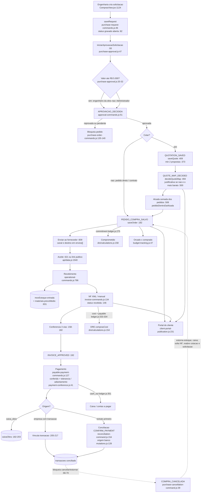

# Compra de obra, de ponta a ponta (visão transversal da Fase 0)

Origem: agente da Fase 0 (descoberta), leitura estática; nada executado. Vale como mapa-mestre; os detalhes estão nos relatórios por funcionalidade (F1…F14). Caminhos relativos à raiz do worktree. Lacunas declaradas pelo próprio agente estão no fim.

## (b) Fluxo, etapa por etapa

**1. Solicitação.** A UI monta `status: anterior?.status || "enviada"` (`ComprasView.jsx:1175`). O comando do servidor sobrescreve com `status: current?.status || "aberta"` (`purchase-request-commands.js:82`). Numeração SC-nnnn no servidor (`:50-52`). A aprovação nasce no servidor e ignora a instância enviada pelo navegador (`:87-99`). Insumos novos entram no catálogo na mesma operação (`:17-38`, `:75-80`).

**2. Aprovação.** Até R$ 5.000 aprova o engenheiro da obra, acima disso o Administrador (`purchase-approval.js:12`, `:20-32`). Decisão = comando `APROVACAO_DECIDIDA`; o aprovador é sempre o usuário autenticado (`approval-commands.js:51-68`). O gate está só no **pedido** (`purchase-order-commands.js:135-140` e `:212-215`). Cotação não verifica aprovação (`:409-443`). Pedido sem solicitação só tem a alçada por valor (`purchase-approval.js:84-88`).

**3. Cotação e escolha do fornecedor.** O mapa exige no mínimo 2 propostas, uma por fornecedor (`purchase-order-commands.js:373-379`). A decisão avalia as escolhas, exige justificativa para quem não for o mais barato e soma o total de todos os pedidos gerados para checar a alçada (`:494-511`). Gera um pedido por fornecedor vencedor via `saveOrder` (`:533`). Grava `decisoes` por item com decisor, data e `economia` (`:540-562`). Vínculo item a item: o item da cotação guarda `solicitacaoItemId` (`:351`); o item do pedido guarda `cotacaoItemId` (`:529`). Compras sem cotação aparecem como alerta, exceto pedidos 100% de contrato (`calculations.js:119-120`, `:175`).

**4. Pedido, envio e aceite.** Valida período fechado, alçada, número duplicado e piso de pagamentos (`purchase-order-commands.js:117-180`). O envio registra canal e destino em `envios[]` (`:609-619`). O aceite registra nome, data e canal, e a previsão confirmada vira a nova previsão (`:621-644`). O fornecedor aceita sem login por link assinado (HMAC, 15 dias, impressão digital do pedido): `server/supplier-acceptance-link.js:37-59`, `:104-133`; rota `api/data.js:1540-1588`.

**5. Recebimento e estoque.** Recebimento parcial ou total gera `movEstoque` do tipo entrada. O servidor confere item, quantidade e custo contra o pedido (`operational-commands.js:786-819`). Atualiza `qtdRecebida`, `recebimentos[]` e o custo médio ponderado do insumo (`:820-837`). O status gravado do pedido **não muda**: "parcial" e "recebido" são derivados por `statusPedido` (`calculations.js:13-18`). Dois caminhos de UI para o mesmo comando: `ComprasView.jsx:1547` (parcial) e `LegacyApp.jsx:12850` ("Chegou", sempre o saldo todo).

**6. Nota fiscal.** Nasce `"recebida"` (`invoice-commands.js:146`). XML NF-e: `LegacyApp.jsx:5261-5274`; casamento de itens com o pedido: `nfe-xml.js:75-93`. A conferência de 3 vias grava `divergencias` (`invoice-commands.js:158-182`). A aprovação exige confirmação explícita de risco se houver divergência (`:201-203`).

**7. Pagamento.** NF precisa estar aprovada para ser paga (`purchase-payment-validation.js:9`). Pedido só é pago até o conferido (menor entre recebido, faturado e pedido, mais tolerância de 2% ou R$ 50). Acima disso é adiantamento, com motivo e só para financeiro/admin (`payment-conference.js:24-55`). Pagamento de NF ligada a pedido é copiado para o pedido, limitado ao saldo, com `notaFiscalId` (`payable-payment-commands.js:171-180`). Origem `caixa_obra` cria movimento em `caixaObra` (`:182-203`). Transação bancária vinculada: o valor deve bater e a saída recebe o rateio (`:143-155`, `:205-217`).

**8. Extrato bancário.** Importação com dedupe por chave (`transaction-commands.js:73-167`). Conciliação de pagamento: o motor sugere a candidata (`engine.js:35-37`). O servidor executa `CONFIRM_PAYMENT` ou `LINK_EXISTING_PAYMENT` (`server/reconciliation-command.js:154-180`). `registrarPagamentoEConciliar` cria o pagamento no pedido ou na nota, com `origem:"banco"` (`mutations.js:124-161`). A alternativa `CONFIRM_ALLOCATION` cria `outrasDesp` ou `despesasEmpresa` direto (`reconciliation-command.js:73-92`).

**9. DRE e comprometido.** Pedido gera só compromisso (`ledger.js:275`), reduzido pelo valor das NFs reconhecidas (`:276-278`). Custo de compras = NF reconhecida: o ledger cria o evento `cost` em `ledger.js:333` e o DRE soma só `nota_fiscal` em `dre/calculations.js:154`. Pagamento de pedido sem NF vira `cash_out` não alocado (`ledger.js:279-293`). Despesa de caixa da obra sem documento vira custo (`:549-553`). O gate compara o custo persistido com o do ledger por obra e competência (`server/procurement-financial-facts.js:57-71`; usado em `api/data.js:419`).

**10. Portal do cliente.** Publica pedidos, cotações, NFs e caixa por obra, conforme as flags `publicarCompras`, `publicarCotacoes`, `publicarNotasFiscais` e `publicarCaixaObra` (`client-portal-publication.js:178`, `:208`, `:231`, `:263`). Dois caminhos de entrega: por link, ao vivo (`api/data.js:1589-1633`); autenticado, por foto manual gravada em `client_portal_publications` (`api/data.js:1902-1910`; lido em `api/client.js:94-102`).

**11. Orçado × comprado.** Compara por etapa de 1º nível: orçamento de controle × pedidos enviados, parciais e recebidos (`budget-tracking.js:47-88`). O comparativo por obra reaproveita esse cálculo (`by-work.js:22-78`).

**12. Suprimentos e catálogo.** A Curva ABC e os planos leem `movEstoque` e `pedidos`, mas não geram solicitação nem pedido (`MarcosCurvaASuprimentos.jsx:40-64`). O catálogo alimenta os itens de solicitação e pedido. O recebimento atualiza `precoMedio`, `ultimoPrecoCompra` e `ultimaUnidadeCompra` (`operational-commands.js:825-836`).

## (c) Fluxograma

## (d) Veredito das hipóteses S1-S18 (leitura estática, sem execução)

- **S1** (status inicial "aberta" × "enviada"): provável bug. O código sobrescreve o status (`purchase-request-commands.js:82`) e os consumidores testam `"enviada"` (`calculations.js:152`, `workspace.js:50`, `ComprasView.jsx:2237-2246`). O teste unitário não afirma o status inicial. O e2e semeia `"enviada"` (`e2e/purchase-workspace.spec.js:10`, `:12`), então não exercita a criação.
- **S2** (portal publica cotação ou NF cancelada): confirmado no código. `client-portal-publication.js:7` não lista `"cancelada"`, e `purchase-order-commands.js:658` grava exatamente esse status.
- **S3** (unidade no portal): confirmado. O portal usa `unidadeRef` (`:241`) com quantidade e preço na unidade de compra (`:242`, `:244`).
- **S4** (dois portais com frescor diferente): confirmado.
- **S5** (dois "comprometidos"): confirmado. Questão de intenção de negócio.
- **S6** (NF "recebida" já é custo no DRE): confirmado (`ledger.js:22` e `:61-65`).
- **S7** (dependência morta `calcObraComprasCost`): confirmado.
- **S8** (origem "banco"): confirmado. `mutations.js:128` grava `"banco"`; `payable-payment-commands.js:27` e `calculations.js:146-150` não conhecem esse valor; a cópia da nota para o pedido não tem teto de saldo nem `notaFiscalId` (`mutations.js:148-152`).
- **S9** (suprimentos sem comando, sem escritor para alertas e reservas): confirmado.
- **S10** (escritas diretas): confirmado. Cotação sem checagem de aprovação: confirmado.
- **S11** (Modo IA cria rascunho `PC-IA-n`): confirmado.
- **S12** (NF-e ignora unidade): confirmado.
- **S13** (fonte de verdade fragmentada): confirmado. O caminho de comando sem `POSTGRES_URL_NON_POOLING` (`api/data.js:2275-2292`) não chama `sincronizarComprasAlteradas`; só o caminho `:2209` chama. As tabelas de `20260725_financial_engine.sql` não têm uso aparente.
- **S14** (id fixo `reconciliationHold`): confirmado.
- **S15** (resto do gate pagamento × recebimento): confirmado; efeito de manutenção, não funcional.
- **S16** (comando legado sem chamador): confirmado por grep.
- **S17** (validação da cadeia não roda no caminho de comando): confirmado.
- **S18** (avaliação do fornecedor depende de `fornecedorId` na NF): confirmado.
- **S19 (novo)**: o portal mostra pedido recebido como "enviado". `clientStatus` do pedido vem do status gravado (`client-portal-publication.js:255`), que nunca vira "parcial" ou "recebido". Só as quantidades por item (`:243`) indicam o recebimento.

## (e) Informação que se perde ou deixa de ser rastreável
1. **Item da solicitação → item do pedido.** A solicitação só aponta `pedidoId` e `pedidoIds` (`purchase-order-commands.js:229-235`). O item da cotação guarda `solicitacaoItemId` (`:351`), mas o item do pedido gerado por mapa guarda `cotacaoItemId` (`:529`) e não `solicitacaoItemId`. O atendimento parcial por item da solicitação só se reconstrói via cotação.
2. **Histórico de análise.** Cancelar o pedido zera `analisadoEm` e `analisadoPor` da solicitação (`purchase-cancellation-command.js:135`). Cancelar a cotação remove o id de `cotacaoIds` de todas as solicitações (`purchase-order-commands.js:667-669`). O vínculo histórico some do lado da solicitação; o único registro fica em `changeLog` (`:670-675`), que as respostas da API excluem (`api/data.js:147-150`).
3. **Pedido cancelado e cotação.** O pedido mantém `cotacaoId`, mas a cotação volta a aberta e perde `pedidoId`, `escolhida`, decisor e justificativa (`purchase-cancellation-command.js:148-152`). A decisão de fornecedor original deixa de existir na cotação.
4. **Pagamento duplicado em dois objetos.** O mesmo pagamento aparece em `notasFiscais[].pagamentos` e `pedidos[].pagamentos`, ligado só por id e por `notaFiscalId`, que o caminho bancário não grava (S8).
5. **Origem do pagamento.** Pelo caminho bancário vira `"banco"`, e se perde se foi empresa, caixa ou cliente direto (`mutations.js:128`). A reclassificação grava `origemAnterior` (`payable-payment-commands.js:276`), mas só no outro caminho.
6. **Recebimento → NF.** Não há vínculo entre cada `recebimentos[]` e os itens da nota. A conferência é por valor e por `pedidoItemId` (`invoice-commands.js:167-172`).
7. **Custo no DRE sem documento.** Pagamento de pedido sem NF vira caixa "não alocado" (`ledger.js:279-293`). Despesa de caixa sem vínculo vira custo manual (`:549-553`). O custo de compra fica sem ligação com pedido, recebimento ou cotação.
8. **Extrato → compra.** `CONFIRM_ALLOCATION` cria `outrasDesp` ou `despesasEmpresa` sem ligar a pedido ou NF (`reconciliation-command.js:79`, `:88`). Se a NF chegar depois, pode haver custo duplicado. Existência de trava não verificada.
9. **Portal.** Mostra o status bruto do pedido (S19). Não publica a justificativa da escolha, provavelmente intencional.
10. **Edição de pedido.** Fica o log de `ajustes` com total anterior e novo e o motivo (`purchase-order-commands.js:222-227`). A mudança por item (quantidade ou preço) não fica.

## (f) Dependências externas
- Postgres/Supabase: `POSTGRES_URL_NON_POOLING` para a trava; sem ela, o caminho de comando cai em tentativas otimistas (`api/data.js:2197`, `:2275`).
- Segredos: `PEDIDO_ACEITE_SECRET` ou `SUPABASE_SERVICE_ROLE_KEY` (`supplier-acceptance-link.js:18-24`) e rate limit central no link público (`api/data.js:1541-1548`).
- OneDrive / Microsoft Graph para anexos de cotação, pedido e NF (`LegacyApp.jsx:5257`; rotas em `api/microsoft/`).
- Gemini no Modo IA (`LegacyApp.jsx:5239`; `api/ai-agent.js`).
- ORSE oficial `orse.cehop.se.gov.br` (`api/references.js:26`, `:142-250`) e importação de planilhas SINAPI/ORSE.
- Envio ao fornecedor: links `wa.me` e `mailto`. O app não envia a mensagem sozinho (`COMPRAS_UX_FLUXO.md:55`).
- Arquivos OFX/extrato bancário (parser em `conciliacao/calculations.js:62`).
- Vercel: funções, cron de backup e plano Hobby limitado (comentário em `api/data.js:1936-1938`).

## (g) Confiança e lacunas
- Alta no fluxo de comandos (solicitação, aprovação, cotação, pedido, recebimento, nota, pagamento, cancelamento), no ledger/DRE e no portal. Média em conciliação e catálogo. Média em S5 e S6 (questões de regra de negócio). S1 exige execução para fechar.
- Lacunas: `financeiro/workflows.js` (coberto depois pelo F7); matching e UI de conciliação, `work-cash-commands.js`, `payables.js` e o render de `ComprasView.jsx` (cobertos depois por F8/F9); `api/data.js` entre as linhas 860-1536 e 2301-2780; `server/financial-shadow.js`, `procurement-registry-shadow*.js`, `api/client.js` inteiro e os testes; trava contra custo duplicado entre NF e despesa criada por `CONFIRM_ALLOCATION` (item 8 de (e)).

## Verificação do orquestrador (a preencher)
- S1 por execução e S19 por leitura de `client-portal-publication.js:255` (ver `03-unified-proposal.md`).
