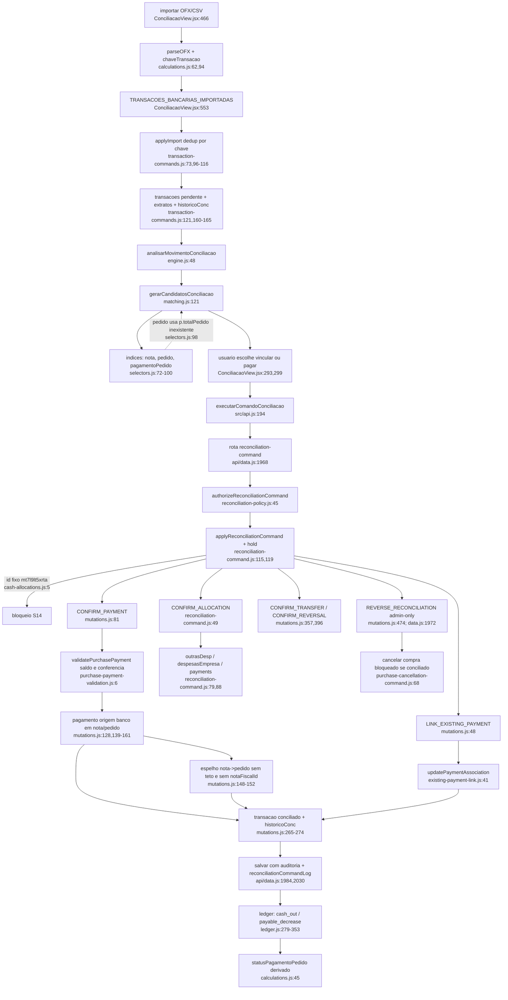

# F9 · conciliacao-bancaria (extrato bancário)

Origem: subagente Flowchart da Fase 1 (leitura estática, nenhum teste executado, banco de produção não consultado). Caminhos relativos à raiz do repositório.

## (a) Fontes consultadas
`PATHFINDER-2026-10-26/00-features.md`; `server/reconciliation-command.js` 1-210 (inteiro); `server/reconciliation-policy.js` 1-61; `server/reconciliation-execution.js` 1-17; `server/reconciliation-response.js` 1-13; `src/domains/conciliacao/mutations.js` 1-580 (inteiro); `cash-allocations.js` 1-89; `transaction-commands.js` 1-221; `existing-payment-link.js` 1-74; `matching.js` 1-342; `engine.js` 1-139; `selectors.js` 1-195; `identity.js` 1-68; `calculations.js` 1-140 (parseOFX, chaveTransacao, hashArquivo); `permissions.js` (grep); `financeiro/purchase-payment-validation.js` 1-13; `payable-payment-commands.js` 1-379; `payables.js` 1-20; `ledger.js` 140-216, 262-354, 560-599 (demais por grep); `compras/payment-conference.js` 1-56; `calculations.js` 1-70; `purchase-cancellation-command.js` 1-186; `api/data.js` 150-180, 828-880, 1960-2075 (grep de `reconciliation` no arquivo todo); `server/operational-command-policy.js` 135-164; `server/section-authorizations.js` 255-295 (grep nas linhas 20 e 68); `src/api.js` 193-194; `src/features/conciliacao/ConciliacaoView.jsx` 215-314, 455-584, 725-775.
Lacunas de leitura: ~1.000 linhas de `ConciliacaoView.jsx`; `payroll.js`, `pix-card.js` e testes; `LegacyApp.jsx` (normalização de pedido) só por grep; `conciliarMuitosParaMuitos` (`mutations.js:422`): chamador no servidor não achado, UI não varrida.

## (b) Achados

### Observação de arquitetura
O comando de conciliação **não passa por `applyOperationalCommand`**: tem rota própria `action==="reconciliation-command"` (`api/data.js:1968`), chamada por `executarComandoConciliacao` (`src/api.js:194`). Importar, ignorar e reabrir transações bancárias passam pelo `applyOperationalCommand` (`operational-commands.js:276` chama `applyBankTransactionCommand`); quem pode: `admin` e `financeiro` (`operational-command-policy.js:145-149`).

### 1. Caminho feliz de uma compra no extrato
**Importação.** `importar` (`ConciliacaoView.jsx:466`) lê OFX/QFX com `parseOFX` (`calculations.js:62`) ou CSV/XLSX por detecção de colunas (`ConciliacaoView.jsx:485-521`). Cada movimento ganha `chave`: `fit:<FITID>` se houver FITID, senão `h:data|valor|descricao[0..40]` (`calculations.js:94-96`). Saem para o servidor com `contraparteNome`, `contraparteDocumento`, `chavePix`, `endToEndId`, `txid` (`ConciliacaoView.jsx:532-542`). Comando `TRANSACOES_BANCARIAS_IMPORTADAS` (`:553`); o servidor (`transaction-commands.js:73-167`) valida 1 a 5.000 linhas, deduplica por `chave` (`:96-116`) e grava `extratos`, `transacoes` com `status:"pendente"`, `version:1` e um evento `extrato_importado` em `historicoConc`. Só `admin` e `financeiro` importam.

**Candidatos automáticos.** `analisarMovimentoConciliacao` (`engine.js:48`) usa `criarIndicesFinanceiros` (`selectors.js:32`) e `gerarCandidatosConciliacao` (`matching.js:121`), coletando candidatos por valor em centavos, documento, nome da contraparte e chave PIX (`matching.js:129-133`). Pontuação (`:57-106`): valor exato 30; CPF/CNPJ exato 35; PIX exato 35; data até 2 dias 12; nome exato 15; identificador bancário 60. Bloqueios (`:254-270`): fato cancelado ou arquivado; período fechado; valor do movimento maior que o saldo (`:261`); CPF/CNPJ divergente. Classificação (`engine.js:22-30`): `pronta` (score ≥95 com margem de 15 pontos para a segunda), `revisar` (80-94), `investigar` (60-79). `elegivelLote` (`engine.js:66`) vale para `pronta`, e `revisar` sem ambiguidade; `comandoConciliacaoAutomatica` (`:105`) converte em comando.

**Ação do usuário.** Vincular a pagamento existente: `LINK_EXISTING_PAYMENT` (`ConciliacaoView.jsx:293`). Registrar o pagamento e conciliar: `CONFIRM_PAYMENT` (`:299`), e a UI recusa valor diferente do extrato (`:302`). Ambos por `executarConciliacaoNoServidor` (`:236`): gera `idempotencyKey` `rec_<ts>_<rand>` (`:245`), até 3 retentativas em 429/503 (`:247-251`) e adota o patch do servidor (`:253-257`).

**Servidor** (`api/data.js:1968-2075`). `REVERSE_RECONCILIATION` só para `admin` (`:1972`); a chave idempotente deve casar com `^[a-zA-Z0-9_-]{16,200}$` (`:1973`). Com `POSTGRES_URL_NON_POOLING` usa `executarMutacaoEmpresaBloqueada` (`:1986`); sem ele, lock otimista com até 6 tentativas (`reconciliation-execution.js:4-17`). `authorizeReconciliationCommand` (`reconciliation-policy.js:45`): `admin` e `financeiro` fazem tudo; `rh` só `CONFIRM_ALLOCATION` com categoria `mao_obra`, e `CONFIRM_PAYMENT`/`LINK_EXISTING_PAYMENT` para funcionário ou título de folha; `LINK_PARTIAL_CASH`/`REVERSE_PARTIAL_CASH` exigem perfil sem restrição de obra. Depois grava em `reconciliationCommandLog` (limite de 1000 entradas, `:1984`) a chave, o tipo, o `transactionId`, o ator, o `resumo` e os `purchaseOrderIds` alterados. O espelho de compras é sincronizado em `sincronizarComprasAlteradas` (`:2020`, `:2064`); o caminho idempotente chama `sincronizarPedidosConciliacao` (`:834`).

**Mutação pura.** `registrarPagamentoEConciliar` (`mutations.js:81`, tipos `nota` e `pedido`): bloqueia período fechado (`:86`); exige obrigação existente e ativa (`:99-103`); exige `|valor| == |transação|` com tolerância de 0,01 (`:105`); exige sinal de saída (`:106`); valida com `validatePurchasePayment` (`:108-113`). `validatePurchasePayment`: nota precisa estar `aprovada` ou `paga` (`purchase-payment-validation.js:9`); valor não pode passar do saldo (`:11`); no pedido, aplica a conferência recebido × nota, com adiantamento só para financeiro/admin (`payment-conference.js:41-56`). Depois grava o pagamento no pedido ou na nota (`mutations.js:139-161`); para nota ligada a pedido, espelha o pagamento no pedido (`:148-152`). Marca a transação como `conciliado` com `vinculo`, `gerados`, `valorVinculado` (`:265-268`), adiciona `pagamento_registrado` em `historicoConc` (`:269-274`); `stampChangedPurchaseParents` sobe a `version` de pedido e nota (`:276`).

**Rateios, transferências e estornos.**
- `CONFIRM_ALLOCATION` (`reconciliation-command.js:49-113`): rateios fecham o valor do extrato em centavos (`:58-60`); cada rateio de obra vira linha em `outrasDesp` (`:79`), de empresa em `despesasEmpresa` (`:88`); entradas viram `payments` do tipo `recebimento_avulso`; pode ligar a uma medição, gravar o recebedor de mão de obra (`:98`) e criar regra automática `regrasConc` (`:102`). **Nenhum destino é pedido ou nota**: o rateio é a rota de "despesa sem documento".
- `CONFIRM_TRANSFER` (`mutations.js:357`): liga duas transações (saída e entrada, valores iguais, mesmo `parId`); não gera receita nem despesa; qualquer ponta bloqueada, ou com vínculo parcial, impede (`reconciliation-command.js:127-128`).
- `CONFIRM_REVERSAL` (`mutations.js:396`): liga um estorno de banco ao movimento original (sinal oposto exigido); não recria nem apaga o original.
- `REVERSE_RECONCILIATION` (`mutations.js:474`): exige motivo (`reconciliation-command.js:205`) e é `admin`-only (`api/data.js:1972`); marca como `estornado` o que a conciliação criou (pagamentos, `outrasDesp`, `despesasEmpresa`, `payments`); desvincula pagamentos que já existiam sem apagá-los (`:483-489`); devolve a transação a `pendente`.
- `LINK_PARTIAL_CASH`/`REVERSE_PARTIAL_CASH` (`cash-allocations.js:41`): vínculo parcial entre uma transação e um evento de caixa do razão; não altera valores financeiros (`changesFinancialAmounts:false`, `:38`).

**Efeito em DRE e caixa.** O razão lê o blob. Pagamento de nota gera `cash_out` e `payable_decrease` (`ledger.js:336-353`). Pagamento de pedido sem nota gera `cash_out` com `unallocated:true` e o issue `PAYMENT_UNALLOCATED` (`:279-293`); o custo vem só da NF. Pagamento de pedido cujo id (ou transação) já está num pagamento de nota reconhecível é descartado, para não contar o caixa em dobro (`:280-281`). `UNCLASSIFIED_BANK_TRANSACTION` (`:571-579`) marca transação conciliada sem efeito de caixa vinculado. Duplicidade de efeito de caixa por transação ou por pagamento gera `DUPLICATE_TRANSACTION_EFFECT` e o evento duplicado é descartado (`:193-214`).

### 2. S8: PARCIAL
**Confirmado**: `origem:"banco"` em `mutations.js:128`, enquanto o enum do módulo de pagamentos é `empresa|caixa_obra|cliente_direto` (`payable-payment-commands.js:27`). O pedido não recebe `origemPagamento` (o `updatePaidTarget` do módulo de pagamentos não é usado em `mutations.js:155-161`); a UI cai no rótulo "Empresa" (`calculations.js:52-53`), então "banco" some na tela; o razão guarda `origem:"banco"` só em metadata (`ledger.js:289,349`). Não há movimento em `caixaObra` para pagamento do banco (o cancelamento trata com `if(!movement)continue`, `purchase-cancellation-command.js:81`). O espelho da nota no pedido copia o valor integral e não leva `notaFiscalId` (`mutations.js:150`), enquanto o caminho oficial (`payable-payment-commands.js:174-176`) usa `Math.min(value, saldo do pedido)` e grava `notaFiscalId`.
**Refutado**: "sem teto de saldo" para `registrarPagamentoEConciliar` está errado, porque chama `validatePurchasePayment` (`mutations.js:108`), que barra valor acima do saldo da nota ou do pedido e aplica a conferência do pedido. `vincularPagamentoExistente` não cria pagamento: liga a um existente, exige valor igual com 0,01 de tolerância (`existing-payment-link.js:30`) e não grava `origem`. A suposta consequência ruim no cancelamento (`purchase-cancellation-command.js:60-121`) não se confirma: o espelho sem `notaFiscalId` é excluído de `directPayments` porque o id está em `invoicePaymentIds` (`:60-64`); um pagamento direto conciliado trava o cancelamento com "Desfaça a conciliação" (`:68-70`), o que protege mas obriga a chamar o admin (desfazer é admin-only).
**Cenário numérico**: pedido PC-X de R$ 10.000, com nota de R$ 10.000 aprovada e ligada ao pedido; o pedido já tem pagamento direto de R$ 6.000. O banco debita R$ 10.000 e o usuário concilia com a nota (`CONFIRM_PAYMENT`, `targetType:"nota"`). A validação olha só o saldo da nota (R$ 10.000) e passa; o pedido recebe espelho de R$ 10.000 sem o teto de R$ 4.000 do caminho oficial; `totalPagoPedido` = R$ 16.000 (`calculations.js:40-43`), saldo 0, status "pago"; o razão registra R$ 16.000 de `cash_out` (6.000 do pedido direto, mais 10.000 da nota; o espelho de 10.000 é descartado pela dedup e o pagamento de 6.000 permanece). O pagamento a mais, de R$ 6.000, não é detectado em nenhum nível.

### 3. S14: CONFIRMADA
`reconciliationHold` (`cash-allocations.js:5-7`) bloqueia o id literal `"mt7l9lt5xrta"`; o texto fixo cita "APORTE GERAL", "R$ 7.160,00" e "B2-04". Call sites: `reconciliation-command.js:119` e `:127` (primeira checagem de todo comando de conciliação, inclusive `REVERSE_RECONCILIATION`); `cash-allocations.js:32` e `:45`; `transaction-commands.js:60` (impede ignorar e reabrir). Cenário: o `admin` tenta conciliar, ignorar, reabrir ou desfazer essa transação; todas as rotas recusam com a mensagem fixa, inclusive se o valor real do extrato já não for R$ 7.160,00; não há como liberar sem alterar o código. O id é gerado por `uid()` na importação (`ConciliacaoView.jsx:535`), então só funciona na base de produção atual. Provável, **não verificado**: a rota genérica `save-sections` aceita `transacoes` de `admin` e `financeiro` (`section-authorizations.js:20`) e `validateBankReconciliationPolicy` não cobre `transacoes`; se confirmado, a trava do hold pode ser contornada por essa rota.

### 4. O extrato "enxerga" o pedido?
**O pedido é praticamente invisível como candidato direto.** O motor busca saldo em `Number(p.totalPedido||0)` (`selectors.js:98` e `matching.js:176`). Esse campo não existe no dado de produção: `totalPedido` é uma função de `compras/calculations.js:35` que calcula a partir de `itens`; em código fora de teste não se achou lugar que grave o campo (grep); só o teste `mutations.test.js:19` o preenche à mão. Resultado: o saldo indexado é `0 − pago` (zero ou negativo) e o pedido não casa por valor (`matching.js:258`: `saldoCentavos <= 0` pula a pontuação de valor; `podeRegistrarPagamento` fica falso, `:180`). Um pedido só aparece se houver casamento por documento ou contraparte, e o índice não registra fornecedor para pedido; quase nunca acontece. O candidato prático para compras é a **nota fiscal** (saldo de `valorLiquido`/`valorBruto`, `selectors.js:83-88`). `pagamentoPedido` (pagamento já registrado sem transação) é candidato por `pg.valor` e funciona (`:93-96`). Confiança alta quanto ao código lido; sem dado de produção, não se confirmou que nenhum `totalPedido` persistido exista fora desse código.

**Pedido pago por transferência e conciliado.** Via `registrarPagamentoEConciliar`, o pedido ganha um item em `pagamentos` com `origem:"banco"`; `statusPagamentoPedido` é derivado (`pago` quando `pago >= total − 0,01`, `calculations.js:45-50`), então o status de pagamento muda. Não são atualizados `origemPagamento` nem `liberadoEntregaEm`, que o caminho oficial atualiza (`payable-payment-commands.js:109-111`); consumidores que leem `liberadoEntregaEm` direto não foram verificados.

**Banco debita valor diferente.** Menos que o saldo (parcial): com nota, o servidor aceita (valor igual ao extrato e menor que o saldo); o status bruto da nota permanece `aprovada` porque `mutations.js:141-143` não atualiza `status` (o caminho oficial atualiza, `payable-payment-commands.js:102-107`); `statusPagamentoNota` deriva `parcial`/`paga` do valor pago (`payables.js:12-20`). Mais que o saldo (juros, multa): o candidato é bloqueado (`matching.js:261`) e o servidor recusa (`purchase-payment-validation.js:11`); sobra `CONFIRM_ALLOCATION`, que cria `outrasDesp`/`despesasEmpresa` sem ligar a pedido ou nota; a nota continua aberta e o caixa já saiu, com risco de duplicidade no DRE. Desconto: não há campo na conciliação simples; `conciliarMuitosParaMuitos` aceita ajustes (`mutations.js:422-466`) mas não está exposto em `RECONCILIATION_COMMAND` (UI não varrida). Depois de conciliar uma nota, o vínculo `nota:<id>` entra em `transacoesConsumidas` (`selectors.js:189-195`) e `matching.js:141` impede sugerir o mesmo vínculo de novo; um segundo pagamento parcial legítimo da mesma nota não é sugerido, embora o servidor o aceitasse.

**Duplicidade: o mesmo débito conciliado duas vezes.** Camadas: (1) chave idempotente em `reconciliationCommandLog` (`api/data.js:1978`), log truncado em 1000 (`:1984`); (2) a transação precisa estar `pendente` (`reconciliation-command.js:35-40`; `mutations.js:51,85`); (3) execução sob lock (`api/data.js:1986`) ou lock otimista; (4) `validateExistingPaymentLink` impede reutilizar pagamento já ligado a outra transação (`existing-payment-link.js:31-35`); (5) `recordPayment` rejeita transação já usada (`payable-payment-commands.js:148`); (6) `DUPLICATE_TRANSACTION_EFFECT` no razão (`ledger.js:193-214`); (7) importação: dedup por `chave` (`transaction-commands.js:96-116`); o mesmo extrato em OFX e em CSV gera chaves diferentes (`fit:` e `h:`), então os débitos entram em duplicata; linhas legítimas iguais (mesma data, valor e 40 primeiras letras) do CSV são tratadas como duplicadas e descartadas (`:116`). **Buracos**: em `CONFIRM_ALLOCATION` e `CONFIRM_MANUAL_ENTRY` não há checagem contra pagamento já existente; `CONFIRM_MANUAL_ENTRY` passa `duplicidadeRevisada:true` fixo (`reconciliation-command.js:150`), afirmando uma revisão que não houve; dois débitos de OFX e CSV que viram duas transações podem ser conciliados contra nota ou pedido diferentes (para a mesma nota, a segunda é barrada pelo saldo); `CONFIRM_ALLOCATION` tem `idempotencyKey` só no log e usa ids gerados na hora (`commandId`). Nenhum teste foi executado.

### 5. Efeitos colaterais por coleção
`transacoes`: `status`, `vinculo`, `gerados`, `rateios`, `valorVinculado`, `saldoNaoVinculado`, `statusAtualizadoEm/Por` (em `registrarPagamentoEConciliar`, `marcarTransacao` grava só `statusAtualizadoEm`, sem autor; o autor vai para `historicoConc`; o caminho `allocateTransaction` grava o autor na transação, `reconciliation-command.js:107-110`). `extratos`: criado na importação (`transaction-commands.js:140-150`); `arquivarExtrato` é `admin`-only (`ConciliacaoView.jsx:765-768`). `historicoConc`: um evento por ação, com `operadorId`, `operador`, `statusAnterior`/`statusNovo`, `valor`, `criadoEm`. `reconciliationLinks`: `tituloFolha` grava link (`mutations.js:251-258`); vínculos parciais usam `kind:"existing_cash_allocation"`. `reconciliationCommandLog`: log de auditoria no blob, limitado a 1000. `outrasDesp`/`despesasEmpresa`: criados por rateio, lançamento novo e regra; estornados (não apagados) no desfazer. `payments`: recebimentos avulsos. `pedidos`/`notasFiscais`: pagamento `origem:"banco"`, `conciliado:true`, `transacaoId`; a nota ganha `transacaoId` próprio. Auditoria financeira: `salvarFinanceiroComAuditoria` grava `before/after` da transação (`api/data.js:2030-2038`).

## (c) Fluxograma

## (d) Veredito
S8: PARCIAL (confirmados `origem:"banco"` fora do enum e o espelho nota→pedido sem teto e sem `notaFiscalId`; refutados "sem teto de saldo" e o dano no cancelamento). S14: CONFIRMADA (id fixo de transação em regra de negócio; bloqueia até `REVERSE_RECONCILIATION`; sem caminho para liberar sem código).
Achados novos: (1) **alto risco**: o pedido é quase invisível para o extrato (índice e motor leem `p.totalPedido`, campo que o dado real não tem; só a função calcula): a conciliação de compra funciona de verdade só para nota fiscal e para pagamento já registrado; (2) o status bruto da nota fica `aprovada` mesmo após pagamento integral pelo extrato, e o pedido não recebe `origemPagamento` nem `liberadoEntregaEm`, que o caminho oficial atualiza; (3) `duplicidadeRevisada:true` é fixo no servidor (`reconciliation-command.js:150`); (4) com baixa parcial de nota, o vínculo `nota:<id>` fica consumido e o motor para de sugerir a mesma nota (`matching.js:141`); (5) a mesma conta importada em OFX e CSV gera duas transações (chaves `fit:` e `h:`).

## (e) Informação que se perde ou deixa de ser rastreável
- **Quem conciliou e quando**: fica em `historicoConc` e `reconciliationCommandLog`; o log é truncado em 1000 (`api/data.js:1984`) e a idempotência depende dele (`reconciliationLinks` é histórico permanente só para vínculo parcial, `cash-allocations.js:52-58`); na própria transação, `registrarPagamentoEConciliar` e `vincularPagamentoExistente` gravam só `statusAtualizadoEm`, sem autor (`mutations.js:37-38`).
- **O que o usuário viu na hora**: não é salvo. O servidor não grava candidatos, score nem motivos; `analisarMovimentoConciliacao` roda só no navegador; a observação vai como `Sugestão <confiança>` / `Confirmação em lote · candidata <classe>` (`ConciliacaoView.jsx:303`, `engine.js:108`), sem score.
- **Estorno**: o pagamento criado fica `estornado` com motivo, autor e data; o evento `desfeito` do histórico grava só o motivo como descrição, sem `detalhes`; a transação volta a `pendente` com `vinculo:null` e `gerados:[]` (`mutations.js:571`), perdendo na própria transação o rastro do vínculo anterior; `valorVinculado` é zerado.
- **Contraparte**: fica na transação importada (`contraparteNome`, `contraparteDocumento`, `chavePix`, `endToEndId`, `txid`); o pagamento criado em compras não copia nada disso; o motivo "Identificador bancário já vinculado" depende de `fitid`/`endToEndId`/`txid` estarem também no item de compras, o que `mutations.js:124-137` não grava.
- **Divergência de valor** (juros, desconto): sem campo próprio em `CONFIRM_PAYMENT`; vira rateio em `outrasDesp`/`despesasEmpresa` sem ligar ao documento.
- **Origem "banco"**: a UI mostra "Empresa" (`calculations.js:52-53`).
- **Linhas do extrato descartadas** como duplicadas ficam só como contagem `qtdDuplicadas`, sem lista (`transaction-commands.js:147`).

## (f) Dependências externas
Parser de OFX interno (`calculations.js:62`), sem biblioteca externa; biblioteca `XLSX` (sob demanda por `carregarXLSX`, `ConciliacaoView.jsx:480`) para CSV/XLSX; Supabase/Postgres (`executarMutacaoEmpresaBloqueada`, `salvarFinanceiroComAuditoria`/`financial_save_with_sync`, `api/data.js:858-877`; `POSTGRES_URL_NON_POOLING` obrigatório para vínculos parciais, `:1971`); migration `20261023144434_api_reconciliation_integrity` (referenciada em `api/data.js:2323`); função SQL `financial_guard_source_reconciliation` (chamada em `api/data.js:963`).

## (g) Confiança e lacunas
Alta: fluxo servidor (`api/data.js` 1968-2075, `reconciliation-command.js`, `mutations.js`); S14; ausência do campo `totalPedido` em código de produção (grep em `.js/.jsx`). Média: impacto prático de "pedido invisível" (depende de existirem dados com `totalPedido` persistido; banco não consultado) e efeitos de `liberadoEntregaEm` e do status bruto da nota em consumidores não varridos. Lacunas: ~1.000 linhas de `ConciliacaoView.jsx`; `payroll.js`, `pix-card.js`, testes; chamador de `conciliarMuitosParaMuitos`; bypass do hold por `save-sections` não testado; `sincronizarComprasAlteradas` só por referência; função SQL `financial_guard_source_reconciliation` e migration de integridade não lidas.

## Verificação do orquestrador (a preencher)
- **Pedido invisível ao extrato** (`p.totalPedido`): confirmar lendo `selectors.js:98`/`matching.js:176` e procurando quem grava `totalPedido`; confirmar por execução de `gerarCandidatosConciliacao` com um pedido real.
- S8 (cenário numérico dos R$ 6.000 a mais): reproduzir por execução.
- Bypass do hold (S14) por `save-sections`: confirmar por teste (read-only no código; não tocar produção).
