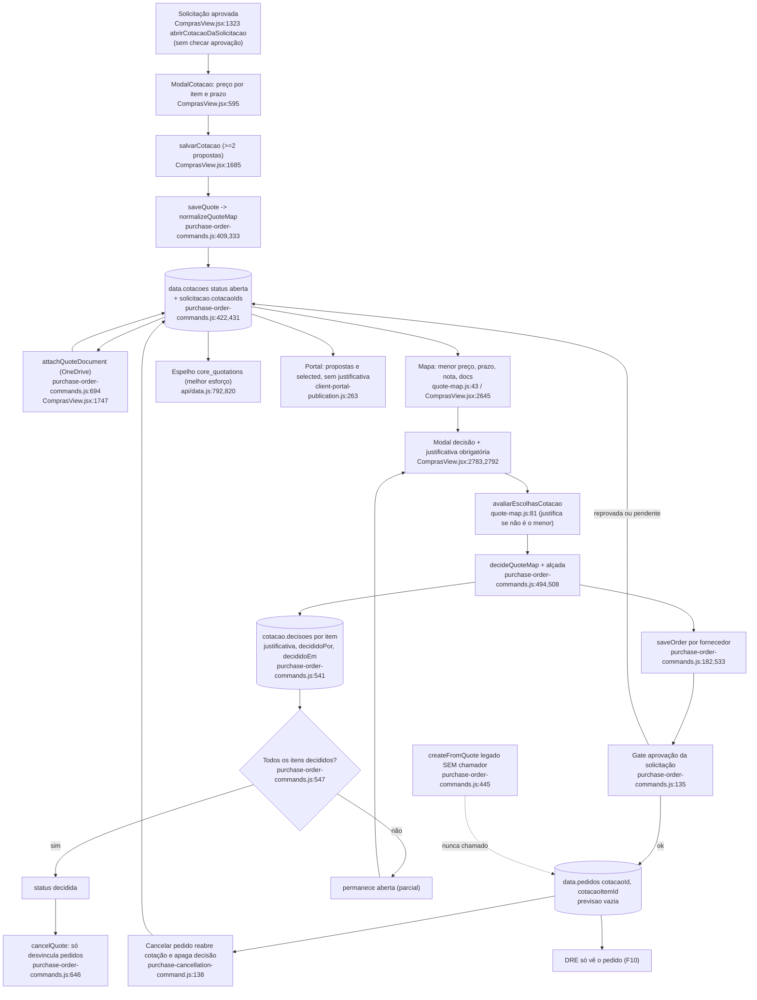

# F3 · cotacao-e-escolha-fornecedor

Origem: subagente Flowchart da Fase 1 (leitura estática, nada executado). Caminhos relativos à raiz do repositório.

## (a) Fontes consultadas
`PATHFINDER-2026-10-26/00-features.md`; `src/domains/compras/purchase-order-commands.js` 1-770 (inteiro); `quote-map.js` 1-117 (inteiro); `components/ComprasView.jsx` 583-672 (ModalCotacao), 1275-1345, 1680-1805, 2594-2663 (aba cotações), 2745-2800 (modais e decisão) mais grep de `cotac|quote|avaliacaoForn|contrato|justificativa`; `supplier-rating.js` 1-59; `supply-contracts.js` 20-93; `calculations.js` 95-175; `src/domains/sync/operational-commands.js` 156-164 e 215-345; `api/data.js` 165-185 (início dos papéis), grep de papéis em 225-232 e 322-329, 771-832, 2183-2301; `server/purchase-quote-order-live-write.js` 1-65; `server/client-portal-publication.js` 1-30 e 205-314; `server/procurement-chain-policy.js` 1-70; `server/procurement-registry-shadow.js` 20-80; `purchase-cancellation-command.js` 100-186; greps repo-wide de `PURCHASE_ORDER_CREATED_FROM_QUOTE|PEDIDO_COMPRA_GERADO_COTACAO|createFromQuote` e `cotac|justificativaEscolha|decididoPor|economia`.

## (b) Achados

### B1. Caminho feliz
1. **Solicitação.** `abrirCotacaoDaSolicitacao` (`ComprasView.jsx:1323-1336`) exige só `podeProcessar` e insumo vinculado; abre `ModalCotacao` com 2 propostas vazias e `solicitacaoId` preenchido. **Não verifica aprovação** (S10).
2. **Montar o mapa.** `ModalCotacao` (`ComprasView.jsx:595-672`): itens nas linhas, fornecedores nas colunas; cada fornecedor informa só `prazoDias` e o preço unitário por item; o menor preço da linha fica em verde (`:609-612,647-649`) e há total por fornecedor (`:653-655`); cada fornecedor aparece uma vez (`:614,631`).
3. **Salvar.** `salvarCotacao` (`ComprasView.jsx:1685-1720`) valida no cliente (insumo, quantidade, mínimo de 2 propostas com algum preço) e dispara `QUOTATION_SAVED` via `dispatchCommand` com `expectedVersion`. O reducer é `saveQuote` (`purchase-order-commands.js:409-443`), que chama `normalizeQuote` (`:259`) e `normalizeQuoteMap` (`:333-407`); grava `status:"aberta"`, `version`, `criadoPor*`, `updatedBy` (`:422-429`); na solicitação acrescenta o id em `cotacaoIds` e move `enviada` para `em_analise` (`:431-435`).
4. **Anexos.** `ComprasView.jsx:1746-1771`: limite de 5,5 MB, upload ao OneDrive (`enviarArquivoOneDrive` `:1749`) e comando `PURCHASE_QUOTE_DOCUMENT_ATTACHED` (`attachQuoteDocument`, `purchase-order-commands.js:694-723`); fica em `proposta.documentos[]` com legenda, url, `enviadoPor`, `enviadoEm` (`ComprasView.jsx:1751`); só aceita cotação `aberta` (`:697`).
5. **Decisão.** "Decidir e gerar pedidos" (`ComprasView.jsx:2658`) abre o modal (`:2783-2800`) com `sugestaoDeEscolhas` (melhor oferta por item, `quote-map.js:68-69`). `decidirCotacao` (`ComprasView.jsx:1775-1797`) manda `QUOTE_MAP_DECIDED` com `choices`, `justifications` e um `orderId` por fornecedor. O reducer `decideQuoteMap` (`purchase-order-commands.js:494-567`) valida a versão (`:497`), chama `avaliarEscolhasCotacao` (`quote-map.js:81-117`, valida e agrupa por fornecedor), confere a alçada sobre a soma de todos os pedidos (`:508-511`) e chama `saveOrder` uma vez por fornecedor com `siblingQuoteId` (`:533`; `saveOrder` em `:182-245`). `saveOrder`, via `normalizeOrder`, reaplica o gate de aprovação (`:135-140`) e a solicitação vai a `pedido_gerado` com `pedidoIds` (`:229-235`).
6. **Estado terminal.** A cotação vira `decidida` só se todos os itens têm decisão (`:547,554`); decisão parcial mantém `aberta`. Terminais: `decidida` (rótulo "Compra gerada", `ComprasView.jsx:2635`) e `cancelada`. Uma cotação parcialmente decidida aparece como "Cotada" na lista, sem selo que distinga "parcial".
7. **Espelho e papéis.** Papéis `admin` e `compras` (`api/data.js:226,230-232`); todos os comandos de cotação passam por `applyOperationalCommand` (`operational-commands.js:304`), que grava o recibo (`appendReceipt` `:156-162`).

### B2. FOCO: como o sistema ajuda e registra a ESCOLHA DO FORNECEDOR

**(a) Critérios que a tela mostra**

| Critério | Mostra? | Evidência |
|---|---|---|
| Preço unitário e total por item/fornecedor | Sim | `ComprasView.jsx:2649` (menor destacado, ✓ no vencedor); `:2791` (opção com preço e total) |
| Ordenação | Sim | `quote-map.js:52-53`: menor preço, desempate por menor prazo; `melhorPropostaId` é a primeira da lista |
| Prazo | Sim, informativo | `ComprasView.jsx:2645` ("N dia(s) · total"); só desempata (`quote-map.js:53`); **não aparece no seletor de decisão (`:2791`)** |
| Nota do fornecedor (0-10) | Sim, informativo | `ComprasView.jsx:2645` (cor + tooltip `explicacaoNotaFornecedor`); `:2791` ("nota X"); cálculo em `supplier-rating.js:23-44` (pontualidade 50%, NFs 30%, cancelamentos 20%, janela de 365 dias) |
| Documentos da proposta | Sim | `ComprasView.jsx:2653` |
| Frete e condições comerciais | **Não** | O modal (`:629-633`) só pede fornecedor e prazo; o servidor aceita `obs` (`purchase-order-commands.js:369`) e `salvarCotacao` copia `p.obs` (`ComprasView.jsx:1691`), mas não há entrada nem exibição; não existe campo estruturado de frete, pagamento ou validade |
| Contrato de fornecimento vigente | **Não** na cotação | `contratosDisponiveis` só em `ModalPedido` (`ComprasView.jsx:435-441`, "dispensa cotação") |
| Histórico de preço do insumo | **Não** no mapa nem na decisão | `historicoPrecoTodos` em `:317,826` (pedido e abas de preço); `precoRef` é gravado no item (`purchase-order-commands.js:349`) mas não é exibido no mapa nem na decisão pelas linhas lidas |

**(b) Vencedor que não é o mais barato.** A justificativa é obrigatória por item quando o preço escolhido é maior que o menor (`escolhaPrecisaJustificativa`, `quote-map.js:73-77`, EPS 1e-6) ou quando o item tem menos de 2 ofertas. O servidor impõe a regra em `avaliarEscolhasCotacao` (`quote-map.js:95-99`), chamada por `decideQuoteMap` (`purchase-order-commands.js:500-501`); não dá para contornar pela UI. A UI mostra "Justificativa obrigatória *" (`ComprasView.jsx:2792`) e destaca a borda em laranja. Fraquezas: texto livre sem tamanho mínimo (só `.trim()`, `quote-map.js:94`); "mais barato" é só preço unitário (prazo, nota e frete não entram); item com uma única oferta é possível porque uma proposta pode cotar só alguns itens (`purchase-order-commands.js:363-366`).

**(c) Onde ficam decisão, autor e data.** Coleção `data.cotacoes`, no blob `company_app_data`. Multi-item: `quote.decisoes[itemId] = {propostaId, justificativa, economia, pedidoId, decididoPorId, decididoPorNome, decididoEm}` (`quote-map.js:109`; `purchase-order-commands.js:541-546`); no topo: `decididoPorId`, `decididoPorNome`, `decididoEm`, `pedidoIds`, `pedidoId`, `economia` (`:549-562`), **sobrescritos a cada decisão parcial** (só o histórico por item preserva quem decidiu cada parte). Legado: `escolhida` e `justificativaEscolha` (`:552-553`); o comando legado `createFromQuote` grava também `justificativaEscolha` e `economia` (`:479-485`). O espelho `core_quotations.payload` leva a cotação inteira (`procurement-registry-shadow.js:32-45`). Recibo no blob (`operational-commands.js:156-162`): só `idempotencyKey`, `type`, `entityId`, `actorId`, `appliedAt`, últimos 2000.

**(d) A decisão e a justificativa chegam a pedido, DRE, portal e auditoria?**
- **Pedido: só o vínculo, não a justificativa.** O pedido gerado recebe `cotacaoId`, `solicitacaoId` e, por item, `cotacaoItemId` (`purchase-order-commands.js:521-531`); não leva `propostaId`, justificativa, prazo da proposta nem condição comercial. **O prazo da proposta é calculado** (`group.prazoDias`, `quote-map.js:103`) **e descartado**: `decidirCotacao` manda `forecast:""` (`ComprasView.jsx:1788`) e `decideQuoteMap` grava `previsao:String(payload.forecast||"")` (`:519`). O pedido nasce sem previsão de entrega, e os alertas de atraso e "sem previsão" (`calculations.js:118`) dependem de digitação manual. Os itens do pedido não trazem `contratoId`, então não há checagem de preço contra contrato nem consumo de saldo (`supply-contracts.js:60-89`).
- **DRE: não chega.** Nenhum arquivo de `financeiro/*` ou `dre/*` aparece no grep de `cotacao|economia|decididoPor`; o DRE vê só o pedido (compromisso, F10). A economia aparece só em `mapaGerencialCompras` (`calculations.js:127`) e na tela (`ComprasView.jsx:2655`). (Base: grep por nome de arquivo, não leitura de `ledger.js`.)
- **Portal do cliente** (`client-portal-publication.js:263-312`, opt-in `publicarCotacoes`): publica as últimas 20 cotações com **todas as propostas** (nome do fornecedor, total, prazo, `selected`); **não publica justificativa**; os preços dos perdedores ficam visíveis ao cliente (decisão de transparência a confirmar com o responsável). Cotação `cancelada` é publicada: o filtro `active` (`:7`) só exclui `cancelado/cancelled/estornado/reversed`. **S2 CONFIRMADA para cotações.**
- **Auditoria:** `decideQuoteMap` **não grava `changeLog`** (só `cancelQuote` grava, `:670-679`, tipo `purchase_quote_deleted`); o `salvarComAuditoria` do caminho sem trava registra só `{command, entityId}` e `{command, idempotencyKey}` (`api/data.js:2262-2266`); o caminho com trava (`executarComandoOperacionalBloqueado`, `:2198`) não foi lido. Na prática a trilha da decisão é o próprio registro da cotação mais o recibo.

**(e) Mínimo de propostas.** **2 propostas** com fornecedores distintos. Servidor: `purchase-order-commands.js:373,377` (legado `:279`); cliente: `ComprasView.jsx:1694`. Propostas sem nenhum preço são **descartadas em silêncio** (`:366`, `ComprasView.jsx:1690`). Não há exigência de 3 (o ≥3 é só a métrica "cotações competitivas", `calculations.js:125`). Não existe "dispensa de cotação" com motivo; a exceção é o pedido por contrato (`pedidoPorContrato`, `supply-contracts.js:92`), fora deste fluxo. Não há alçada por valor que exija mais propostas (a alçada em `:508-511` só decide quem aprova o total).

**(f) Contratos e avaliação.** **Avaliação: só informa** (`avaliacoesFornecedores` usada na exibição, `ComprasView.jsx:953,2645,2791`; nenhuma lógica de decisão ou do servidor a consulta; nota baixa não exige justificativa). **Contrato: não participa** (não aparece na tela de cotação nem em `avaliarEscolhasCotacao`; existe só "contrato dispensa cotação" no pedido, `ComprasView.jsx:440`, `calculations.js:119-120`). Um contrato vigente com preço menor não é comparado com as propostas; um pedido vindo de cotação não consome saldo de contrato.

### B3. Efeitos colaterais, cancelamento e liberação da solicitação
- **`saveQuote`** escreve `cotacoes`, `solicitacoesCompra.cotacaoIds`, `status` e `analisadoEm/Por` da solicitação. Ao editar, a cotação é reconstruída do zero (`:396-405`) e as propostas antigas são sobrescritas, sem histórico de versões.
- **`decideQuoteMap`** escreve `pedidos` (um por fornecedor), `solicitacoesCompra` (`pedido_gerado`, `pedidoId`, `pedidoIds`), `cotacoes` e `operationalCommandReceipts`.
- **Espelhos.** Com `POSTGRES_URL_NON_POOLING`, `sincronizarComprasAlteradas` (`api/data.js:820-832`, chamado em `:2208-2210`) faz upsert em `purchase_requests`, `core_quotations` e `core_purchase_orders` para todo registro alterado, **inclusive decidir e cancelar**. O comentário de `server/purchase-quote-order-live-write.js:17-24` ("decidir e cancelar só no lote") está **desatualizado**. O caminho sem a variável (`api/data.js:2253-2296`) **não espelha** (S13). Falha de espelho é engolida (`:801-803`). `quotationRow` (`shadow:32-45`) filtra cotações sem `materialId` no snapshot em lote (`:62`).
- **`cancelQuote`** (`purchase-order-commands.js:646-681`): exige motivo; grava `status:"cancelada"`, `canceladaPor*`, `motivoCancelamento`, `changeLog`; **permite cancelar cotação já `decidida`** (só barra se já cancelada); limpa `cotacaoId` dos pedidos vinculados (`:664-666`); tira o id de `cotacaoIds` das solicitações (`:667-669`). **Não libera a solicitação nem cancela os pedidos**: a solicitação continua `pedido_gerado` com `pedidoId`; os pedidos mantidos passam a contar como "sem cotação" (`calculations.js:120`) e perdem a justificativa de origem. A `economia` do cancelado **continua somada** em `mapaGerencialCompras` (`calculations.js:109,127` não filtram status).
- **Cancelar o pedido** (`purchase-cancellation-command.js:138-153`) reabre a cotação (`aberta`) e **apaga a decisão daquele pedido**, inclusive a justificativa (`decisoes` filtrado; no legado limpa `justificativaEscolha` e `decididoPor*`), e recalcula `economia`.
- **Cadeia:** `validateProcurementChain` (`procurement-chain-policy.js:14-70`) exige vínculos de mesma obra e bidirecionais; roda só nas rotas genéricas `save`/`save-sections` (S17, `api/data.js:2875,2945,3049`).

### B4. S10 e S16
- **S10: PARCIAL.** Primeira metade CONFIRMADA: `saveQuote` e `quoteRequestOf` (`purchase-order-commands.js:319-327`) só checam existência da solicitação e igualdade de obra, não olham `instanciaDaSolicitacao`, aprovação nem `status==="cancelada"`; a UI também não (`ComprasView.jsx:1323-1336`). Dá para abrir e salvar cotação para solicitação pendente, reprovada ou cancelada. O bloqueio vem na **decisão**: `normalizeOrder` recusa solicitação cancelada (`:132`) e sem aprovação (`:135-140`) ao criar o pedido; sobra o risco de cotação "órfã" e trabalho inútil, não de pedido indevido. Exceção: solicitação legada sem instância de aprovação passa. Efeito colateral: `saveQuote` promove `enviada` para `em_analise` mesmo sem aprovação (`:432`); por S1, a solicitação nova nasce `aberta` (`purchase-request-commands.js:82`, não relido por este subagente). Segunda metade de S10 ("escritas diretas fora dos comandos"): **REFUTADA para cotação** (as 4 escritas são comandos, `ComprasView.jsx:1707,1731,1753,1780`); restam `update()` direto em `registrarContatoSolicitacao` (`:1283-1294`, grava `solicitacoesCompra.contatos`) e no cache de pastas do OneDrive (`:1769`).
- **S16: CONFIRMADA, agravada.** Grep repo-wide: `PURCHASE_ORDER_CREATED_FROM_QUOTE` aparece só na definição (`purchase-order-commands.js:13,445-487,730,756`), em papel e whitelist (`api/data.js:225,322`), em testes (`purchase-order-commands.test.js:66,79,327`; `src/integration/purchase-quote-order-live-write.test.js:271,305-330`) e num teste negativo que **proíbe** o uso na UI (`src/LegacyApp.quote-map-wiring.test.js:28`). Nenhum chamador em `ComprasView.jsx` nem `LegacyApp.jsx`. **Agravante:** só entende o formato legado (`precoUnit` por proposta, `:452`); em cotação multi-item as propostas têm `precos`, então `prices.length<2` e falha com "precisa de ao menos duas propostas válidas". É código morto e quebrado para o formato atual, mas alcançável por chamada direta à API por `admin` ou `compras`.

## (c) Fluxograma

## (d) Veredito das hipóteses
S10: PARCIAL. S16: CONFIRMADA (e incompatível com cotação multi-item). S2 (parte cotação): CONFIRMADA (`client-portal-publication.js:7,264-265`). S13: CONFIRMADA para cotação (`api/data.js:2208-2210` versus `:2253-2296`). S17: CONFIRMADA (`procurement-chain-policy.js` só roda em `save`/`save-sections`).

## (e) Informação que se perde ou deixa de ser rastreável
1. **Propostas perdedoras e histórico de edição**: editar o mapa reconstrói `propostas` (`purchase-order-commands.js:396-405`) sem versão anterior.
2. **Justificativa só na cotação, não no pedido**: o pedido não carrega `propostaId` nem motivo; `cancelQuote` desvincula (`cotacaoId:""`, `:664-666`).
3. **Justificativa apagada** quando o pedido é cancelado (`purchase-cancellation-command.js:140-151`) ou a decisão é refeita; não há log da decisão anterior e `decideQuoteMap` não escreve `changeLog`.
4. **Autor e data do topo da cotação** são sobrescritos a cada decisão parcial (`:556`); só `decisoes[item]` preserva por item.
5. **Prazo da proposta** vira `previsao` vazia no pedido (`ComprasView.jsx:1788`).
6. **Frete e condições comerciais** (pagamento, validade, CIF/FOB) não têm campo; `obs` existe no modelo, sem entrada na UI (`ComprasView.jsx:629-633`) nem exibição.
7. **Anexos**: só em cotação aberta (`:697`), sem comando de remoção; os arquivos ficam no OneDrive e a metadata em `proposta.documentos`; decisão tomada por e-mail ou WhatsApp não deixa registro (só `contatos` da solicitação, via `update()` direto).
8. **Contrato e nota do fornecedor no momento da decisão** não são congelados; depois não se sabe qual nota o decisor viu.
9. **Economia de cotação cancelada** continua somada no indicador (`calculations.js:127`).
10. **Recibos** retêm só 2000 comandos (`operational-commands.js:161`).
11. **Cotação sem aprovação** (S10): se a solicitação for reprovada depois, a cotação fica aberta e órfã.

## (f) Dependências externas
OneDrive (Graph): `enviarArquivoOneDrive` (`ComprasView.jsx:1749`), pasta `Cotações/<data>/<fornecedor>`; Supabase/Postgres: `company_app_data` (fonte da verdade) e espelhos `core_quotations`, `core_purchase_orders`, `purchase_requests` (`api/data.js:771-832`), conexão direta `POSTGRES_URL_NON_POOLING` (`:2197`); WhatsApp: `ModalCotacaoWhatsApp` (`ComprasView.jsx:2749`), só para pedir cotação, fora do comando; Vercel (`/api/data` `operational-command`); internas: `supplier-rating.js`, `delivery-schedule.js`, `purchase-approval.js`, `supply-contracts.js` (só em `saveOrder`), `unit-conversion.js`.

## (g) Confiança e lacunas
Alta para quote-map, comandos de cotação, UI de decisão, S10 e S16. Média para: portal (só `client-portal-publication.js:205-314` lido), auditoria (não leu `executarComandoOperacionalBloqueado` nem `salvarComAuditoria`) e ausência do DRE (grep por nome de arquivo, não leitura de `ledger.js`). Não verificado: se o histórico de preço (`precoRef`, `historicoPorMaterial`) aparece em algum ponto do fluxo de cotação fora das linhas lidas; `purchase-approval.js` lido só por uso; testes não lidos; `ModalLegendaDocumento` e `LinksDocumentosAuditaveis` só nos call sites; como o app mobile ou o Modo IA tocam em cotação.

## Verificação do orquestrador (a preencher)
- S16 (código morto e quebrado para multi-item): confirmar por teste de execução com cotação multi-item.
- Prazo da proposta descartado (`previsao` vazia): confirmar por execução de `decideQuoteMap`.
- `cancelQuote` em cotação decidida não libera a solicitação: confirmar por execução.
