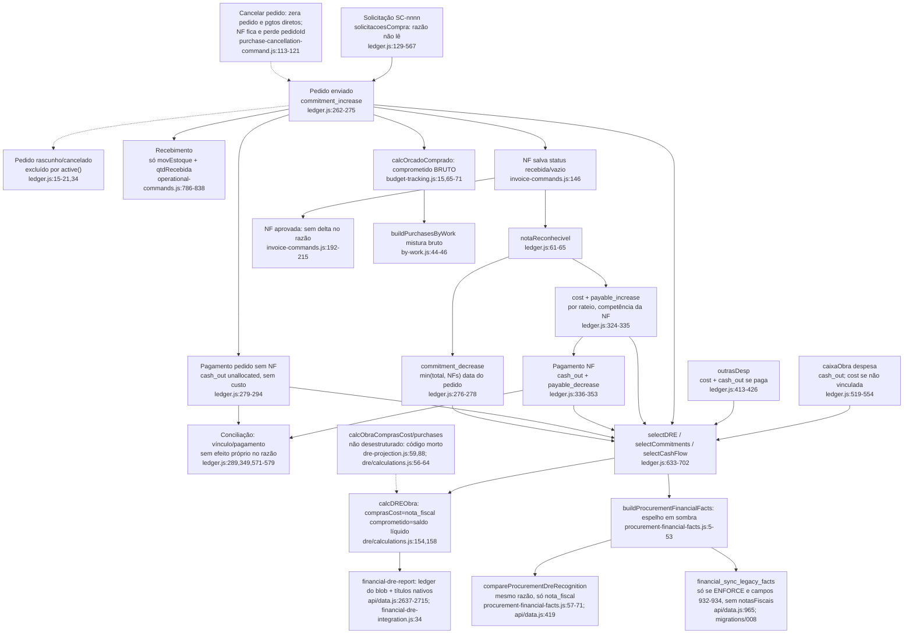

# F10 · dre-comprometido-e-razao (como uma compra de obra chega ao DRE)

Origem: subagente Flowchart da Fase 1 (leitura estática, nada executado nem consultado no banco). Caminhos relativos à raiz do repositório.

## (a) Fontes consultadas
`PATHFINDER-2026-10-26/00-features.md` e `docs/COMPRAS_SUPABASE_DRE.md` 1-21; `src/domains/financeiro/ledger.js` 1-742 (inteiro); `src/domains/dre/calculations.js` 1-426 (inteiro); `server/dre-projection.js` 1-255 (inteiro); `server/procurement-financial-facts.js` 1-71 (inteiro); `server/financial-shadow.js` 1-207 (inteiro); `server/financial-dre-integration.js` 1-93 (inteiro); `server/financial-write-policy.js` 70-110; `api/data.js` 330-510 (`relatorioSombraFinanceira` 405-432), 760-1015 (sincronizações ao vivo, `salvarFinanceiroComAuditoria`, `LEGACY_FINANCIAL_FACT_FIELDS`, `gravarMutacaoNaTransacao`), 2183-2312 (`operational-command`), 2560-2715 (rotas DRE canônico), greps de `FINANCIAL_ENGINE_ENFORCE` (153) e `FINANCIAL_OPERATIONAL_COMMANDS` (293-320); `migrations/008_skip_dre_snapshot_sync_on_write.up.sql` (inteiro) e `migrations/20260725_financial_engine.sql` 1-120; `invoice-commands.js`, `payable-payment-commands.js`, `work-cash.js` (inteiros); `work-cash-commands.js` 20-114; `compras/purchase-cancellation-command.js`, `budget-tracking.js`, `by-work.js` (inteiros); `sync/operational-commands.js` 786-841; `scripts/check-financial-boundaries.mjs` 1-60; greps de `calcObraComprasCost`, `cliente_direto`, setters de status "cancelada/estornada/rejeitada", consumidores de `calcDREObra`.
Não lidos (ou só grep): `server/procurement-registry-shadow*.js`, `purchase-payment-validation.js`, `compras/calculations.js` (`statusPedido`), telas de DRE em `src/features/financeiro/*` e `LegacyApp.jsx` além das linhas de grep, `buildDreCashManagement` (`conciliacao/cash-allocations.js`).

## (b) Achados

### 1. Rastro de uma compra pelo razão
Regras de efeito em `buildFinancialLedger` (`ledger.js:129`); o razão é derivado do blob a cada chamada e não é persistido (`ledger.js:1-4`).

| Etapa | O que o razão emite | Onde |
|---|---|---|
| Solicitação | Nada: o razão só lê `pedidos`, `notasFiscais`, `caixaObra`, `outrasDesp` etc. | `ledger.js:129-567` não referencia `solicitacoesCompra` |
| Pedido enviado | `commitment_increase` (id `pedido:<id>:commitment`), categoria "compras", data = `order.data`; competência = `order.competencia` ou mês da data. Não gera custo, contas a pagar nem caixa. | `ledger.js:262-275` |
| Pedido rascunho ou cancelado | Excluído: `active()` rejeita "rascunho/cancelado/estornado..." (`ledger.js:15-21,34`); status fora de `APPROVED_ORDER` também sai (`:27,264`). | |
| Recebimento físico | Nada no razão: só incrementa `qtdRecebida` e cria `movEstoque` (`operational-commands.js:786-838`); o status do pedido continua "enviado"; o razão não lê `movEstoque` nem `qtdRecebida`. | |
| NF reconhecida | Por rateio, `cost` + `payable_increase` (ids `nota_fiscal:<id>:allocation:<r>:cost/payable`), mais `commitment_decrease` no pedido de origem com valor `min(total do pedido, soma das NFs reconhecidas)`. | `ledger.js:297-335`; `:276-278` |
| Pagamento de NF | `cash_out` + `payable_decrease`; data = `payment.data`; competência herdada da NF. | `ledger.js:336-353` |
| Pagamento de pedido, sem NF paga | `cash_out` só, com `unallocated:true` e `metadata.obligationMissing`; issue `PAYMENT_UNALLOCATED`; não gera custo. | `ledger.js:279-294` |
| Pagamento criado pela conciliação | Entra como pagamento de pedido ou de NF; a conciliação não cria efeito próprio, só `transacaoId` e `conciliado` em metadata. | `ledger.js:289,349` |
| Transação bancária sem efeito | Apenas issue `UNCLASSIFIED_BANK_TRANSACTION`. | `ledger.js:571-579` |

**O custo nasce na NF**, quando ela é salva com status vazio ou "recebida", ou "aprovada/paga/conferida/reconhecida" (`ledger.js:22,61-65`). Competência = `invoice.competencia`, senão o mês da emissão (`:100-103,301`); `date` = emissão, senão vencimento: competência de documento, não de pedido nem de pagamento. **A saída de caixa nasce no pagamento** (`payment.data` da NF ou do pedido, ou `entry.data` do `caixaObra`), data independente da competência.

Vocabulário de efeitos de compra: `cost`, `commitment_increase`, `commitment_decrease`, `payable_increase`, `payable_decrease`, `cash_out`. `cost_reversal` existe só para `despesasEmpresa` com valor negativo (`ledger.js:449`). **Não existe `reversal` para compras**: a reversão é por omissão (o fato passa a `active() == false` e o evento some na próxima derivação).

O DRE lê só `cost` e `cost_reversal` (`selectDRE`, `ledger.js:633-656`): `comprasCost` = `sumSource("nota_fiscal")` (`dre/calculations.js:154`); `comprometido` = `selectCommitments(...).balanceCents` (`:123,158`); `contasPagar` = saldo de `payable` (`:122,157`); `saidasCaixa` = `cash_out` do período.

### 2. Veredito de hipóteses

**S5 (duas definições de "comprometido"): CONFIRMADA, com um terceiro uso.**
- Bruto: `calcOrcadoComprado` soma o valor bruto dos itens de pedidos `enviado/parcial/recebido` (`budget-tracking.js:15,65-71`), sem reduzir por NF.
- Líquido: o razão calcula por pedido `max(0, commitment_increase − commitment_decrease)` (`ledger.js:275-278,689-691,702`); o DRE expõe como `dre.comprometido` (`dre/calculations.js:158`).
- Mistura em `by-work.js:44-46`: com orçamento de controle, `Σ controle.linhas.comprometido + semApropriacao` (bruto); sem controle, `soma(comPedido, totalPedido)` (bruto filtrado por `statusPedido()`); em nenhum caso é o líquido do razão. `aPagar` (`by-work.js:56`) é `saldoPagamentoPedido` sobre o pedido, uma terceira base.
- Terceiro uso: `calcVisaoFinanceira` calcula `commitment` = `dre.comprometido` (líquido) / `contractValue` (`dre/calculations.js:320-321,342-343`).
- Defeito temporal no líquido: o `commitment_decrease` herda `date: order.data` (`ledger.js:269,278`), não a data da NF; com `asOfDate` (`dre/calculations.js:123`) o abatimento de uma NF emitida depois também vale para meses anteriores a ela.
- Os dois números só coincidem para pedido sem NF.

**S6 (NF "recebida" ou vazia reconhece custo antes da aprovação): CONFIRMADA.**
- `saveInvoice` grava `status: current?.status||"recebida"` (`invoice-commands.js:146`); `notaReconhecivel` aceita vazio ou `recebida` (`ledger.js:22,61-65`); custo e conta a pagar entram no DRE já em `NOTA_FISCAL_SALVA`.
- A divergência (`invoice-commands.js:158-181`: `INVOICE_EXCEEDS_ORDER`, `INVOICE_EXCEEDS_PHYSICAL_RECEIPT`, `divergenciasItens`) é só informativa, não retém o valor. `approveInvoice` (`:192-215`) só troca o status para "aprovada" (exige `riskAccepted` se houver divergências); não altera o razão, porque "recebida" e "aprovada" reconhecem o mesmo valor.
- Consequência para NF divergente: entra o valor integral (`invoiceAmount`, `ledger.js:58`) e infla `comprasCost`; o `commitment_decrease` fica limitado a `min(total, recognized)` (`:278`), então o excesso da NF não aparece no compromisso.
- **Não existe comando de rejeitar ou cancelar NF** (`invoice-commands.js` só tem SALVA e APROVADA); o grep de setters `cancelada/estornada/rejeitada` em `src` (fora de testes) não achou nenhum para `notasFiscais`. `inactiveStatus` (`invoice-commands.js:26-28`) e `INACTIVE` (`ledger.js:15-21`) existem, mas ninguém os grava por comando: uma NF só sai do DRE se um `save` genérico gravar esse status.
- Agravante: `updatePaidTarget` muda a NF para "aprovada" ou "paga" ao registrar o primeiro pagamento (`payable-payment-commands.js:102-107`), sem passar pela trava `riskAccepted` de `approveInvoice` (`invoice-commands.js:201`). `validatePurchasePayment` não foi lido e pode barrar parte disso (lacuna).
- O gate `compareProcurementDreRecognition` usa o mesmo `buildFinancialLedger` (`procurement-financial-facts.js:63`), por isso não detecta custo reconhecido cedo demais.

**S7 (`calcObraComprasCost`/`purchases` em `dre-projection.js` é código morto): CONFIRMADA.** `dre-projection.js:59-61` define `purchases` e `:88` passa `calcObraComprasCost: purchases` para `createDreCalculations`; a fábrica desestrutura só `getDays, getQ, monthName, calcObraLaborCost, calcEquipCustoObra, calcEquipFaturamentoEmpresa, canonicalEvents` (`dre/calculations.js:56-64`); `calcObraComprasCost` nunca é lido (o mesmo vale para `calcObraTercCost`, `calcTercEmpresaCost`, `calcObraTercEmpresaCost`, `dre-projection.js:86-87`). O nome aparece só em `dre-projection.js:88`, fixtures, testes e no regex de proibição de `scripts/check-financial-boundaries.mjs:31`. Se alguém ligasse, `purchases` somaria o bruto de pedidos (`totalPurchase`, `:48-49`) e dobraria o custo. Código a remover.

**S13 (fonte de verdade fragmentada): CONFIRMADA, refinada.**
- O DRE servido (`financial-dre-report`, `api/data.js:2637-2715`) é calculado do razão derivado do blob mais os eventos de `canonicalDreEvents`, que considera só títulos nativos: `titles.filter(title=>!title.metadata?.legacyId)` (`financial-dre-integration.js:34`). Os títulos de compras espelhados carregam `legacyId` (`migrations/008...up.sql:179-183`); logo **os fatos canônicos de compras (`financial_titles`, `settlements`, `financial_events cost_recognized`) nunca alimentam o DRE**: servem só ao gate de comparação (`api/data.js:419`; `scripts/apply-financial-shadow.mjs:72`) e como sombra.
- O espelho para os fatos canônicos só roda se `FINANCIAL_ENGINE_ENFORCE==="true"` (`api/data.js:153,965`); senão o modo é `audited_shadow` e só grava o blob (`:863-865`; `financial-write-policy.js:89-90`). Valor em produção não verificado.
- Mesmo com enforce ligado, `LEGACY_FINANCIAL_FACT_FIELDS` é `medicoes, payments, pagsTerceiros, outrasDesp, despesasEmpresa, pedidos, transacoes` (`api/data.js:932-934`): **faltam `notasFiscais` e `caixaObra`**. Um comando que só altera NF (`NOTA_FISCAL_SALVA`, `APROVADA`) não dispara `buildLegacyFinancialFacts` (`:958,965`); os `cost_recognized` de compras no banco ficam defasados até um comando que mexa em `pedidos` ou nos outros campos, ou até a carga manual. O gate acusaria a divergência, mas o DRE servido não é afetado porque não lê esses fatos.
- Espelhos `purchase_requests`, `core_quotations`, `core_purchase_orders`: só em `sincronizarComprasAlteradas` (`api/data.js:820-832`), dentro de `if(process.env.POSTGRES_URL_NON_POOLING)` (`:2197-2210`); o caminho alternativo (`:2251-2296`) não espelha. Se `FINANCIAL_ENGINE_ENFORCE` estiver ligado, `salvarFinanceiroComAuditoria` lança erro sem essa variável (`:866`). Os espelhos são melhor esforço e só logam erro (`:781,802,816`); também não alimentam o DRE.
- Tabelas de `migrations/20260725_financial_engine.sql` (`purchase_orders`, `purchase_order_items`, `goods_receipts`, `goods_receipt_items`, `supplier_invoices`, `supplier_invoice_items`, `journal_entries`, `journal_lines`): grep em `api`, `server`, `src`, `scripts` não achou uso (só migrations, docs e um teste PGlite).
- Resultado: o blob `company_app_data` é a única fonte que de fato define o DRE de compras; os demais são sombra ou espelho de escrita.

### 3. Compra sem nota fiscal
- **Pedido pago, sem NF** (`ledger.js:279-294`): só `cash_out` (`unallocated:true`) e issue `PAYMENT_UNALLOCATED`; sem custo até existir NF (intencional, `docs/COMPRAS_SUPABASE_DRE.md:19`); aparece em `saidasCaixa` e `pagamentosNaoAlocados` (`dre/calculations.js:162-164,196`); o custo fica subestimado até a NF. Se a NF vier depois, os pagamentos antigos do pedido continuam como `cash_out` do pedido (só são pulados se o id ou `transacaoId` estiver nos pagamentos da NF, `ledger.js:150-153,280-281`); o `payable_decrease` não é emitido para eles, então o saldo a pagar da NF pode ficar aberto apesar de o dinheiro já ter saído. Migração desses pagamentos para a NF não verificada (lacuna).
- **Caixa da obra com despesa manual, sem vínculo** (`ledger.js:519-554`): emite `cash_out` e, se `isDespesa && !linked`, também `cost` (`:549-552`) com issue `WORK_CASH_EXPENSE_WITHOUT_DOCUMENT`; `linked` = `notaFiscalId||pedidoId||medicaoId||pagamentoId` (`:524`); nasce com `efeitoDRE:"custo_obra"` (`work-cash-commands.js:51`). O custo entra no DRE na competência de `entry.data`, em `totalCustos`, mas **não entra em nenhum balde de detalhe**: `comprasCost` é só `nota_fiscal` (`dre/calculations.js:154`); `outrasTotal` é só `outra_despesa` + `canonical_title` (`:153`); em `companyDre`, `outrasDiretas = outrasTotal + comprasCost + equipCostObras` (`dre-projection.js:122`), então o total `workCosts` fecha (`:103`) mas a linha de detalhe não soma o caixa da obra; o mesmo em `porObra.outras` (`:159`); em `calcProjecaoContratoObra`, `outrasTotal` é recomputado por resíduo (`dre/calculations.js:297`), então cai em "outras". O material pago pelo caixa não entra em `materialCost` (só NF e `outra_despesa` material, `:288-296`); em contrato com taxa de administração, a base da taxa é subestimada.
- **Despesa de obra (`outrasDesp`)** (`ledger.js:413-426`): `cost` na competência e `cash_out` se paga; aparece em `outrasTotal`; é o caminho correto para material sem NF.
- **Pagamento de pedido pelo caixa da obra**: `recordPayment` cria o pagamento no pedido e o movimento em `caixaObra` com `pedidoId` e `pagamentoId` (`payable-payment-commands.js:182-203`). Dupla contagem de caixa evitada (o movimento tem `sourceSubId = pagamentoId`, que casa com o `paymentId`; na chave `cash_out|sourceSubId|valor` o segundo é descartado com issue `DUPLICATE_TRANSACTION_EFFECT`, `ledger.js:204-214`, severidade `warning`). Dupla contagem de custo evitada (`linked=true` suprime o `cost` do caixa, `:549`). **Risco sem trava**: lançar uma `outrasDesp` ou despesa de caixa avulsa para a mesma compra que depois recebe NF; o razão não cruza esses caminhos.
- **`cliente_direto`**: é só rótulo. Nenhum código de razão, DRE ou conciliação o lê (só `compras/*`, `LegacyApp` e `payable-payment-commands.js:27`). O `cash_out` é emitido igual, com `origem` só em metadata (`ledger.js:288-291,349`). Se o cliente pagou o fornecedor direto, a saída de caixa da empresa fica superestimada em `saidasCaixa`, `saldoCaixa` e `CASH_OUT`; o custo (por NF) não é afetado. `buildDreCashManagement` não foi lido e pode tratar isso à parte.

### 4. Cancelamentos e estornos (o razão "reverte" por omissão)
- **Pedido cancelado** (`purchase-cancellation-command.js:39-185`): vai para "cancelado", então `active()` o exclui e `commitment_increase`, `commitment_decrease` e os `cash_out` do bloco do pedido somem (`ledger.js:262`); pagamentos diretos do pedido (sem NF) viram "estornado" (`:91-95`); o movimento de `caixaObra` vira "estornado" (`:106-112`). **As NFs do pedido não são canceladas**: recebem `pedidoId:""` e uma divergência (`:113-121`) e **continuam reconhecendo custo e pagamentos** (coerente com a realidade fiscal, mas o cancelamento da compra não reduz o custo de uma NF já lançada). Estoque: bloqueia se já consumido (`:101`) e marca as entradas como "cancelado".
- **NF cancelada ou estornada**: o razão suportaria (`ledger.js:15-21`), mas não há comando nem UI que a produza (S6).
- **Pagamento estornado** (`reversePayment`, `payable-payment-commands.js:305-367`): marca "estornado" e cancela o movimento do `caixaObra`; o `cash_out` e o `payable_decrease` somem e o saldo a pagar reabre; a NF volta para "aprovada" se deixar de estar quitada (`:331`); bloqueia se a transação bancária estiver "conciliada" (`:66-68,315-316`); é preciso desfazer a conciliação antes.
- **Reclassificação de origem** (`:222-303`): cancela o movimento antigo do caixa e cria outro; o `cash_out` do pagamento permanece (mesmo `paymentId`).
- **Período fechado**: os comandos barram em `isDateInClosedPeriod`.

### 5. Chamadores e telas
`calcDREObra` e `calcDREConsolidado` são usados no cliente (`LegacyApp.jsx:4217,4328,4360,5512,5519,5734`; `controladoria/executive-summary.js:31,85`); no servidor, `financial-dre-report` e `buildRequestedDreProjectionRows` usam o mesmo motor (`api/data.js:2681`), com resultado cacheado em `financial_events dre_snapshot`, invalidado por `sourceRevision` e `DRE_PROJECTION_VERSION` (`api/data.js:2674-2676`). Dois caminhos para a mesma conta (cliente ao vivo e servidor materializado), com o mesmo razão como base.

## (c) Fluxograma

## (d) Veredito
S5 CONFIRMADA (orçado × comprometido e comparativo por obra usam bruto, o DRE usa líquido; o decremento tem data errada, `ledger.js:269,278`). S6 CONFIRMADA (custo e conta a pagar nascem em "recebida" ou vazio, sem rejeição possível; divergência e aprovação não mudam o valor). S7 CONFIRMADA (código morto). S13 CONFIRMADA e refinada (o DRE servido é blob mais títulos nativos; os fatos canônicos de compras são sombra; as tabelas de 20260725 estão sem uso).
Conclusões: o modelo é consistente em si (custo por competência da NF, caixa por data de pagamento, compromisso por pedido); a competência reside na NF, pedido e recebimento nunca criam custo; pontos frágeis: custo antes de aprovar, ausência de rejeição de NF, dois "comprometidos", caixa da obra fora dos baldes de detalhe, e `cliente_direto` tratado como saída de caixa.

## (e) Informação que se perde ou deixa de ser rastreável
1. **Etapa do orçamento (`orcNivel1Id`/`orcItemId`)** vive só em itens de pedido e é consumida só por `calcOrcadoComprado` (`budget-tracking.js:58,65-72`). O razão não tem campo de etapa: `add()` guarda `obraId`, `category`, `sourceType/Id/SubId` (`ledger.js:177-187`); no rateio de NF, `etapaId` entra só no hash do id (`:110`) e não vira atributo do evento. Nenhum custo do DRE traz a etapa; o orçado × realizado por etapa não bate com NF, e o "realizado" no controle é o comprometido por pedido, não o custo da NF.
2. **Vínculo NF ↔ pedido ↔ item**: o evento de custo da NF não guarda `pedidoId` nem item; só o fato canônico guarda `pedidoId` em metadata (`procurement-financial-facts.js:48-49`), e esse não alimenta o DRE; `itensNota`/`pedidoItemId` ficam no blob; após cancelar o pedido, a NF perde o `pedidoId` (`purchase-cancellation-command.js:114`).
3. **Fornecedor**: `counterparty` é texto livre (nome); não há `fornecedorId` no evento; NF sem `fornecedorId` e sem nome fica sem contraparte.
4. **Categoria**: NF usa `invoice.categoria||"material"` (`ledger.js:327`); pedido usa "compras"; o custo de compra não distingue material de serviço de forma estruturada; pagamentos sem NF caem em "compras" ou na categoria do caixa.
5. **Origem do pagamento** (`empresa`/`caixa_obra`/`cliente_direto`): só em `metadata.origem`, nunca usada para filtrar caixa; perde-se a distinção entre caixa da empresa, caixa da obra e terceiro pagador.
6. **Pagamentos de pedido antes da NF**: o vínculo com a NF posterior não é criado no razão.
7. **Data de recebimento físico**: não chega ao razão; não existe custo reconhecido por entrega.
8. **Defasagem do snapshot**: mudança só em NF não sincroniza o espelho canônico; divergências só aparecem no gate manual.

## (f) Dependências externas
Supabase/PostgreSQL: `company_app_data` (blob e linhas por domínio), `financial_titles`, `settlements`, `financial_events` (incluindo `dre_snapshot`), `bank_transactions`, `reconciliation_links`, `legacy_record_links`, `financial_shadow_runs`, `audit_events`, mais os espelhos `purchase_requests`, `core_quotations`, `core_purchase_orders`; funções `financial_sync_legacy_facts` e `financial_save_with_sync` (SECURITY DEFINER, `service_role`, `migrations/008...`). Variáveis `POSTGRES_URL_NON_POOLING`, `FINANCIAL_ENGINE_ENFORCE`, `SUPABASE_URL`/service key. Bibliotecas `postgres` e `@supabase/supabase-js`. Constante `DRE_PROJECTION_VERSION` em `api/data.js` (regra do `CLAUDE.md` §2: subir quando o cálculo do DRE mudar). Módulos internos: `expense-taxonomy`, `labor-cost-engine`, `attendance-engine`, `equipamentos/calculations`, `cash-allocations`.

## (g) Confiança e lacunas
Alta: regras de efeito do razão e fórmula do DRE; S5, S6, S7 (S7 por ausência de leitura; S6 pela ausência de comando de rejeitar/cancelar NF, grep e não execução); a condição de sincronização de S13 (`api/data.js:932-934,958,965` e `migrations/008...`). Média: que o espelho canônico fique defasado após mudança só de NF (inferência de leitura; fluxo não executado); efeito de `cliente_direto` no caixa (depende de `buildDreCashManagement`, não lido). Lacunas: `server/procurement-registry-shadow*.js`; `purchase-payment-validation.js` e `statusPedido` (afeta a conclusão sobre pagamento de NF "recebida" sem aprovação); telas `src/features/financeiro/*` e trechos de `LegacyApp.jsx` (4217-4360, 5512-5734) só por grep; valor real de `FINANCIAL_ENGINE_ENFORCE` e `POSTGRES_URL_NON_POOLING` em produção; migração de pagamentos de pedido para a NF posterior; `scripts/apply-financial-shadow.mjs` só por grep.

## Verificação do orquestrador (a preencher)
- S6, S5 e o defeito de data do `commitment_decrease`: reproduzir por execução do razão (`buildFinancialLedger` + `selectDRE`/`selectCommitments`) com um cenário numérico.
- `cliente_direto` superestimando `saidasCaixa`: reproduzir por execução.
- Valor real de `FINANCIAL_ENGINE_ENFORCE`: não é verificável por SQL (variável de ambiente); registrar como pendente do usuário.
