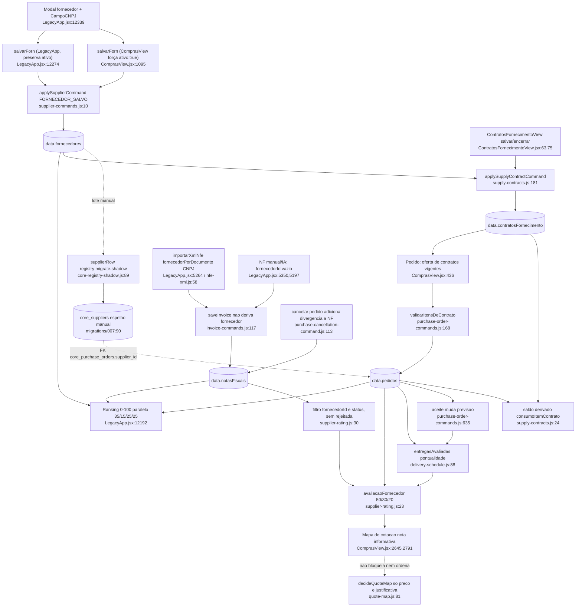

# F5 · fornecedores-contratos-avaliacao

Fase 1 (somente leitura; nada executado).

Resumo: o cadastro tem CNPJ, contato e endereço, mas não tem dados bancários, documentos nem validade de certidões. O contrato fica no servidor, com saldo derivado e validação no pedido. A nota 0-10 é só informativa: aparece no mapa de cotação e não bloqueia nem ordena nada. A S18 está CONFIRMADA na parte do `fornecedorId` e é latente na parte da `rejeitada`. Existem duas "notas" de fornecedor que não se conversam.

## (a) Fontes consultadas
`00-features.md` 1-146; `compras/supplier-commands.js` 1-29; `supply-contracts.js` 1-186; `supplier-rating.js` 1-59; `delivery-schedule.js` 1-116; `nfe-xml.js` 1-135; `financeiro/invoice-commands.js` 1-230; `purchase-cancellation-command.js` 108-121; `purchase-order-commands.js` 160-172 + greps; `components/ContratosFornecimentoView.jsx` 1-119; `ComprasView.jsx` 432-461, 816-827, 1085-1105, 2640-2645, 2671-2745 (+ greps de `avaliacaoForn` 953, 2645, 2791); `LegacyApp.jsx` 5196-5197, 5244-5273, 5275-5311, 5340-5350, 12180-12330 (ranking e `salvarForn`), 12332-12447 (`ModalFornecedor`), 14484-14494; `src/domains/suppliers/*` (grep e listagem; editor novo atrás da flag `features.newSupplierEditor=false`, `src/config/features.js:3`); `docs/compras-avaliacao-fornecedor.md` 1-31; `server/core-registry-shadow.js` 89-96, 159-196; `migrations/007_create_core_registry_projection.up.sql` 90-109; `migrations/014_create_procurement_projection.up.sql` 20-90; `server/operational-command-policy.js` 150-179; greps em `api/data.js` (221-223 papéis, 2390-2428 `core-registry-report`) e `package.json:38,46`.

## (b) Achados concretos

### 1. Cadastro de fornecedor
- Comando `FORNECEDOR_SALVO`, em `applySupplierCommand` (`supplier-commands.js:10-27`): exige `actorId` (:12), `id` e `nome` (:15-16); controla concorrência por versão: `version` do atual deve igualar `expectedVersion` (:19), a criação exige 0 (:20); CNPJ duplicado é barrado comparando só os dígitos (:21-22) — quem não tem CNPJ passa livre; grava `version+1`, `updatedAt`, `updatedById`, `updatedBy` (:23-24). O objeto é `{...current,...raw}`: sobrescreve tudo e não guarda o valor anterior.
- Papéis: admin, compras e financeiro (`api/data.js:221`, `operational-command-policy.js:165-168`).
- Chamadores: `ComprasView.jsx:1095-1105`, `LegacyApp.jsx:12274-12282` (tela Fornecedores) e `LegacyApp.jsx:14485-14494`. A terceira tem fallback sem comando via `persistirCadastro` (:14490), que ignora a trava de versão e o CNPJ duplicado.
- Campos do modal (`LegacyApp.jsx:12339-12447`): nome, razão social, fantasia, CNPJ, contato, telefone, e-mail; ramos (`categorias`, alimentam a "sugestão de fornecedor"); CEP e endereço completo. O CNPJ chama a consulta externa (`CampoCNPJ`, :12347-12375) e preenche `situacaoCadastral`, `dataAbertura` e `atividadeCnae`. Esses campos são gravados uma vez, como foto, e nunca reconsultados.
- Não existe nenhum campo de dados bancários ou PIX, prazo ou condição de pagamento padrão, inscrição estadual, certidões (CND, FGTS) ou documentos. O editor novo (`supplierEditorSchema.js`) só tem contato, telefone, e-mail e ramos, e está desligado.
- **Bug de `ativo`:** `salvarForn` em `ComprasView.jsx:1098` e `LegacyApp.jsx:14488` força `ativo:true` a cada edição. Só a versão de `LegacyApp.jsx:12276` preserva `ativo!==false`. Não há controle de inativar fornecedor no modal (até :12447) nem escritor de `ativo:false`. Na prática `ativo` é campo morto. Mesmo existindo inativo, o servidor só valida que o fornecedor existe (`purchase-order-commands.js:123`, :280, :374), não que esteja ativo. A UI esconde os inativos (`ComprasView.jsx:822`, `ContratosFornecimentoView.jsx:48`), só filtro de tela.
- A situação cadastral (ex.: "BAIXADA") é gravada mas não é checada em pedido nem cotação.

### 2. Contrato de fornecimento
- Comandos `CONTRATO_FORNECIMENTO_SALVO` e `_ENCERRADO` (`supply-contracts.js:8-11`), papéis admin e compras (:13, `api/data.js:222-223`).
- `normalizarContrato` (:102-139): exige fornecedor existente (:106); vigência `AAAA-MM-DD` com fim >= início (:109-110); 1 a 200 insumos (:111), cada um com preço > 0 e quantidade > 0 (:118-119); conversão de unidade válida (:120); um insumo só aparece uma vez por contrato (:117); na edição, insumo já consumido não pode sair nem baixar a quantidade abaixo do consumido (:126-135).
- `salvarContrato` (:141-162): trava por versão; gera o número `CF-nnnn` (:94-100); bloqueia edição de contrato encerrado (:146); o contrato sempre fica `status:"ativo"` (:154).
- Saldo derivado, nunca gravado: `consumoItemContrato` (:24-28) soma `qtd` dos itens de pedidos "vivos" (não cancelados) com `contratoId` e `contratoItemId`. `saldoItemContrato` (:30-34) = contratado − consumo. `pedidoVivo` (:20) inclui rascunho: um rascunho já consome saldo. Conta o pedido, não o recebimento.
- Vigência: `contratoVigente` (:36-37) compara a data do pedido com início e fim. O status continua "ativo" depois que vence; a UI só mostra o selo "VENCIDO" (`ContratosFornecimentoView.jsx:98,103`). Não há encerramento automático.
- Encerramento (`encerrarContrato`, :164-177): motivo obrigatório; grava `motivoEncerramento`, `encerradoEm`, `encerradoPorId`, `encerradoPor`; o contrato fica no blob (soft close) e aparece em "Mostrar encerrados" (`ContratosFornecimentoView.jsx:53,115`).
- Uso no pedido: a UI oferece os contratos vigentes do mesmo fornecedor e obra (`contratosDisponiveis`, `supply-contracts.js:41-44`; `ComprasView.jsx:436-446`). O item entra com preço travado (:458-459). No servidor, `validarItensDeContrato` (`supply-contracts.js:60-89`, chamado em `purchase-order-commands.js:168`) confere: contrato existente, ativo, do mesmo fornecedor, da mesma obra e vigente na data do pedido; insumo e unidade iguais ao do contrato; preço <= acordado; quantidade <= saldo. Item que não aumentou nem qtd nem preço não é reavaliado (:66-68).
- Pedido 100% por contrato dispensa cotação (`pedidoPorContrato`, :92; usado só em `calculations.js:120` para a métrica "sem cotação").
- O vínculo `contratoId` é opt-in, vem do cliente. Nada obriga a usar um contrato vigente com preço menor, nem compara contrato × preço de cotação.

### 3. Nota do fornecedor (`supplier-rating.js:23-44`)
- Janela de 365 dias (:17). Três critérios: pontualidade (`entregasAvaliadas`, `delivery-schedule.js:88-96`) 50%; notas sem divergência (`divergencias.length==0`) 30% (:36); pedidos não cancelados ÷ emitidos, rascunho fora (:26) 20% (:37).
- Critério sem registro sai e os pesos são redistribuídos (:39-41). Sem registro algum, a nota fica `null` ("sem histórico").
- Pontualidade mede contra a previsão vigente. O aceite do fornecedor reescreve `previsao` (`purchase-order-commands.js:635`, comentário "prazo confirmado vira previsão"). O atraso é medido contra o prazo reconfirmado, não contra o prometido na cotação.
- Pedido recebido ou pago fora da janela por data de pedido (`pedido.data`) sai do cálculo.
- Aparece só no mapa de cotação (`ComprasView.jsx:953` cálculo, `:2645` cabeçalho de proposta com tooltip `explicacaoNotaFornecedor`, `:2791` opções da decisão por item "· nota X,X").
- **Não influencia a escolha**: não há ordenação, filtro, bloqueio nem alerta. A regra "justificativa se não for o mais barato" olha só o preço (`quote-map.js`, `decideQuoteMap`).

### 4. Segunda "nota" paralela (inconsistência)
- A tela Fornecedores da `LegacyApp.jsx` (:12192-12265) calcula outro ranking de 0 a 100: preço 35%, frete 15%, prazo 25%, qualidade 25% (:12305). Heurística sobre cotações, fretes por regex de texto (`/cif|fob/`, :12216-12217) e divergências (−12 pontos por NF, :12252).
- Só avalia fornecedores ativos (:12192) e usa `entregasAvaliadas(...,"")` sem pendentes (:12239).
- O mesmo fornecedor tem "nota 7,6" no mapa de cotação (0 a 10) e "nota 82" na tela Fornecedores (0 a 100), com fórmulas e janelas diferentes (a tela deixa escolher 6, 12 ou 24 meses ou todo o histórico, :12296).
- O texto da tela diz "Critérios sem evidência não reduzem a nota — apenas a confiança" (:12320); o doc oficial diz o mesmo para o outro cálculo.
- Esse ranking também depende de `n.fornecedorId` nas NFs de frete (:12205); ver S18.

### 5. Quem é o fornecedor da NF (base da S18)
- XML NF-e: `lerXmlNfe` extrai `documentoFornecedor` do emitente, CNPJ ou CPF (`nfe-xml.js:50-51`). `fornecedorPorDocumento` (:58-62) compara só os dígitos do `cnpj`, `documento` ou `cpf` do cadastro.
- `importarXmlNfe` (`LegacyApp.jsx:5264`) define `fornecedorId: forn?.id || ""` (:5269) e avisa com toast quando não acha o CNPJ (:5273). Se o CNPJ não casa, o XML ainda zera o `fornecedorId` e guarda só o nome em texto, mesmo numa NF que já tinha id. Fornecedor cadastrado sem CNPJ nunca é achado.
- Lançamento manual: o formulário tem só `Inp label="Fornecedor"` de texto livre ligado a `fornecedorNome` (`LegacyApp.jsx:5350`). Não há seletor de fornecedor nem herança do pedido selecionado (:5350, `Sel` "Pedido relacionado").
- Modo IA: a NF é criada com `fornecedorId:""` fixo (`LegacyApp.jsx:5197`).
- Servidor: `normalizeInvoice` não deriva `fornecedorId` do `pedidoId` e só faz `...current,...raw` (`invoice-commands.js:117`). O razão usa o nome em texto (`ledger.js:329`).

### 6. Verificação da S18
- **Parte 1 — CONFIRMADA.** `supplier-rating.js:30-32` filtra `doFornecedor(nota)`, que testa `nota.fornecedorId === fornecedorId`. NF manual, NF de IA, NF de XML cujo CNPJ não casa e NF com fornecedor sem CNPJ cadastrado ficam sem `fornecedorId` e são ignoradas. Efeito: o critério "notas" (30%) só enxerga NFs vindas de XML com CNPJ casado; fornecedor com todas as NFs manuais e divergentes não é penalizado; se nenhuma NF tem id, o critério some e os pesos viram 50/70 e 20/70, o que infla ou distorce a nota; mesma lacuna na aba de frete do ranking antigo (`LegacyApp.jsx:12205`). Dados reais de produção não verificados.
- **Parte 2 — PARCIAL (latente).** O filtro exclui `cancelada`, `cancelado` e `estornada` (:31), mas não `rejeitada` nem `rejeitado`, que o próprio `inactiveStatus` (`invoice-commands.js:26-28`) e o ledger (`ledger.js:17,358`) tratam como inativos. Falta também `estornado`. Mas nenhum comando grava `rejeitada` numa NF: `invoice-commands.js` só produz `recebida` e `aprovada`, e a UI lista apenas "recebida", "aprovada" e "paga" (`LegacyApp.jsx:5350`). Não há comando de cancelar NF. Hoje é inconsistência de filtro sem efeito visível, a menos que o status venha de importação ou dado antigo.
- **Efeito colateral mais grave.** `purchase-cancellation-command.js:113-121`, ao cancelar um pedido, zera o `pedidoId` das NFs dele e acrescenta uma divergência. Se a NF tem `fornecedorId`, ela passa a contar como NF "com divergência" na nota do fornecedor. O fornecedor é penalizado duas vezes, nos cancelamentos (20%) e nas notas (30%), por um cancelamento que pode ter sido decisão interna da construtora.

### 7. Espelho `core_suppliers` (migration 007)
- Tabela de projeção em lote: `id, name, tax_id, active, categories, source_hash, payload, archived_at` (`migrations/007...up.sql:90-109`).
- `supplierRow` (`server/core-registry-shadow.js:89-96`) copia nome, CNPJ só em dígitos, ativo, categorias e o payload inteiro. Alimentada por `npm run registry:migrate-shadow` (`package.json:38`, `scripts/apply-core-registry-shadow.mjs:72`), manual. Não há escrita automática no `api/data.js`.
- Não é lida pelo app. Só serve de relatório de paridade (`api/data.js:2390 core-registry-report`, `package.json:46`) e de alvo de chave estrangeira de `core_purchase_orders.supplier_id` (`migrations/014:80-81`).
- Utilidade hoje: baixa. Prepara o futuro modelo relacional e a integridade do espelho de pedidos. Pelo comentário da 014 (:29-34), nunca faz DELETE físico, só `archived_at`. Depende de a projeção rodar.

### 8. Escritas e coleções
- `data.fornecedores[]`: id, nome, razaoSocial, nomeFantasia, cnpj, contato, telefone, e-mail, categorias, endereço, obs, situacaoCadastral, dataAbertura, atividadeCnae, ativo, version, updatedAt, atualizadoEm, updatedById, updatedBy.
- `data.contratosFornecimento[]`: id, numero, fornecedorId, obraId, vigenciaInicio, vigenciaFim, itens[], observacao, status, criadoEm, criadoPor, updatedAt, version, motivoEncerramento, encerradoEm, encerradoPor.
- A nota do fornecedor não é gravada: é derivada ao vivo de `pedidos`, `notasFiscais` e `item.recebimentos`.
- Seções com autorização por seção: `fornecedores` admin, compras e financeiro (`server/section-authorizations.js:17`). `data-projection.js:16` inclui `contratosFornecimento` e `fornecedores` na seção compras.
- A integridade da cadeia (S17) vale para a rota genérica `save`. `fornecedores` e `contratosFornecimento` continuam graváveis por `save` e `save-sections` com a permissão de seção (não aprofundado).

## (c) Fluxograma

## Foco do usuário: escolher bem o fornecedor
O que existe: nota 0-10 por pontualidade, NF e cancelamento (só leitura no mapa); ramos para sugerir fornecedor (`LegacyApp.jsx:12390`); histórico por fornecedor — pedidos, recebidos, obras, insumos e volume mensal (`ComprasView.jsx:2709-2727`); evolução de preço por insumo × fornecedor, só do material recebido, com média ponderada (:2733-2743); contrato com preço travado e saldo; mapa multi-proposta com justificativa se não escolher o mais barato.

O que falta ou está pouco confiável:
1. A nota não participa da decisão: sem alerta "fornecedor com nota baixa" ou "histórico de atraso", e sem justificativa exigida por nota.
2. Duas notas diferentes (0-10 e 0-100) e a base da NF depende de `fornecedorId` que muitas NFs não têm.
3. Sem concentração: não há % do volume por fornecedor, nem dependência por insumo ou obra (só total por fornecedor).
4. Sem documentos de habilitação (CND, FGTS, INSS, alvará, contrato social) nem validade.
5. Sem dados bancários, PIX, prazo e condição de pagamento padrão, nem alerta de divergência entre o favorecido do pagamento e o cadastro.
6. Situação cadastral na Receita é foto única e não bloqueia pedido de fornecedor baixado ou inapto.
7. Sem inativar ou bloquear fornecedor de verdade, nem motivo de bloqueio (campo `ativo` morto).
8. Histórico de preço do fornecedor existe por insumo, mas não aparece na hora de montar a cotação (guarda de preço de `ComprasView.jsx:460+` não verificada).
9. Contrato não é comparado com a cotação, não há alerta de vencimento próximo nem de saldo baixo (só barra laranja a 90%, `ContratosFornecimentoView.jsx:113`).
10. Custo total (frete, prazo de pagamento) não entra na comparação além do preço (no ranking antigo o frete vira nota por regex de texto).

## (d) Veredito das hipóteses
- **S18: CONFIRMADA** na parte do `fornecedorId`, **PARCIAL (latente)** na parte da `rejeitada`.
- **S10** (escritas diretas): PARCIAL. Fornecedor e contrato passam por comando com versão. A terceira tela (`LegacyApp.jsx:14490`) tem fallback `persistirCadastro` sem comando.
- **S17**: sem impacto direto pelo que foi lido. `fornecedores` e `contratosFornecimento` seguem graváveis por `save` e `save-sections` com permissão de seção (`section-authorizations.js:17`).
- **S13**: o espelho `core_suppliers` é manual e pode ficar defasado (item 7).
- S11, S12, S14, S15, S16: não se aplicam. A NF do Modo IA sempre sem `fornecedorId` (:5197) agrava a S18. Achado novo fora da lista: bug do `ativo:true` forçado (item 1).

## (e) Informação que se perde ou deixa de ser rastreável
1. Histórico de alterações do cadastro: só `updatedBy` e `version` do último salvamento; o valor anterior (CNPJ, contato, ramos) é sobrescrito. Não há log por campo.
2. Edição de contrato: preço e quantidade anteriores são sobrescritos (`supply-contracts.js:153-161`); só o último `updatedBy`. Não dá para ver o preço acordado em março depois de uma renegociação.
3. Contratos encerrados: motivo e quem encerrou ficam (:172-173), mas o histórico de edições antes do encerramento some. Contrato vencido nunca vira "encerrado" sozinho.
4. Bloqueio e inativação: não existe motivo, data nem autor (`ativo` morto, forçado a `true`).
5. Situação cadastral na Receita: gravada uma vez. Se o fornecedor for baixado depois, o sistema não sabe.
6. NFs sem `fornecedorId`: o vínculo NF-fornecedor fica só como texto livre (`fornecedorNome`), então histórico, concentração e nota perdem essas notas. Se o XML não casa, até o id que existia é apagado (`LegacyApp.jsx:5269`).
7. Pontualidade: o prazo prometido na cotação (`prazoDias`) é sobrescrito pela previsão confirmada no aceite (:635); "prometido × realizado" se perde e a nota mede o atraso contra a data renegociada.
8. A divergência injetada pelo cancelamento do pedido (`purchase-cancellation-command.js:113-121`) mistura "problema do fornecedor" e "cancelamento interno" na mesma lista.
9. A nota é derivada ao vivo e não guardada: não há série histórica, e a janela móvel de 12 meses faz a nota mudar sem registro.
10. `core_suppliers`: o espelho depende de execução manual do script.

## (f) Dependências externas
Consulta de CNPJ (`CampoCNPJ`, `ramosDosCnaes`) e de CEP (`CampoCEP`) em serviços externos (componente não lido, API não verificada); Supabase via blob `company_app_data` e espelho `core_suppliers`, e `api/data.js` com `service_role`; chave de acesso e XML da NF-e vindos do usuário (arquivo local, sem consulta à SEFAZ); Modo IA (`LegacyApp.jsx:5225-5241`) gera NF sem id de fornecedor; `unit-conversion.js` na validação do contrato (`supply-contracts.js:6`).

## (g) Confiança e lacunas
Alta: comandos de fornecedor e contrato, fórmula da nota, S18 (`fornecedorId`), bug do `ativo:true` e duplicidade das notas. Média: ausência de escritor de `ativo:false` ou de NF `rejeitada` (greps limitados) e o espelho `core_suppliers` ser só manual (script e prebuild/CI não lidos).
Não lido: final do `ModalFornecedor` (após :12447), `CampoCNPJ`/`CampoCEP`; `quote-map.js` em detalhe; guarda de preço em `ComprasView.jsx:460+`; `procurement-chain-policy.js`; `section-authorizations.js` além de :17; dados de produção. Nada executado.

## Verificação do orquestrador (a preencher)
- S18: contar, por leitura no banco (mirror não-gzip, ou pela exportação), quantas NFs têm `fornecedorId` vazio — não é possível por SQL se o blob estiver gzip; registrar como pendente.
- Reproduzir por execução `avaliacaoFornecedor` com NF sem `fornecedorId`.
