# F7 · nota-fiscal-e-conferencia-3-vias

Origem: subagente Flowchart da Fase 1 (somente leitura; cenário numérico derivado por leitura, não executado).

Em resumo: a nota entra como `recebida`, já vira custo no DRE e só depois passa pela aprovação. A conferência de 3 vias é calculada uma vez, no momento de salvar, e só alerta, nunca bloqueia. S6 e S2 confirmadas; S12 parcial. Não existe comando para cancelar ou rejeitar uma nota.

## (a) Fontes consultadas
- `PATHFINDER-2026-10-26/00-features.md` 1-146.
- `src/domains/financeiro/invoice-commands.js` 1-231 (inteiro).
- `src/domains/financeiro/workflows.js` 1-170 (inclui `analyzePurchaseThreeWayMatch` 36-72 e `isDateInClosedPeriod` 136).
- `src/domains/compras/nfe-xml.js` 1-136 (inteiro) e `__fixtures__/nfe-teste.xml` 1-17.
- `src/LegacyApp.jsx`: 5100-5242 (Modo IA, `aceitar`, ramificações de nota); 5244-5350 (`novaNotaFiscal`, `CentralFiscal`: `importarXmlNfe` 5261, `salvar` 5275, `aprovar` 5312); 13965-13985 (o "cancelada" ali é de medição, não de NF).
- `purchase-payment-validation.js` 1-14; `payment-conference.js` 1-57.
- `ledger.js` 1-130, 255-365, 600-670 + grep de `legacy` e `cost`.
- `payable-payment-commands.js` 120-235 + grep; `payables.js` 9-17.
- `purchase-cancellation-command.js` 105-135 + grep; `unit-conversion.js` (grep) e `purchase-order-commands.js` 270-320.
- `operational-commands.js` 156-165 (`appendReceipt`) e 220-320.
- `api/data.js` 205-220 + grep de `notasFiscais`; `server/client-portal-publication.js` 1-30 e 200-290.

## (b) Achados concretos

### Entradas de nota (3 caminhos, todos usam `NOTA_FISCAL_SALVA`)
1. **Manual ou XML** (`CentralFiscal.salvar`, `LegacyApp.jsx:5275-5311`). O comando é `INVOICE_SAVED`, com `expectedVersion` 0 na criação (5295).
   - `importarXmlNfe` (5261-5274) lê o XML só no navegador, com `lerXmlNfe` (`nfe-xml.js:23`). Preenche o formulário, acha o fornecedor pelo CNPJ (`fornecedorPorDocumento`, `nfe-xml.js:58`) e sugere pedidos por fornecedor, obra e itens casados (`sugerirPedidosParaNota`, `nfe-xml.js:105`).
   - Os itens do XML são ligados ao pedido por `casarItensNota` (`nfe-xml.js:75`).
2. **Modo IA, destino novo** (`LegacyApp.jsx:5197-5206`). Cria a nota com `fornecedorId:""`, `chave:""`, `pedidoId:""`, `rateio` único e `divergencias:sugestao?.alertas`. Fica sem pedido e sem itens, então não há 3 vias.
3. **Modo IA, anexar documento a uma nota existente** (5150-5162). Reenvia a nota inteira, com o documento acrescentado, por `INVOICE_SAVED`.

### `saveInvoice` (`invoice-commands.js:134-190`)
- O status é `current?.status||"recebida"` (146). Uma edição não muda o status, nem de nota já `aprovada`.
- `normalizeInvoice` (71-132) valida: obra existente, número, emissão e valor bruto positivo; período não fechado (87); pedido existente e da mesma obra (89-91); chave duplicada (92-95); itens (`validarItensNota`, 97); retenções ≤ bruto (41) e soma dos rateios = bruto (65); nota com pagamento ativo não pode mudar obra, pedido ou valores (107-114).
- O 3-way roda em `analyzePurchaseThreeWayMatch(projection, pedidoId)` (159), com a nota candidata já incluída.
- `divergencias` é recalculado: issues do 3-way (173-174) mais divergências por item (167-172). O resultado sobrescreve qualquer `divergencias` vindo do cliente (176).
- `threeWayMatch` guarda `{status, orderedCents, receivedCents, invoicedCents, checkedAt}` (177-181).

### `analyzePurchaseThreeWayMatch` (`workflows.js:36-72`)
- Pedido = Σ `qtd*precoUnit`. Recebido = Σ `qtdRecebida*precoUnit` (14-17). Faturado = Σ `valorBruto` das notas ativas do pedido (39-43).
- Notas `recebida` (não aprovadas) entram no faturado, porque `inactive` só exclui cancelada, estornada, rejeitada e rascunho.
- Issues (45-56): `RECEIPT_EXCEEDS_ORDER` (recebido > pedido, erro); `INVOICE_EXCEEDS_ORDER` (faturado > pedido, erro); `INVOICE_EXCEEDS_PHYSICAL_RECEIPT` (faturado > recebido, só warning).
- Tolerância fixa de 1 centavo. Não usa a tolerância configurável 2% / R$ 50 de `payment-conference.js:10`.
- O `status` (60-64) vai de `conciliado` a `aguardando_nf`, `nf_acima_recebimento` e `parcial`. É só informativo; nada bloqueia por ele.
- A comparação é só de valor total, por pedido. Quantidade e preço por item são tratados à parte (`divergenciasDoItem`).

### Consequência prática do 3-way
- Nota que chega antes da mercadoria (o normal) gera `INVOICE_EXCEEDS_PHYSICAL_RECEIPT` na hora de salvar. A mensagem ("Valor fiscal acima do material fisicamente recebido", 163) entra em `divergencias`, e isso exige aceite de risco para aprovar (201).
- O aceite é um `window.confirm` genérico no cliente (`LegacyApp.jsx:5313-5314`), para qualquer divergência.
- A divergência é congelada no salvar e nunca recalculada:
  - Receber a mercadoria depois não limpa o aviso.
  - Lançar uma 2ª nota que estoura o pedido marca só a 2ª. A 1ª continua sem divergência e aprovável.
  - Uma nota que ficou com divergência por recebimento pendente continua exigindo aceite de risco mesmo depois de a mercadoria chegar.

### `approveInvoice` (`invoice-commands.js:192-215`)
- Bloqueia nota inativa (195), versão divergente (196), já `aprovada` ou `paga` (199) e período fechado (200).
- Exige `riskAccepted===true` se houver divergências (201).
- Grava `status:"aprovada"`, `aprovadoPorId`, `aprovadoPor` e `aprovadoEm` (205-209).
- `riskAccepted` não é gravado na nota nem no recibo. `appendReceipt` (`operational-commands.js:156-162`) guarda só `{idempotencyKey, type, entityId, appliedAt, actorId}`.
- Papéis `admin` e `financeiro` para salvar e aprovar (`api/data.js:213-214`). A mesma pessoa pode lançar e aprovar, sem segregação de funções.

### Liberação do pagamento
- `validatePurchasePayment` (`purchase-payment-validation.js:9`) exige nota `aprovada` ou `paga` para pagar a nota. O saldo é `valorLiquido || valorBruto` menos o já pago (`payables.js:9`).
- Pagar nota não passa pela conferência de adiantamento: `type!=="pedido"` retorna `{campos:{}}` (12).
- Se a nota tem `pedidoId`, o pagamento é espelhado no pedido com `notaFiscalId` (`payable-payment-commands.js:171-179`). Esse espelho não passa por `avaliarPagamentoPedido`.
- Pagar o pedido direto usa `conferenciaPagamentoPedido`: conferido = min(recebido, faturado, pedido), mais tolerância (`payment-conference.js:29-35`). O faturado inclui nota `recebida` não aprovada. Há então dois portões diferentes: nota exige aprovação, pedido considera nota ainda não aprovada como lastro.
- Pagar a nota até `paga` ou `aprovada` define o status (`payable-payment-commands.js:103`, `331`).

### Efeito do cancelamento de pedido na nota (`purchase-cancellation-command.js:113-121`)
Zera `pedidoId` da nota e acrescenta uma divergência textual. Não muda o status. A nota segue `recebida` ou `aprovada` e continua custo no DRE e conta a pagar.

### Perguntas específicas

**NF sem pedido**
- `pedidoId` vazio é permitido. Não há 3-way (`match=null`, `invoice-commands.js:158-159`), `threeWayMatch:null` e nenhuma divergência.
- A nota fica aprovável sem nenhuma conferência, e já é custo no DRE. O pagamento só exige `aprovada`.
- A UI oferece "Sem pedido" (`LegacyApp.jsx:5350`). No Modo IA, toda nota nasce sem pedido nem fornecedor.

**NF com pedido e valor diferente**
- Valor acima do pedido: `INVOICE_EXCEEDS_ORDER` vira divergência. Mesmo assim a nota é gravada e reconhecida como custo pelo valor integral da nota. Só a aprovação exige o aceite.
- Valor abaixo do pedido: não há issue. O status do 3-way vira `parcial` ou `aguardando_nf`, informativo.
- Para o XML, `valorBruto` é `vNF` (`nfe-xml.js:52`). Frete, IPI, ST e desconto entram nisso e a conferência compara com o pedido sem imposto. Frete e imposto fora do pedido viram divergência, sem tolerância. O fixture ilustra: o item "TAXA DE ENTREGA" não casa com nenhum item do pedido e vira "sem item correspondente" (`invoice-commands.js:169`).

**Impostos e retenções**
- `lerXmlNfe` não lê retenções nem `vDesc`. As retenções são digitadas à mão (`LegacyApp.jsx:5255`, `5270`).
- O servidor só valida retenção ≥ 0 e ≤ bruto (`invoice-commands.js:32-43`), e `valorLiquido = bruto − retenções` (106).
- O 3-way e o DRE usam `valorBruto`. O pagamento usa `valorLiquido`.
- O razão reconhece o custo pelo bruto (`ledger.js:58`, `299`). As retenções não geram obrigação de recolhimento nem efeito separado no ledger (não aparecem em 297-354). Gap a confirmar fora do escopo lido.

**Duplicidade e chave de acesso**
- Há uma única checagem: chave não vazia igual à de outra nota não inativa devolve "Já existe uma nota ativa com esta chave de acesso." (`invoice-commands.js:92-95`).
- A chave só é extraída pelo XML (`nfe-xml.js:28-29`, com 44 dígitos exigidos na leitura do XML, 47). O servidor aceita qualquer string em `raw.chave`, sem validar 44 dígitos nem dígito verificador. O campo manual é livre (`LegacyApp.jsx:5350`).
- Não há checagem de duplicidade por (fornecedor, número, série) nem por (CNPJ, número, valor, data). Vale para nota manual, sem chave, e para Modo IA, que grava `chave:""` e `fornecedorId:""`.
- Importar o mesmo XML duas vezes é barrado. Digitar a mesma nota sem chave passa duas vezes e vira custo em dobro.
- Duas notas ativas para o mesmo pedido são somadas no faturado. O 2º lançamento acusa `INVOICE_EXCEEDS_ORDER`.

**Vínculos e campos**
- `fornecedorId` e `fornecedorNome` não são validados no servidor: nenhum teste de existência, nenhum cruzamento com `pedido.fornecedorId`. Uma nota pode apontar para um pedido de outro fornecedor.
- `...current,...raw` (`invoice-commands.js:117`) deixa o cliente enviar campos extras, como `aprovadoPor`. O status é fixado em 146, mas a trilha de aprovação não é bloqueada na criação.

## (c) Fluxograma

```mermaid
flowchart TD
  A["Receber nota fiscal<br/>LegacyApp.jsx:5348"] --> B{"Origem?"}
  B -->|"XML"| C["importarXmlNfe<br/>LegacyApp.jsx:5261"]
  B -->|"Manual"| D["salvar<br/>LegacyApp.jsx:5275"]
  B -->|"Modo IA"| E["aceitar nota IA, sem fornecedor/pedido/chave<br/>LegacyApp.jsx:5197"]
  C --> C1["lerXmlNfe: chave, CNPJ, vNF, itens<br/>nfe-xml.js:23"]
  C1 --> C2["fornecedorPorDocumento por CNPJ<br/>nfe-xml.js:58"]
  C2 --> C3["sugerirPedidosParaNota<br/>nfe-xml.js:105"]
  C3 --> C4["casarItensNota, sem conversao de unidade (S12)<br/>nfe-xml.js:75"]
  C4 --> D
  D --> F["dispatchCommand NOTA_FISCAL_SALVA<br/>LegacyApp.jsx:5293"]
  E --> F
  F --> G["applyInvoiceCommand, papel admin ou financeiro<br/>invoice-commands.js:225 / api/data.js:213"]
  G --> H["normalizeInvoice: obra, periodo, pedido, chave duplicada<br/>invoice-commands.js:71"]
  H -->|"erro"| X["Rejeita com mensagem<br/>invoice-commands.js:142"]
  H --> I{"Tem pedidoId?"}
  I -->|"nao"| J["sem 3-way, sem divergencia<br/>invoice-commands.js:158"]
  I -->|"sim"| K["analyzePurchaseThreeWayMatch pedido x recebido x faturado<br/>workflows.js:36"]
  K --> K2["divergenciasDoItem por item<br/>nfe-xml.js:95"]
  J --> L["saveInvoice grava status recebida + divergencias congeladas<br/>invoice-commands.js:146,175"]
  K2 --> L
  L --> M["data.notasFiscais<br/>invoice-commands.js:186"]
  M --> N["buildFinancialLedger: notaReconhecivel inclui recebida (S6)<br/>ledger.js:61,297"]
  N --> O["Eventos cost e payable_increase = DRE<br/>ledger.js:333"]
  M --> P["Portal: filtro active masculino (S2)<br/>client-portal-publication.js:7,210"]
  M --> Q["Aprovar pagamento<br/>LegacyApp.jsx:5312"]
  Q --> R{"Tem divergencias?"}
  R -->|"sim"| S["window.confirm vira riskAccepted, nao gravado<br/>LegacyApp.jsx:5313"]
  R -->|"nao"| T["NOTA_FISCAL_APROVADA<br/>invoice-commands.js:192"]
  S --> T
  T --> U["status aprovada + aprovadoPor/Em<br/>invoice-commands.js:205"]
  U --> V["validatePurchasePayment exige aprovada<br/>purchase-payment-validation.js:9"]
  V --> W["recordPayment, espelha no pedido com notaFiscalId<br/>payable-payment-commands.js:127,176"]
  W --> N
```

## (d) Veredito

**S6: CONFIRMADA.**
- `ledger.js:22` define `RECOGNIZABLE_INVOICE = recebida, aprovada, paga, conferida, reconhecida`.
- `ledger.js:61-65`: `notaReconhecivel` retorna verdadeiro para status vazio ou `recebida`.
- `invoice-commands.js:146` grava o status inicial `"recebida"`.
- `ledger.js:297-335` gera, para cada rateio, os eventos `cost` e `payable_increase` na emissão, com `legacy:true` para `recebida` (331). `selectDRE` (`ledger.js:633-645`) soma todos os eventos `cost` sem excluir `legacy`.
- Consequência: uma nota divergente já vira custo e conta a pagar no ato do `INVOICE_SAVED`, antes de qualquer aprovação. A competência vem de `emissao`. A conferência de 3 vias e o aceite de risco não retardam nem reduzem esse reconhecimento. Aprovar só muda o status (e, portanto, o direito ao pagamento). O compromisso do pedido cai em min(total do pedido, soma das notas reconhecíveis) (`ledger.js:276-278`), mesmo para nota não aprovada.
- Cenário numérico (derivado por leitura): pedido de 100 sacos a R$ 35 = R$ 3.500, recebidos 60 (R$ 2.100). Nota de R$ 5.080, obra X, emissão em outubro. Ao salvar, a nota gera divergências "Notas fiscais acima do valor contratado... R$ 1.580,00" e "Valor fiscal acima do recebido... R$ 2.980,00". No mesmo instante, a DRE de outubro da obra X sobe R$ 5.080 (e o a pagar também). O compromisso do pedido fica em 0. Se a nota estiver errada, não há comando para cancelá-la; o custo fica até alguém editar o status por fora.

**S12: PARCIAL**, com cenário de falso alerta e de falso silêncio.
- Os itens do pedido guardam `qtd` e `precoUnit` na unidade de compra (`unidadeCompra`, `fatorConversao`, `unit-conversion.js`; `referenceUnitCostOf` divide o preço pelo fator).
- `casarItensNota` (`nfe-xml.js:84-85`) e `divergenciasDoItem` (97-99) comparam `xmlItem.qtd` e `precoUnit` direto com `item.qtd` e `item.precoUnit`.
- `xmlItem.unidade` (`uCom`) é lido (39) e gravado (`invoice-commands.js:124`), mas nunca é comparado com `unidadeCompra`. Nenhum código converte pela unidade.
- Só erra quando a unidade do fornecedor difere da de compra. A conferência total por valor (`workflows.js`) não é afetada.
- Falso alerta: pedido de 10 sacos de cimento a R$ 35 (unidade SC); o fornecedor fatura em 500 KG a R$ 0,70 (equivale a R$ 35 por saco). Resultado: "Quantidade da nota (500) acima do pedido (10)". O preço 0,70 < 35 passa. O pontuador de semelhança ainda pode casar pela descrição, mas perde os +0,2 de bônus por quantidade e preço.
- Falso silêncio: pedido de 1000 KG a R$ 5 e nota de 0,9 TN: a quantidade 0,9 < 1000 passa. Uma nota em unidade menor que cobra mais caro por unidade de compra pode passar no preço (0,8 < 35) e só cair no total. O preço comparado só detecta "acima", nunca "abaixo", e a quantidade idem.
- Os dois lados são unidirecionais ("acima do pedido"): desconto, frete negativo ou quantidade menor não geram alerta.

**S2 (parte NF): CONFIRMADA no filtro**, com ressalva de que hoje nada grava esses status.
- `client-portal-publication.js:7` define `active` excluindo só `cancelado`, `cancelled`, `estornado` e `reversed`, no masculino. O filtro de NF (210) acrescenta só `rejeitada`.
- Os status feminino `cancelada` e `estornada` (reconhecidos como inativos em `invoice-commands.js:26-28` e `ledger.js:15-19`) passam e vão ao cliente, com `clientStatus: item.status` (226). `rascunho` também passa.
- Nenhum código em `src` grava `cancelada`, `estornada` ou `rejeitada` em `notasFiscais` por comando. Só `payables.js:13` trata `cancelada` ao ler. Hoje o risco depende de dado já existente ou de escrita via `save`.
- Efeito atual: o cliente vê toda nota `recebida`, ainda não conferida ou aprovada, e ainda a divergente, com bruto e líquido.

**Caminho feliz** (XML, pedido e CNPJ casados, itens casados): funciona e é bem validado em estrutura (versão otimista, período fechado, rateio, retenção, chave duplicada, item de outro pedido).

**Furos de desenho**: 3-way congelado no save; não há bloqueio, só alerta; duplicidade só por chave; fornecedor da nota não cruzado com o do pedido; nota `aprovada` pode ser editada sem voltar a `recebida`, quando não há pagamento; o pedido pode ser pago com lastro de nota não aprovada; quem lança também aprova.

## (e) Informação que se perde ou deixa de ser rastreável
- **XML original**: `importarXmlNfe` (`LegacyApp.jsx:5261-5274`) lê o arquivo só no navegador e o descarta. O XML só fica guardado se o usuário o anexar de novo em "Anexar XML, PDF ou imagem", que sobe ao OneDrive (5257). Não há vínculo entre o XML anexado e os itens lidos.
- **Itens da nota**: gravados em `itensNota` apenas com nItem, código, descrição, NCM, unidade, qtd, preço, total e `pedidoItemId` (`invoice-commands.js:121-127`). Perdem-se CFOP, impostos por item, desconto, frete, série da NF-e e protocolo de autorização (`nProt`). Perdem-se também `dup` e parcelas (só o menor vencimento é usado, `nfe-xml.js:43`).
- **Chave de acesso**: gravada em `chave` e só validada contra duplicidade, sem validar 44 dígitos nem dígito verificador no servidor. Notas manuais e de IA ficam sem ela.
- **Aceite de risco**: `riskAccepted` não é gravado. Não se sabe quais divergências foram aceitas, nem justificativa, nem quando. A nota guarda só quem aprovou e quando, e `divergencias` textuais. O recibo do comando guarda tipo, ator e hora, sem o payload (`operational-commands.js:158`).
- **Divergências do Modo IA**: os `alertas` da IA vão em `divergencias` (`LegacyApp.jsx:5197`), mas `saveInvoice` sobrescreve `divergencias` com o cálculo (176). Os alertas se perdem (a análise completa continua em `analiseIA`).
- **Divergências já resolvidas**: se um recebimento posterior cobre a divergência, nada é recalculado nem limpo. Também não há histórico de qual era o status do 3-way a cada momento (só o último `threeWayMatch`).
- **Cancelar ou rejeitar nota**: não há comando. A nota errada permanece custo. O pedido cancelado só gera texto de divergência e zera `pedidoId` (`purchase-cancellation-command.js:113-121`), perdendo o vínculo original.
- **Quem lançou vs quem aprovou**: ambos registrados, sem checagem de que são pessoas diferentes.

## (f) Dependências externas
- Gemini, para o Modo IA (`chamarIA`, `verificarStatusIA`; `LegacyApp.jsx:5106`, `5113`).
- OneDrive / Microsoft Graph, para os documentos (`enviarArquivoOneDrive`; `LegacyApp.jsx:5140`, `5257`).
- Supabase / `company_app_data` e `api/data.js`, para a persistência e a autorização por papel (`api/data.js:213-214`).
- Nenhuma consulta à SEFAZ ou ao portal da NF-e. A autenticidade da chave não é verificada.
- O 3-way depende de `recebimento-e-estoque` (F6: `qtdRecebida`) e de `pedido` (F4).

## (g) Confiança e lacunas
- Confiança alta em `saveInvoice`, `approveInvoice`, `analyzePurchaseThreeWayMatch`, `nfe-xml.js` e no reconhecimento do ledger. Média em S2 (não foram rastreados todos os caminhos de escrita que poderiam gravar `cancelada` em nota).
- Lacunas: `ledger.js` 130-255 e 365-600 (pode haver tratamento de retenções; a regra de `legacy` pode ter outro uso, p.ex. no gate de DRE de `dre-projection.js`); `save` e `save-sections` (`api/data.js:2875`, `2945`, `3050`) podem permitir gravar status `cancelada` em `notasFiscais` por fora do comando; sem teste do filtro de status do portal; `invoice-commands.test.js` e `nfe-xml.test.js` não lidos; tela de pagamento (`CentralPagamentosFinanceiro`, `LegacyApp.jsx:5373`) e `ComprasView` não lidas para a nota; cenário numérico não executado.

## Verificação do orquestrador (a preencher)
- S6 cenário numérico (pedido R$ 3.500, recebido R$ 2.100, nota R$ 5.080): reproduzir por execução de `applyInvoiceCommand` + `buildFinancialLedger` + `selectDRE`.
- Verificar se `save-sections` permite gravar status `cancelada` em `notasFiscais`.
- S12: reproduzir `divergenciasDoItem` com 10 SC × 500 KG.
