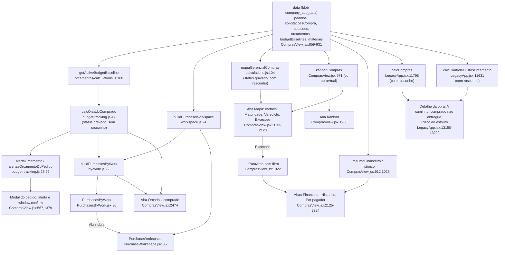

# F11 · orcado-x-comprado-e-fila

Fase 1 (somente leitura; nada executado). Abreviações: `CV` = `src/domains/compras/components/ComprasView.jsx`, `LA` = `src/LegacyApp.jsx`, `calc` = `src/domains/compras/calculations.js`, `BT` = `budget-tracking.js`, `BW` = `by-work.js`, `WS` = `workspace.js`.

Resumo: o F11 não tem uma definição de "comprometido", "a pagar" ou "atrasado". Tem pelo menos cinco para "comprometido", três para "a pagar" e três para "atrasado". Cada tela escolhe a sua, e a mesma obra mostra números diferentes conforme a tela. S5 CONFIRMADA e ampliada; S1 CONFIRMADA. Achados novos: Kanban preso a uma obra, exceções do mapa sem filtro, opção "Cancelado" do histórico sempre vazia, tiles "Pedidos" e "Recebimentos" idênticos.

## (a) Fontes consultadas
`00-features.md` 1-146; `docs/COMPRAS_ROADMAP.md` 1-45; `WS` 1-82; `BT` 1-102; `BW` 1-78; `calc` 1-187; `PurchaseWorkspace.jsx` 1-87; `PurchasesByWork.jsx` 1-86; `CV` 532-575, 780-1063, 1370-1399, 1880-2370, 2455-2615; `orcamentos/calculations.js` 80-150 (`getActiveBudgetBaseline` 100-108); `LA` 11626-11660 (`calcControleCustosOrcamento`), 11790-11821 (`calcCompras`), 12600-12640, 12928-12951 (`previsaoObra`), 13140-13265, 13440-13480; `purchase-request-commands.js` 74-89; `by-work.test.js` linha 57. Greps: consumidores de `calcCompras`, `calcOrcadoComprado`, `mapaGerencialCompras`, `buildPurchaseWorkspace`, `buildPurchasesByWork`, `orcNivel1Id`, `semApropriacao`, `calcControleCustosOrcamento`.

## (b) Achados concretos

### b.1 Tabela indicador × tela × função × definição

| Indicador | Tela | Função (arquivo:linha) | Coleção / status | Definição real |
|---|---|---|---|---|
| Fila: linhas e contadores por etapa | Fila, "Solicitar", "Cotar", "Aprovações", "Pedidos", "Receber" | `buildPurchaseWorkspace` `WS:24-82`; `counts` `WS:78`; navegação `PurchaseWorkspace.jsx:15-20` | `solicitacoesCompra` (exclui `cancelada` e `pedido_gerado`, `WS:41`), `cotacoes` com `status==="aberta"` e itens pendentes (`WS:31-33`), `pedidos` com `statusPedido` ≠ cancelado e ≠ recebido (`WS:64-67`) | Projeção pura. Solicitação com cotação aberta sai da lista (`WS:44`). Pedido em rascunho vai para a etapa "pedidos", os demais para "recebimentos" (`WS:70`). |
| Prazo vencido, Atenção ao prazo, Em aprovação | Cartões da fila | `WS:79-80`, `purchaseDeadline` `WS:13-21`; botões `PurchaseWorkspace.jsx:53-58` | Todas as linhas da fila | Atrasado = data < hoje, "atenção" = 0 a 3 dias. A data é `necessidade` (solicitação), a da solicitação de origem (cotação) ou a menor entrega pendente do item, com `previsao` do pedido como reserva (`WS:68-69,74`). |
| Total R$ da linha do pedido | Fila | `totalPedido` `calc:35-36` via `WS:74` | `itens.qtd × precoUnit` | Inclui rascunho. |
| Comprometido | Mapa gerencial (cartão) | `mapaGerencialCompras` `calc:107,110`; render `CV:2021` | `pedidos` com `status !== "cancelado"` | Inclui rascunho. Rotulado "Pedidos emitidos". |
| Pago, Recebido físico | Mapa (cartões) | `calc:111-112`; `totalPagoPedido` `calc:40-43`; `recebidoPedido` `calc:37-38`; `CV:2022-2023` | `pagamentos` com `active`; pedido com `transacaoId` e sem pagamento conta como 100% pago (`calc:42`) | Sem teto por pedido, então a % pode passar de 100. Recebido é valorado ao preço do pedido, nunca ao da NF. |
| A pagar | Mapa (cartão) | `calc:113` (soma de `saldoPagamentoPedido`, `calc:44`); `CV:2024` | `pedidos` ≠ cancelado, incluindo rascunho | O valor inclui rascunho, mas a legenda `fila.pagamentos` (`calc:155`, usada em `CV:2024`) exclui rascunho (`pedidosValidos`, `calc:114`). Valor e contagem usam universos diferentes no mesmo cartão. |
| Economia registrada | Mapa (cartão) | `calc:127`; `CV:2025` | Soma de `c.economia` de todas as cotações do escopo (`calc:109`) | Inclui cotação cancelada e aberta. O campo é lido, não recalculado. |
| Qualidade dos dados / Maturidade | Mapa | `completude` `calc:163-170`; `CV:2026`, `CV:2104` | Ver b.3 | Seis testes "existe algum". |
| Fila do mapa (5 tiles) | Mapa "Onde o dinheiro e o material estão" | `fila` `calc:151-158`; `CV:2093-2099` | `solicitacoes` com `status==="enviada"` (`calc:152`), `cotacoes` abertas, pedidos válidos | `fila.pedidos` (`calc:154`) e `fila.recebimentos` (`calc:157`) usam exatamente o mesmo filtro (`statusPedido ≠ recebido` sobre `pedidosValidos`). Os tiles "Pedidos" e "Recebimentos" mostram sempre o mesmo número. Ambos abrem a aba `pedidos` (`CV:2096,2098`), nunca a área `recebimentos`. |
| Atrasados (alerta) | Mapa, Exceções | `pedidosComItensAtrasados` (`delivery-schedule.js`) em `calc:116-117` | Só pedidos válidos (sem rascunho nem cancelado) | Atraso por item, com remessas. |
| Origem real dos pagamentos | Mapa | `origens` `calc:146-150`; `CV:2120` | `pagamentos.filter(active)` por `pg.origem` | Exclui estornados. |
| Kanban (5 colunas, valor da coluna, risco Andon) | Aba Kanban e mini-Kanban do Mapa | `kanbanCompras` `CV:971-1014`; render `CV:1968-2011` e `CV:2030-2067` | Só `obraAtual` (`CV:982,991,995`), sem `obraIdsMapa` | Prazo = `p.previsao` ou `p.dataEntrega` (`CV:1005`). Risco usa `Math.ceil` e `<=3` (`CV:973-980`). Coluna "concluido" vem de `statusPedido` (`CV:1002`). Solicitação sai da coluna se existir qualquer cotação não cancelada (`CV:981,991`). |
| Contadores de prazo do mapa (Atrasados, Atenção, No prazo, Sem data) | Mapa | `CV:2038-2045` | `kanbanCompras` (uma obra) | Ver b.2 item 1. |
| Controle dos pedidos | Mapa | `pedidosMapa` `CV:928-931`; render `CV:2069-2087` | `pedidos` ≠ cancelado em `obraIdsMapa` | Inclui rascunho. Status exibido vem de `statusPedido` (`CV:2077`). |
| Por quem pagou | Aba "Por quem pagou" | `pedidosPorPagador` `CV:933-940`; total `CV:2128` | `p.origemPagamento` do pedido (padrão "empresa"), valor total do pedido | Agrupa o valor cheio do pedido pela origem declarada, não pelos pagamentos reais. Difere de `origens` (`calc:146`). |
| Financeiro: Total a pagar, pendentes, liberados, sem conciliação, origens | Aba Financeiro | `resumoFinanceiro` `CV:912-921`; lista `CV:904-911` | `p.status` gravado fora de {cancelado, rascunho} | Não filtra `active` nos pagamentos (`CV:914,917-920`). Soma estornos em "sem conciliação" e "origens". |
| Histórico de compras: total, empresa, caixa, cliente, "Recebido na obra" | Aba Histórico | `pedidosHistorico` `CV:1026-1030`; `comprasHistoricoFiltradas` `CV:1031-1042`; totais `CV:2269`; linha `CV:2276-2279` | Pedidos ≠ cancelado, por escopo ("obra atual" por padrão) e período (12 meses por `p.data`) | Inclui rascunho. A opção "Cancelado" do filtro (`CV:2263`) nunca devolve resultado, porque o cancelado já foi removido em `CV:1027`. Sem `active` nos pagamentos (`CV:2276-2278`). |
| Orçado × comprometido × recebido × previsto por etapa | Aba "Orçado x comprado" (uma obra) | `calcOrcadoComprado` `BT:47-88`; chamado em `CV:860`; render `CV:2480-2593` | `budgetBaselines` (tipo "controle") + `orcamentos` + `pedidos` por `p.status` gravado | Comprometido = `COMPROMETIDO.has(p.status)` com `enviado`, `parcial` ou `recebido` (`BT:15,65-71`). Rascunho vai para `previsto` (`BT:69`). Item sem preço usa `materiais.precoMedio` em quantidade de referência (`BT:34-43`). Só etapas de 1º nível (`BT:18-26`). Sem vínculo: `semApropriacao` (`BT:68`). |
| Alerta 90% / estourou | Linhas da aba e modal de pedido | `alertaOrcamento` `BT:28-32`; `LIMITE_ATENCAO_ORCAMENTO` `BT:14` | Mesmo cálculo | Etapa sem orçado e com valor > 0 conta como "estourou" (`BT:30`). |
| Alerta do pedido em edição e confirmação de estouro | Modal de pedido | `alertasOrcamentoDoPedido` `BT:92-102`; `CV:567-571`; confirmação `CV:1379-1381` | Pedido simulado como "enviado" | A confirmação ignora rascunho (`CV:1380`) e é um `window.confirm`. |
| Compras por obra (orçado, comprometido, % orçado, a receber, a pagar, prazos) | Fila em "Todas as obras" e aba orçado em "Todas as obras" | `buildPurchasesByWork` `BW:22-78`; `CV:1900,1964-1966,2475-2479`; `PurchasesByWork.jsx:30-86` | `calcOrcadoComprado` + `buildPurchaseWorkspace` + pedidos | Com controle: comprometido = soma das linhas + `semApropriacao` (`BW:44-45`). Sem controle: soma de `totalPedido` dos pedidos cujo `statusPedido` ∈ {enviado, parcial, recebido} (`BW:37,46`). A receber = `pendentePedido` de enviado e parcial (`BW:9,55`). A pagar = `saldoPagamentoPedido` de tudo que não é rascunho (`BW:56`). Atrasados e andamento vêm das linhas da fila (`BW:26-33`). |
| Resumo da obra: "comprado e ainda não entregue" | Detalhe da obra (alerta) | `calcCompras` `LA:11798-11821`, chamado em `LA:12615`; render `LA:13179-13186` | `pedidos` ≠ cancelado, incluindo rascunho | `aReceber = comprado − recebido` (`LA:11818`). Um rascunho dispara "comprado e ainda não entregue". |
| "A caminho" / "Pedidos em aberto" / "Chegou" | Detalhe da obra | `pedAbertos` `LA:12632-12633`; render `LA:13190-13222`, `LA:13472` | `statusPedido` ∈ {enviado, parcial} | "Sim, chegou tudo" assume recebimento total (`LA:13229,13245`). |
| "Já comprado" e "Saldo" na seção Orçamento | Detalhe da obra | `orcTotal` `LA:12608-12612` (via `orcamentoDaObra`, `planejamento/legacy-engine.js:53`); `cmp.comprado` `LA:13455-13459` | Itens do orçamento de controle (sem BDI) vs `calcCompras.comprado` | Compara o orçado total com o comprado incluindo rascunho. |
| "Previsão executiva": Orçado / Comprometido / Recebido / Projeção; "Risco de estouro" | Detalhe da obra | `calcControleCustosOrcamento` `LA:11631-11657`; `previsaoObra` `LA:12938-12949`; render `LA:13163-13167` | `pedidos` ≠ cancelado, incluindo rascunho | Comprometido = total das etapas + `semApropriacao` (`LA:12939`). Saldo = orçado − comprometido. "Risco de estouro" quando o saldo < 0 (`LA:13167`). |
| Tela Orçamento (controle de custos) | `OrcamentoView.jsx:566` | `calcControleCustosOrcamento` | Mesma regra que o resumo da obra | Mesma divergência. Render não lido. |

### b.2 S5: pares de telas que mostram números diferentes
1. **Mapa × Kanban dentro da mesma tela.** Os cartões do Mapa usam `obraIdsMapa` (todas as obras no escopo "Empresa", `CV:817-820`, `CV:924`). O `kanbanCompras` usa só `obraAtual` (`CV:982,991,995`). O comentário em `CV:814-816` diz "fonte única para o KPI, as listas e o kanban", e o código não cumpre. Em "Todas as obras", os contadores "Atrasados" e "Atenção em 3 dias" (`CV:2040-2043`) e o mini-Kanban mostram uma obra só, sem aviso, abaixo de KPIs de empresa.
2. **Comprometido do Mapa × Orçado × comprado.** O Mapa (`calc:107`) inclui rascunho e usa preço do pedido. O orçado × comprado (`BT:65-71`) exclui rascunho e usa `precoMedio` quando `precoUnit` é 0.
3. **Comprometido do detalhe × linha de "Compras por obra".** O detalhe soma só as linhas (`CV:2498`). A tabela `BW:44-45` soma as linhas mais `semApropriacao`. O teste `by-work.test.js:57` confirma de propósito que `comprometido = Σ linhas + semApropriacao`. A "conferência" do R1 é com as linhas da tela, não com o total mostrado. O percentual do detalhe (`CV:2500`) também difere do `pctOrcado` (`BW:52`). O `semApropriacao` pode empurrar a obra para "gravidade 0 / estourou" (`BW:16`) sem nenhuma etapa estourada. A tabela fica em tom perigo (`PurchasesByWork.jsx:22`) sem o chip "Estourou em N etapas" (`PurchasesByWork.jsx:52`).
4. **Detalhe da obra × aba Orçado × comprado.** "Previsão executiva" (`LA:11647-11650`, `LA:12939`) e "Já comprado" (`LA:11800-11801`) incluem rascunho. A aba da obra exclui rascunho (`BT:69`). Um orçamento "estourado" no detalhe da obra pode estar dentro do limite na aba de Compras. O "Risco de estouro" do detalhe (`LA:13167`) não passa por `alertaOrcamento`: não há 90%, nem limite por etapa, só o saldo do total.
5. **Gravado × derivado por `statusPedido`.** Usam `p.status` gravado: `BT:65,68-69`, `calc:107,114`, `CV:905,913`, `LA:11800`, `LA:11647`. Usam `statusPedido` derivado: `WS:64-66`, `BW:37,55-56`, `calc:124,154,157`, `CV:898-900,908,1002,1034,2077`, `LA:12633`. Só se distinguem em status fora de {rascunho, enviado, parcial, recebido, cancelado}. `COMPROMETIDO.has(p.status)` exige um dos três literais; `statusPedido` trata qualquer valor diferente de cancelado e rascunho como comprometido (`calc:13-18`). Pedido legado com `status` vazio ou diferente, em `BT`, vai para `previsto` ou nem aparece; em `BW` sem controle entra como comprometido. A divergência prática mais frequente é o rascunho, não o derivado (dado real não medido).
6. **A pagar.** Mapa (`calc:113`, inclui rascunho), Financeiro (`CV:915`, exclui rascunho e cancelado), Compras por obra (`BW:56`, exclui rascunho), `calcCompras.aPagar` (`LA:11817`, inclui rascunho). Mapa e Financeiro, na mesma aba de Compras e na mesma obra, divergem pelo rascunho.
7. **A receber.** `calcCompras.aReceber` (`LA:11818`, inclui rascunho) × `BW:55` (só enviado e parcial, valor de `pendentePedido`). O alerta do detalhe da obra (`LA:13179-13186`) conta rascunho como "comprado e ainda não entregue".
8. **Origem do pagamento.** Mapa filtra `active` (`calc:121,146-150`). `calcCompras` (`LA:11803-11806`), `resumoFinanceiro` (`CV:914,918-920`) e Histórico (`CV:2269,2276-2278`) não filtram. Pagamento estornado soma em umas telas e não em outras. "Por quem pagou" agrupa pelo valor total do pedido (`CV:2128`), não pelo pagamento.
9. **Atrasado.** Fila e Compras por obra contam solicitação e cotação vencidas (`WS:38-39`, `BW:26-33`). O Mapa conta só entrega de pedido válido, por item (`calc:116`). O Kanban usa só `p.previsao` do cabeçalho, uma obra e `Math.ceil` (`CV:1005,973-980`). O aviso de atraso na aba Pedidos usa `pedidosEmAtraso` filtrado por `obras` (todas as obras visíveis), não por `obraIdsMapa` (`CV:862-863,2328-2336`). `pedidosEmAtraso` e `delivery-schedule.js` não lidos.
10. **Contadores de solicitação.** Navegação "Solicitar" usa `counts.solicitacoes` (`WS:78`, `CV:1958`). A aba "Solicitações · N" usa `status==="enviada"` (`CV:857,1918`). O tile do Mapa usa `status==="enviada"` (`calc:152`). Com S1, o primeiro conta e os outros dois não.
11. **Rascunho como "Em fornecimento".** O tile "Pedidos / Em fornecimento" do Mapa (`calc:154`) usa `pedidosValidos`, que exclui rascunho. A fila inclui rascunho na etapa "pedidos". O Kanban lista rascunho em "Pedidos a enviar" (`CV:1003`).
12. **Histórico × Mapa.** O Histórico filtra 12 meses por `p.data` e "obra atual" por padrão (`CV:789,1026-1030`). O Mapa não tem filtro de período. A mesma obra mostra totais diferentes por esse motivo, sem sinal na tela.
13. **Perna "reduzida pelas NFs".** No F11 nenhum indicador usa `notasFiscais` (verificado em `WS`, `BT`, `BW`, `calc:1-187`). "Comprometido" no F11 é sempre bruto do pedido. A outra definição (compromisso reduzido pela NF em `ledger.js:275-278`) é do F10.

Veredito S5: CONFIRMADA e ampliada. Ao menos cinco definições de comprometido: (1) `calc:110`, (2) `LA:11801`, (3) `BT:65-71`, (4) `BW:44-46`, (5) `LA:11647-11650`.

### b.3 Maturidade, Veredicto e Exceções do Mapa

**Maturidade do controle** (`CV:2102-2111`, valor em `calc:163-170`). `completude` é a média de seis testes booleanos de existência, ×100:
1. Existe algum pedido válido (`calc:164`).
2. Algum pedido tem `cotacaoId` (`calc:165`).
3. Algum item tem remessa prevista (`calc:166`).
4. Algum pedido tem `pagamentos` (`calc:167`).
5. Algum item tem `recebimentos` (`calc:168`).
6. Algum fornecedor do cadastro inteiro tem CNPJ e categorias (`calc:169`). Esse teste não respeita o escopo.

Só pode assumir 0, 17, 33, 50, 67, 83 ou 100. Um único pedido com cotação, remessa, pagamento e recebimento em 100 pedidos já dá 83. Não mede cobertura, só se o recurso é usado alguma vez. As faixas divergem: o texto usa 80 e 55 (`CV:2104`), a cor do anel usa 75 (`CV:2104`) e o cartão usa 75 e 50 (`CV:2026`). As quatro linhas abaixo do anel: `coberturaCotacao` (`calc:159-160`); `concorrencia` (`calc:161`, inclui cotações canceladas); `pontualidade` via `pontualidadeEntregas` (`delivery-schedule.js`, não lido; `null` aparece como "Sem base", `CV:2108`); `concentracaoTop3` (`calc:144-145`, sobre todos os pedidos, inclusive rascunho).

**Veredicto gerencial** (`CV:2121`). O título depende só de `completude` e `alertas.length`: `completude>=80 && alertas<=2` → "Controle suficiente, com boa rastreabilidade"; `completude>=55` → "Controle operacional útil, ainda não completo"; senão → "Controle insuficiente para uma carteira de obras". Como `completude` é múltiplo de 16,7, equivale a 5 de 6 ou mais e 4 de 6 ou mais. O parágrafo abaixo do título é texto fixo ("O sistema já cobre esse ciclo...") e não muda com os dados. O veredito não usa orçamento, atraso em R$, estouro nem NF.

**Exceções para decidir agora** (`calc:171-179`, render `CV:2115`). Sete alertas: entregas atrasadas, recebimento sem quitação, R$ a pagar, pedido sem cotação ou contrato, pedido sem previsão, pagamento sem conciliação e concentração dos três maiores fornecedores acima de 75%. Cada linha chama `irParaArea(a.destino)` (`setAba(id)` + `setRegistroFoco("")`, `CV:1922-1925`): leva à aba, não a uma lista filtrada.

| Alerta | Destino | O que a pessoa vê ao clicar |
|---|---|---|
| Entregas atrasadas | `pedidos` | Lista inteira de pedidos. O banner de atraso lista no máximo 3 e usa outro escopo (`CV:2328-2336`). |
| Recebimento sem quitação | `financeiro` | Filtro padrão "Pendentes" (`CV:803`), não o conjunto exato. |
| A pagar | `financeiro` | Idem. |
| Sem concorrência | `cotacoes` | Mapa de cotações, que não lista pedidos sem cotação. O destino não corresponde ao objeto do alerta. |
| Sem previsão | `pedidos` | Lista inteira. |
| Pagamento sem conciliação | `financeiro` | Filtro padrão "Pendentes". O filtro "Sem conciliação" existe (`CV:2157`) e não é aplicado. |
| Concentração | `forn` | Cadastro de fornecedores. |

Nenhuma exceção filtra a fila. A fila já tem filtros por prazo e etapa (`PurchaseWorkspace.jsx:39-46`) e o handler `onFiltersChange`, mas o Mapa não os usa. A fase R5 do roadmap prevê "cada exceção abre a fila já filtrada"; hoje não faz. O Mapa também não tem exceção de orçamento: estouro, 90% e `semApropriacao` não aparecem no painel.

### b.4 Duplicações

| Duplicação | Locais |
|---|---|
| Orçado por etapa de 1º nível | `niveisUmOrcamento` `BT:18-26` × `LA:11640` (o do `LA` inclui item órfão em "sem_etapa"). |
| Raiz do vínculo (`orcNivel1Id`/`orcItemId`) | `BT:56-58` × `LA:11633-11637`. |
| Comprometido por etapa | `BT:63-72` (sem rascunho) × `LA:11647-11652` (com rascunho). |
| Orçado total | `LA:12608-12612` (`orcTotal`) × soma de `niveisUmOrcamento`. |
| Soma de pagamentos por origem | `calc:146-150`, `LA:11803-11806`, `CV:914-920`, `CV:2276-2278`, `CV:2269` (três somas inline), `CV:936` (por pedido). |
| A pagar | `calc:113`, `CV:915`, `BW:56`, `LA:11817`. |
| Prazo (Andon × fila) | `risco()` `CV:973-980` × `purchaseDeadline` `WS:13-21` (`Math.ceil` × `Math.round`, rótulos diferentes). |
| Kanban | JSX de colunas e cartões copiado entre `CV:1978-2009` e `CV:2046-2066`. |
| Limite de 90% | `BT:14` (constante), `BW:18` e `PurchasesByWork.jsx:22` (literal 90). |
| Status do pedido | `p.status` e `statusPedido` misturados em mais de uma dezena de pontos (b.2 item 5). |

`calcCompras` está em `LA:11798` e é importado de volta pelo `CV:23` e usado em `LA:12615`: um cálculo de domínio dentro do arquivo legado.

### b.5 S1, solicitação "aberta"
`purchase-request-commands.js:82` grava `status: current?.status || "aberta"` na criação. Consumidores do F11 que testam `"enviada"`: `calc:152`, `CV:857`, `CV:1918`, `CV:2238`, `CV:2239`, `CV:2246` (botões "COTAR", "GERAR PEDIDO", "MARCAR EM ANÁLISE"). Nos arquivos de `src/domains/compras` fora de teste, a única escrita de `"enviada"` é o retorno de cancelamento (`purchase-cancellation-command.js:135`). A única transição para `"em_analise"` sai de `"enviada"` (`purchase-order-commands.js:432`, `CV:1258`). Nada em `purchase-approval.js` (grep) promove `aberta`. Resultado: a solicitação nova aparece na fila (`WS:40-55`, sem teste do status) e no Kanban, mas o contador e os botões da aba "Solicitações" não a veem. A fila diz "Em análise · preparar cotação" (`WS:50`) para `aberta`. Veredito: CONFIRMADA, ressalva: normalização `LA:2028` e aprovação do servidor não lidas, poderiam gravar outro status.

## (c) Fluxograma

## Verificação do orquestrador (a preencher)
- S1: confirmar por execução `PURCHASE_REQUEST_SAVED` → status "aberta" → `buildPurchaseWorkspace` x filtro "enviada" (teste) e por leitura no banco (espelho `purchase_requests`, somente leitura).
- Rascunho entrando em "comprometido" no Mapa e no detalhe da obra, mas não no orçado × comprado: reproduzir com um pedido rascunho.
