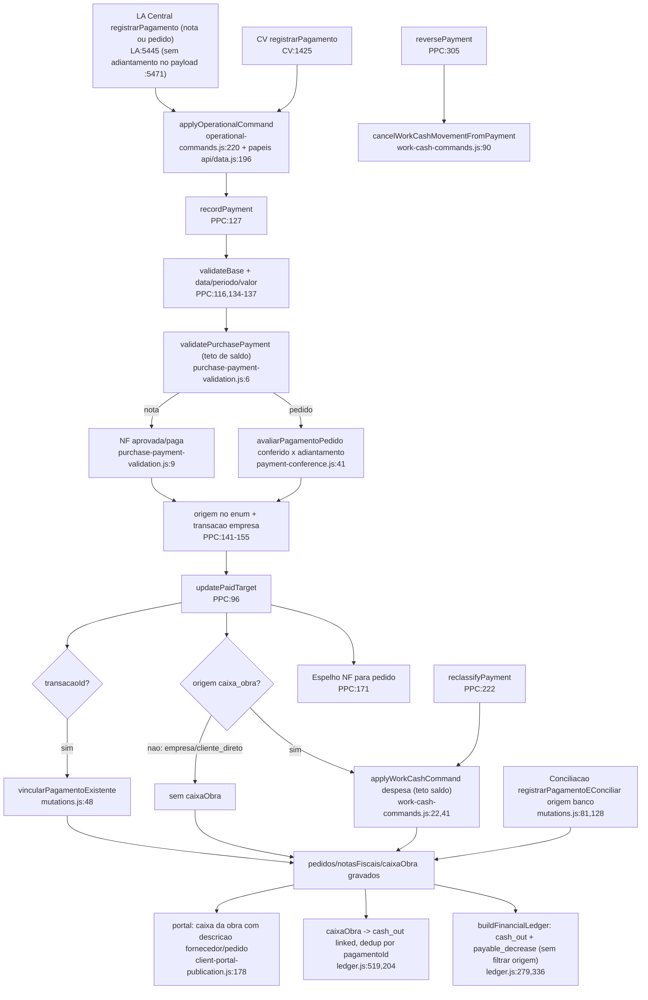

# F8 · pagamento-e-caixa-obra

Origem: subagente Flowchart da Fase 1 (somente leitura; nada executado). Abreviações: PPC = `src/domains/financeiro/payable-payment-commands.js`, CV = `src/domains/compras/components/ComprasView.jsx`, LA = `src/LegacyApp.jsx`, LDG = `src/domains/financeiro/ledger.js`.

## (a) Fontes lidas
- PPC 1-380 (inteiro). `financeiro/purchase-payment-validation.js` 1-14. `payables.js` 1-20. `work-cash-commands.js` 1-114. `work-cash.js` 1-28.
- `compras/payment-conference.js` 1-56. `compras/calculations.js` 1-110. `workflows.js` 1-120 (`analyzePurchaseThreeWayMatch` :36-72).
- CV 1370-1560 (registrarPagamento, reclassificar e estornar), 2100-2240 (por_pagador e financeiro), 2416-2421. Grep de origem em `src`.
- LA 2405-2434 (normalização de pedido), 5395-5502 (Central de pagamentos), registrarPagamento :5445.
- LDG 1-217, 258-360, 515-560, 560-742. `dre/calculations.js` 145-255.
- `conciliacao/mutations.js` 40-255. `compras/purchase-cancellation-command.js` 30-140.
- `sync/operational-commands.js` 215-285. `api/data.js` 160-210. `server/client-portal-publication.js` 175-206.
- Não lidos: `api/data.js` fora de 160-210 e as rotas, `selectors.js`, `existing-payment-link.js`, o modal de pagamento CV:2800-2810 (só grep), o espelho Supabase e o DRE server (`dre-projection`).

## (b) Achados

### B1. Caminho feliz, pedido (CV)
- A UI abre o modal por `abrirPagamento` (CV:1424). Origem inicial = `pedido.origemPagamento`, "empresa" por padrão.
- `registrarPagamento` (CV:1425-1477) valida no cliente: valor <= saldo (:1429); papel `canManagePurchases` (:1430); caixa ativado e saldo suficiente (:1433-1434); conferência e adiantamento (:1435-1438).
- O comprovante vai ao OneDrive (:1442-1448) e volta como `comprovantes[]` com url, path, legenda e enviadoPor.
- O comando `PAYABLE_PAYMENT_RECORDED` (:1457) leva: `targetType` "pedido" e `expectedVersion`; `payment`, com id gerado no cliente; `workCashMovementId` (uid se caixa_obra); workspace, adiantamento e motivoAdiantamento.
- Papéis do comando: admin, financeiro e compras (`api/data.js:196-198`). O comando entra em `applyOperationalCommand`, que chama `applyPayablePaymentCommand` (`operational-commands.js:256-265`) e grava um recibo de idempotência.

### B2. Caminho feliz, nota (Central de pagamentos, LA:5445-5482)
- Só admin e financeiro (`podeOperar`, :5447). A nota precisa estar aprovada ou paga (`validatePurchasePayment` :9). A UI também bloqueia o estado "conferencia" (:5450).
- A nota paga cria pagamento na nota. Se a nota tem `pedidoId`, cria também um espelho em `pedidos[].pagamentos` (PPC:171-180), com valor = min(valor, saldo do pedido) e `notaFiscalId`. O espelho não passa pela conferência.

### B3. Servidor `recordPayment` (PPC:127-220), na ordem das validações
1. `validateBase`: actor.id, obrigação existe e ativa, `expectedVersion` (PPC:116-125).
2. id do pagamento único em pedidos e notas (:134); data válida (:135); período fechado (:136); valor > 0 (:137).
3. `validatePurchasePayment` (:138). Para nota: status aprovada ou paga e valor <= saldo+0,01 (`purchase-payment-validation.js:9-11`). Para pedido: o mesmo teto e depois `avaliarPagamentoPedido` (:12).
4. Origem no enum {empresa, caixa_obra, cliente_direto} (PPC:27,141).
5. Se há `transacaoId`: só origem "empresa" (:145); a transação precisa existir, não estar conciliada, ser uma saída (valor < 0) e ter valor igual ao do pagamento (±0,02) (:146-154).
6. `caixa_obra` exige `obra.hasCaixa` e `workCashMovementId` (:158-161).
7. `buildPayment` (:84-94) grava: status "ativo", version 1; `registradoPorId`, `registradoPor`, `registradoEm`; `comprovantes` (array do cliente); `conciliado` = transacaoId e origem empresa; `transacaoId` zerado se a origem não for empresa.
8. `updatePaidTarget` (:96-114): nota → status "paga" ou "aprovada" e `transacaoId`; pedido → `pagamentos`, `origemPagamento` = origem do último pagamento, `liberadoEntregaEm/Por` quando quitado.
9. Origem `caixa_obra`: espelha em `caixaObra` via `applyWorkCashCommand(MOVIMENTO_CAIXA_OBRA_CRIADO)` (PPC:182-203). O movimento leva `pagamentoId`, `pedidoId`, `notaFiscalId`, documentos e tipo "despesa". O saldo é revalidado: despesa > `calculateWorkCash.saldo` falha (`work-cash-commands.js:41-43`). `efeitoDRE` "custo_obra" (:51).
10. Com transação: grava rateio automático na transação (PPC:205-210) e chama `vincularPagamentoExistente` (:211-216), que liga a transação e põe o status "conciliado" (`mutations.js:48-72`).

### B4. Conferência e adiantamento (`payment-conference.js`)
- `conferidoCents` = min(recebido, faturado, pedido) das 3 vias (:29). A tolerância é o máximo entre pedido × 2% e R$ 50 (:10,30), configurável em `configCompras.toleranciaConferencia`.
- `liberadoCents` = conferido + tolerância − já pago (:35).
- Pagamento <= liberado: tipo "conferido" (:45). Acima: exige `adiantamento===true` e motivo (:47-50), e papel em {admin, financeiro} (:11,51-53). O papel "compras" é recusado no servidor, mesmo que a rota o permita.
- O pagamento grava tipo, `motivoAdiantamento` e `conferidoNoPagamentoCents` (:54-55; PPC:166).
- A conferência só vale para pedido. A nota não passa por ela (`purchase-payment-validation.js:12`).
- **INCONSISTÊNCIA NOVA**: a Central de pagamentos (LA:5471-5475) NÃO envia `adiantamento` nem `motivoAdiantamento`. O pedido sem NF mostra "Confirma o pagamento antecipado?" (LA:5451), mas o servidor rejeita qualquer valor acima de ~R$ 50 ou 2%. Motivo: sem NF e sem recebimento, conferido = 0 (status "aguardando_recebimento_e_nf", `workflows.js:60-61`). O texto "pagamento antecipado" é enganoso: o adiantamento só é possível pelo CV:2806-2810 (modal de compras), e só para admin e financeiro.

### B5. Reclassificação (PPC:222-303, CV:1479-1513)
- Bloqueios: mesma origem é no-op (PPC:231); transação conciliada bloqueia, exceto quando a nova origem é "empresa" (:232-233); `caixa_obra` exige caixa ativado e movimento novo (:235-238).
- Não há checagem de período fechado na reclassificação (compare `reversePayment` :314). Também não checa o saldo do caixa no servidor, só o `applyWorkCashCommand` (despesa > saldo).
- Efeitos: cancela o movimento antigo do caixa via `cancelWorkCashMovementFromPayment` (status "estornado") (PPC:241-249); cria um novo se a nova origem for `caixa_obra` (:250-272); grava `origemAnterior`, `reclassificadoEm/PorId/Por` e `conciliado` recalculado (:274-279); em pedido, acrescenta ajuste auditável (:286-291) e sincroniza o espelho do pedido para nota (:293-301).
- Perda: ao sair de `caixa_obra`, o movimento antigo vira "estornado" com motivo "Origem do pagamento reclassificada.", mas o pagamento mantém só o último `origemAnterior` (sobrescrito numa segunda reclassificação).
- Falha: ao ir para "empresa" a partir de empresa conciliada, `conciliado` fica true com `transacaoId` mantido. Ao ir para `cliente_direto` ou `caixa_obra`, a `transacaoId` permanece no pagamento (`changedPayment` faz spread de `payment`, PPC:274-279), embora `buildPayment` a zere na criação (:88). Resíduo: `conciliado=false`, mas `transacaoId` preenchido e a transação continua "conciliada".

### B6. Estorno (PPC:305-368, CV:1515-1541)
- Exige motivo, período aberto e transação não conciliada (PPC:312-316). É lógico: status "estornado", `motivoEstorno`, `estornadoEm`, `estornadoPorId`, `estornadoPor` (:317-321).
- Cancela o movimento do caixa (:358-366). Recalcula nota ("paga" ou "aprovada") (:331) e `liberadoEntregaEm/Por` (:332-336). Acrescenta ajuste ao pedido (:337-341). Sincroniza o espelho do pedido (:343-357).
- O movimento do caixa não pode ser cancelado isoladamente: "Estorne o pagamento de origem" (`work-cash-commands.js:66`). Isso é bom.
- Cancelar o pedido (`purchase-cancellation-command.js:60-95`) estorna só pagamentos diretos (sem `notaFiscalId` e fora de `invoicePaymentIds`), cancela os movimentos do caixa e bloqueia se a transação estiver conciliada (:68-70). Esses pagamentos de pedido não ganham o motivo do cancelamento no PPC, só no campo `motivoEstorno` (:92).

### B7. Work-cash (`work-cash-commands.js`, `work-cash.js`)
- Dois comandos: criar (aporte ou despesa) e cancelar. Papel admin e financeiro (`api/data.js:194-195`).
- Teto de saldo: despesa > saldo+0,001 falha (:41-43). O saldo = Σ aportes − Σ despesas dos movimentos ativos (`work-cash.js:3-28`).
- Movimento nasce com `conciliado:false`, `transacaoId:""` (:49) e `efeitoDRE` "custo_obra" (despesa) ou "sem_efeito" (aporte) (:51).
- O pagamento de compra pelo caixa passa pelo PPC, que chama `applyWorkCashCommand` por dentro. Por isso um usuário "compras" cria uma despesa do caixa sem ter o papel do comando de caixa (`api/data.js:194` × 196). O ator do movimento é o do pagamento.
- `cancelWorkCashMovementFromPayment` é a única fronteira que cancela um movimento vinculado (:90-114).

### B8. S15, nomes remanescentes do gate de pagamento sobre recebimento: CONFIRMADA (resíduo semântico, sem efeito de bloqueio)
- O recebimento NÃO depende mais do pagamento. O comentário em CV:1543-1546 diz que o recebimento é independente, e o servidor não checa pagamento ao receber.
- Resíduos ainda ativos:
  - `calculations.js:51`: `pedidoLiberadoParaReceber = (statusPagamentoPedido === "pago")`. Um único consumidor: CV:2418, botão "Saldo em aberto · R$" que leva à aba financeiro. O nome induz a erro: é "quitado", não "liberado para receber".
  - `liberadoEntregaEm/Por`: escritos em PPC:110-111, 334-335 e 352-353. Persistidos no salvamento do pedido (CV:1398) e normalizados em LA:2422. Em nenhum lugar são lidos para bloquear nada (grep global: só escrita e normalização).
  - O botão "Receber na obra" na aba financeiro (CV:2162) só aparece com `st==="pago" && !recebido`, mas o recebimento é possível por outros caminhos sem pagamento.
  - Textos desatualizados em CV:390: "a entrega só será liberada após o financeiro registrar o pagamento". Também CV:2159: o rótulo "QUITADO / LIBERADO".
  - CV:2161 trata "recebido sem quitação" como "registro legado / inconsistência", contradizendo a regra atual (compra a prazo é normal).
- Efeito prático: confusão de interface e campos mortos persistidos no blob. Sem risco de integridade.

### B9. S8 (lado da F8; a F9 cobriu o extrato): PARCIAL, concordo com a F9
- Lado conciliação (`mutations.js:124-137`): `basePagamento` grava `origem` "banco" (:128), `conciliado` true, `comprovantes` [], sem `notaFiscalId` e sem `tipo` (a menos que a conferência o traga).
- Para nota (:139-154): o pagamento vai para a nota e para o pedido (:150), com o mesmo id mas sem `notaFiscalId` e com valor integral (sem min com o saldo do pedido).
- Teto de saldo: existe via `validatePurchasePayment` (`mutations.js:108-113`), que checa o saldo (`purchase-payment-validation.js:10-11`). Portanto "sem teto" é REFUTADO no teto do próprio documento.
- Lado F8 (PPC:27,141): o enum é {empresa, caixa_obra, cliente_direto}; "banco" é rejeitado. Origem "banco" CONFIRMADA fora do enum.
- Efeito colateral adicional: a normalização do cliente, LA:2417, converte QUALQUER origem diferente de `cliente_direto`/`empresa` em "caixa_obra" (`pg.origem==="cliente_direto"?...:pg.origem==="empresa"?...:"caixa_obra"`). Portanto o pagamento "banco" da conciliação é exibido em CV e LA como "Caixa da obra". Ele entra nos totais de caixa da obra (CV:919, 2277) sem ter movimento em `caixaObra` e sem saldo debitado. O servidor tem o dado "banco". O cliente re-normaliza e pode regravar "caixa_obra" se o pedido for salvo pelo fluxo de save genérico (não verificado se o save re-envia pagamentos; `purchase-order-commands.js:162` preserva `current.pagamentos`, então o normalizador de comando não reescreve a origem).
- Atenção: LA:2448 (outra normalização, coleção não identificada) usa o default inverso, "empresa". Origem inconsistente por coleção.
- Cancelamento (`purchase-cancellation-command.js:60-64`): o pagamento da conciliação em pedido, sem `notaFiscalId`, é tratado como direto. Se ligado a uma transação conciliada, bloqueia o cancelamento (:68-70). Coerente.

### B10. Como o pagamento chega ao DRE (competência × caixa)
- O pagamento NUNCA gera custo. O custo vem da NF: `cost` e `payable_increase` por rateio (LDG:324-335), na competência da NF. A DRE (`selectDRE`, LDG:633-656) soma só revenue/cost.
- O pagamento de nota gera `cash_out` + `payable_decrease` (LDG:336-353), com `metadata.origem` (:349). O pagamento de pedido SEM NF reconhecida gera `cash_out` com `unallocated:true` e issue `PAYMENT_UNALLOCATED` (:279-294). O pagamento não vira custo.
- O pedido gera `commitment_increase` (:275), e NF reconhecida reduz o compromisso (:278). Pagamentos de pedido cuja id ou `transacaoId` já estão numa nota reconhecida são ignorados, para não duplicar (:280-281).
- O DRE da obra (`dre/calculations.js:162-164`) expõe `pagamentosNaoAlocados` (cash_out unallocated) só informativo. `selectCashFlow` soma todos os `cash_out` por data (LDG:669-677). `dre/calculations.js:154`: `comprasCost = sumSource("nota_fiscal")`.
- Movimento do caixa: gera `cash_out` (despesa) ou `cash_in` (aporte) (LDG:519-535), `linked=true` se tiver `pagamentoId`, e portanto não cria custo extra (:549). Dedup contra o pagamento de nota por `sourceSubId = pagamentoId` (LDG:204-214): o mesmo valor gera dois eventos com ids diferentes mas a mesma chave `cash_out|pagamentoId|valor`. O segundo gera issue `DUPLICATE_TRANSACTION_EFFECT` e é descartado. Ordem de inserção: nota/pedido (:262-354) antes do caixa (:519), então o caixa é o descartado. O pagamento de pedido sem NF carrega `sourceSubId = paymentId` também; dedup igual.
- A issue tem severidade "warning" por padrão (`issue()`, LDG:166) e aparece em `dataIssues`; o resultado numérico fica certo.

### B11. Vínculo com o extrato bancário
- Na F8: o pagamento com origem "empresa" e `transacaoId` chama `vincularPagamentoExistente` (PPC:211). Antes, o PPC coloca rateio na transação (:205-210). O pagamento fica `conciliado:true`. A transação ganha status "conciliado" e `vinculo` {tipo, id, pagamentoId} (`mutations.js:57-60`), e um registro em `historicoConc` (:61-66). Validações extras: `validateExistingPaymentLink` (não lido).
- A UI do pedido oferece só transações sem uso: CV:2809 (apenas valor<0, 80 mais recentes, sem checar se já usadas; o servidor recusa se usadas PPC:148). LA:5441-5442: exclui transações já usadas e ignoradas (100 mais recentes).
- Desfazer a conciliação (`mutations.js:484-503`) marca o pagamento como estornado e solta a `transacaoId` da nota. Estorno e reclassificação pelo PPC são bloqueados enquanto a transação estiver conciliada (PPC:66-68,232,315).

### B12. Portal do cliente (F12)
- Pagamentos de compra NÃO são publicados: `server/client-portal-publication.js` (178-206) só expõe caixa da obra, com opt-in `publicarCaixaObra`: id, data, tipo, categoria, descricao, valor e saldo acumulado, os 40 mais recentes, e um resumo (aportes, despesas, saldo).
- **Vazamento indireto**: a descrição do movimento do caixa gerado por pagamento é "Pagamento do pedido PC-xxxx · NomeFornecedor" ou "Pagamento NF ... · Fornecedor" (PPC:192-194). Logo, com `publicarCaixaObra` ligado, o cliente vê número do pedido e nome do fornecedor das despesas pagas pelo caixa. Não vê comprovante, origem, adiantamento nem quem pagou (payload :188-195 só traz esses campos).
- Pagamentos com origem empresa ou `cliente_direto` não geram movimento no caixa e não aparecem no portal.

### B13. `cliente_direto`: o razão trata como saída de caixa da empresa? CONFIRMADO, SEM MITIGAÇÃO
- No fluxo F8: `cliente_direto` não gera movimento em `caixaObra` (só `caixa_obra` gera, PPC:182), não vincula transação (PPC:88,145) e fica só em `pagamentos[]` com origem. O pagamento é somado nos painéis de origem (CV:918-920, 2276-2278; `calculations.js:147-149`) e no filtro "Quem pagou" (LA:8708).
- No razão: não há nenhuma referência a "cliente_direto" em `ledger.js` (grep). Os dois blocos de pagamento (pedido LDG:279-294; nota LDG:336-353) emitem `cash_out` incondicional, com a origem só em metadata (:290,349). `selectCashFlow` soma todo `cash_out` (LDG:669-677). `dre/calculations.js` só filtra `metadata.pagador==="empresa"` para terceiros (:179-181), nunca para compras.
- Resultado: um pagamento de nota ou pedido feito diretamente pelo cliente aparece como saída de caixa da empresa (`saidasCaixa`, `saldoCaixa` em `dre/calculations.js:195`) e como baixa de contas a pagar (`payable_decrease`, LDG:352). Financeiramente correto para a baixa da obrigação (a dívida com o fornecedor foi extinta), mas o caixa da empresa fica subestimado, pois o dinheiro nunca saiu dela.
- O custo (DRE por competência) não é afetado: vem da NF.
- Não existe contrapartida de entrada/aporte para o `cliente_direto`. Nenhum evento `cash_in` de compensação nem metadata lida por quem agrega. O sistema evita a dupla contagem apenas porque `cliente_direto` não gera movimento em `caixaObra`.
- Outros efeitos da origem: bloqueia transação bancária (PPC:145). Não há prova no servidor de quem foi o pagador (nome do cliente) nem comprovante obrigatório. Lacuna: não lidos `selectors.js`/`existing-payment-link.js` nem as projeções do servidor (`financial-shadow`, `procurement-financial-facts.js:16`, que mapeia `cash_out` em settlements sem olhar origem; grep em `server/` não achou "cliente_direto").

### B14. Efeitos colaterais por comando (coleções e campos)
- RECORDED: `pedidos[].pagamentos` (+`origemPagamento`, `liberadoEntrega*`, version); `notasFiscais[].pagamentos`, status e `transacaoId`, mais o espelho no pedido; `caixaObra[]` (caixa_obra); `transacoes[]`: rateios, status "conciliado", vinculo, e `historicoConc` (se houver transação); `obras[].oneDrive*` (updateWorkspace, PPC:45-58); recibo de idempotência.
- RECLASSIFIED: `pagamentos[]` (origem, origemAnterior, reclassificado*), `caixaObra` (cancela e cria), `pedidos[].ajustes`, `origemPagamento`, versões.
- REVERSED: pagamento estornado, `caixaObra` estornado, `pedidos[].ajustes`, `nota.status`, `liberadoEntrega*`.
- Divergência de versão: o pagamento recebe `version:1` (PPC:91), mas a nota/pedido é verificado por `expectedVersion`, enviado pela UI como `vigente.version` (CV:1459, LA:5469).
- Quirk: o espelho do pagamento de nota no pedido tem valor diferente do original (`valor = min(...)`) e id igual; no estorno, `{...linked,...reversed,valor:linked.valor}` preserva o valor correto (PPC:347).
- Quirk 2: `totalPagoPedido` tem fallback legado: se não há pagamentos mas o pedido tem `transacaoId`, considera o pedido inteiro pago (`calculations.js:40-43`). Pedido legado com `transacaoId` fica "pago" sem registro de pagamento.
- Quirk 3: `updatePaidTarget` calcula `paid` com dois ramos idênticos (PPC:98-100): código redundante.

## (c) Fluxograma

## (d) Vereditos
- **S8: PARCIAL.** "Origem banco fora do enum": CONFIRMADA (`mutations.js:128` × PPC:27). "Sem teto de saldo": REFUTADA (`mutations.js:108-113` chama `validatePurchasePayment`). "Sem `notaFiscalId`": CONFIRMADA (`basePagamento` :124-137; espelho do pedido :150 sem `notaFiscalId` e sem min do saldo do pedido). Agravante novo: LA:2417 rebatiza "banco" como "caixa_obra" na leitura do cliente, o que contamina os totais de caixa sem movimento no `caixaObra`.
- **S15: CONFIRMADA** como resíduo de nomes e campos, sem efeito de bloqueio (`calculations.js:51`; PPC:110-111,334-335,352-353; LA:2422; CV:1398,2418; textos CV:390, 2159, 2161).
- **`cliente_direto`**: o razão o trata como saída de caixa da empresa — CONFIRMADO (LDG:279-294, 336-353; sem filtro de origem).
- **Adiantamento**: funciona no servidor só para admin e financeiro, via CV; a Central de pagamentos (LA) não consegue enviar adiantamento: inconsistência de UX/regra.
- **Estorno**: lógico e auditável; reclassificação tem lacunas (sem período fechado; resíduo de `transacaoId`).

## (e) Informação que se perde ou deixa de ser rastreável
- **Comprovante**: vive em OneDrive por URL (`comprovantes[]`). A normalização de LA:2419 descarta anexos sem url (`filter(a=>a.url)`). A reclassificação e o estorno não mexem nele; ao estornar, o comprovante fica no pagamento "estornado". Pagamentos da conciliação têm `comprovantes:[]` sempre (`mutations.js:133`). `cliente_direto` e `empresa` não exigem comprovante (PPC:90 aceita []). O caixa guarda só `comprovante[0].legenda` como texto (PPC:195).
- **Quem pagou**: registra-se o registrador (`registradoPorId/Por/Em`), não quem de fato pagou nem o pagador de `cliente_direto`. A origem "banco" some na leitura do cliente (vira `caixa_obra`).
- **Reclassificação**: `origemAnterior` guarda só a última origem (PPC:276). O histórico completo vive apenas em `pedidos[].ajustes` (só pedido) e nos movimentos de caixa estornados. Em NF não há ajuste (`appendAdjustment` só para pedido, PPC:286,337). Reclassificação de NF não deixa trilha além do campo `origemAnterior`.
- **Estorno**: o pagamento fica no array com motivo, mas `totalPagoNota/Pedido` o ignoram; o espelho de pedido para nota é sobrescrito com `{...linked,...reversed}`, o que perde qualquer dado próprio do espelho (o valor distinto é preservado explicitamente). O motivo do estorno do pagamento não vai para a transação do extrato (bloqueado se conciliado).
- **Adiantamento**: só dentro do pagamento (tipo, `motivoAdiantamento`). Não existe lista de adiantamentos nem baixa/regularização quando o recebimento e a NF chegam depois. `conferidoNoPagamentoCents` é um instantâneo.
- **`cliente_direto`**: sem pagador nominal e sem entrada espelhada no caixa/DRE.
- Os campos `liberadoEntregaEm/Por` perdem o sentido (S15).

## (f) Dependências externas
- OneDrive (Microsoft Graph) para o comprovante: `enviarArquivoOneDrive`, com update de `obras[].oneDrive*` via `payload.workspace` (PPC:45-58; CV:1444; LA:5460). A falha de upload aborta o pagamento antes do comando (CV:1445), mas o arquivo já enviado fica órfão se o comando falhar depois.
- Supabase/Postgres (`company_app_data`) pela rota `operational-command` (`api/data.js:2183`, não relido).
- Extrato bancário importado (`transacoes`) e módulo de conciliação (`mutations.js`).
- Papéis/sessão (`currentUser.role`) em CV:1430 e LA:5447 vs. servidor `api/data.js:196-198`.

## (g) Confiança e lacunas
- Alta: fluxo do PPC, conferência, work-cash, resíduos de S15, falta de tratamento de `cliente_direto` no razão e exposição do portal.
- Média: impacto de LA:2417 em dados persistidos (não verificado se o save genérico regrava a origem normalizada, nem a coleção de LA:2448); ordem de precedência do dedup do razão (inferida da ordem do código).
- Não lidos: `existing-payment-link.js` (`validateExistingPaymentLink`), `selectors.js`, `api/data.js` além de 160-210, `dre-projection`/`financial-shadow` no servidor, o modal CV:2800-2810, as demais telas que consomem origem (LA:8630-8730, 11804). Sem execução de testes ou do fluxo real.
- Fatos a verificar em produção, se possível: quantos pagamentos têm origem "banco" nos pedidos e notas, e se há pedidos legados com `transacaoId` sem `pagamentos[]` (fallback `calculations.js:42`).

## Verificação do orquestrador (a preencher)
- `cliente_direto` superestimando `saidasCaixa`: reproduzir por execução do razão.
- Adiantamento rejeitado na Central de pagamentos: reproduzir com `recordPayment` (pedido sem NF/recebimento, valor > tolerância, sem `adiantamento`).
- Origem "banco" → "caixa_obra" na normalização (`LegacyApp.jsx:2417`): confirmar lendo o código.
