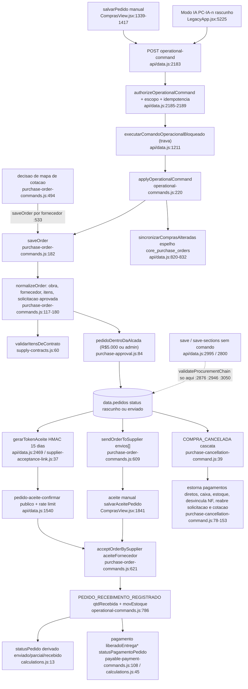

# F4 · pedido-envio-aceite-cancelamento

Origem: subagente Flowchart da Fase 1 (somente leitura; nada executado). Raiz: worktree `keen-sammet-1078d2`.

## (a) Fontes consultadas
- `PATHFINDER-2026-10-26/00-features.md` 1-146
- `src/domains/compras/purchase-order-commands.js` 1-770 (inteiro); `order-dispatch.js` 1-62 (inteiro); `calculations.js` 1-187 (inteiro); `purchase-cancellation-command.js` 1-186 (inteiro); `purchase-approval.js` 1-88 (inteiro); `supply-contracts.js` 1-139
- `workspace.js` 38-82; `budget-tracking.js` 1-102
- `server/supplier-acceptance-link.js` 1-133 (inteiro); `server/procurement-chain-policy.js` 1-70 (inteiro); `server/section-authorizations.js` 1-295 (inteiro); `server/permission-policies.js` 1-12
- `src/domains/financeiro/ledger.js` 10-39 e 258-300; `payable-payment-commands.js` 98-115
- `src/domains/sync/operational-commands.js` 128-340 e 780-842
- `api/data.js` 760-848, 1211-1241, 1530-1599, 2170-2310, 2460-2490, 2800-3090; grep de pontos de chamada (linhas 36-56, 199-232, 287, 306-329, 820, 1513, 2020, 2064)
- `ComprasView.jsx` 1372-1420, 1605-1680, 1800-1900, 2336-2425; `LegacyApp.jsx` 5215-5241 (Modo IA)
- Só grep: `liberadoEntrega*`, `PURCHASE_ORDER_CREATED_FROM_QUOTE`, `statusPedido(`, `PC-IA`.

## (b) Achados

### Caminho feliz, com funções e call sites
1. **Criação.** Quatro origens.
   - Manual: `ComprasView.jsx:1383-1417` monta `p` e despacha `PURCHASE_ORDER_SAVED` com `expectedVersion:0` (1411-1415).
   - Pedido por solicitação: `ComprasView.jsx:1319`, `status:"enviado"`.
   - Mapa de cotação: `decideQuoteMap` (`purchase-order-commands.js:494-567`) chama `saveOrder` uma vez por fornecedor vencedor, com `siblingQuoteId` (533).
   - Modo IA: `LegacyApp.jsx:5225-5231`, rascunho.
   - Todas passam por `applyPurchaseOrderCommand` (752-769), encadeado em `operational-commands.js:304-313`, que acrescenta o recibo de idempotência (156-162, guarda só os últimos 2000).
2. **`saveOrder`** (`purchase-order-commands.js:182-245`):
   - Versão otimista (188-194). Edição exige `adjustmentReason` (195).
   - Novo fornecedor e novos insumos embutidos no pedido (198-206).
   - `normalizeOrder` (117-180) valida obra, fornecedor, data, período fechado (125), itens (76-115) e solicitação.
   - O pedido novo só nasce de solicitação aprovada (135-140). Uma solicitação gera um pedido, salvo irmãos do mesmo mapa (141-146).
   - Contrato de fornecimento: `validarItensDeContrato` (168; `supply-contracts.js:60-89`).
   - Número único entre pedidos "ativos" (170-174). O total não pode ficar abaixo do pago (175-178).
   - Alçada em 210-215. Grava `version`, autoria e `ajustes[]` (216-228).
   - Marca a solicitação como `pedido_gerado` e preenche `pedidoId` e `pedidoIds` (229-235).
3. **Alçada** (`purchase-approval.js:84-88`): papel `admin` passa sempre; total até o limite (padrão R$ 5.000, `configAprovacao.limiteEngenheiroCompra`) passa; acima disso exige instância de aprovação `aprovada` com etapa de administrador concluída, ou política própria da empresa (74-80).
4. **Envio.** `registrarEnvioPedido` (`ComprasView.jsx:1809-1820`) despacha `PURCHASE_ORDER_SENT_TO_SUPPLIER`. `sendOrderToSupplier` (`purchase-order-commands.js:609-619`): recusa rascunho e cancelado (`orderForSupplierAction`, 596-603); canal em `whatsapp|email|impresso` (`order-dispatch.js:5`); acrescenta `envios[] = {id, canal, destino, enviadoEm, enviadoPor...}`. **O status do pedido não muda.** O rascunho vira "enviado" por outro caminho: salvar de novo com `status:"enviado"` (`purchase-order-commands.js:156-158`; `ComprasView.jsx:1882-1886`).
5. **Aceite manual.** `salvarAceitePedido` (`ComprasView.jsx:1841-1856`) despacha `PURCHASE_ORDER_SUPPLIER_ACCEPTED`. `acceptOrderBySupplier` (`purchase-order-commands.js:621-644`): aceite único (624); nome obrigatório e data até hoje (629-630); canal em `whatsapp|email|telefone|presencial|documento|link` (`order-dispatch.js:6`); o prazo confirmado vira `previsao` e a anterior vai para `previsaoAnterior` (637-638); grava `aceiteFornecedor{nome,data,canal,previsaoConfirmada,observacao,registradoPor...}`.
6. **Aceite por link público assinado.**
   - Geração: `api/data.js:2469-2479`. Exige papel `admin` ou `compras` (`supplier-acceptance-link.js:97-98`) e `linkAceiteDisponivel` (101). `gerarTokenAceite` (37-42): HMAC-SHA256 com `PEDIDO_ACEITE_SECRET` ou chave derivada de `SUPABASE_SERVICE_ROLE_KEY` (18-24), validade de 15 dias (12). Nada é gravado no banco. A URL é montada em `ComprasView.jsx:1828` como `/aceite-pedido#token`.
   - Uso público: `api/data.js:1540-1588`, ações `pedido-aceite-ver` e `pedido-aceite-confirmar`. Limite de tentativas por IP (`rateLimitCentral`, 1541-1543). Token inválido ou vencido não lê a base (1546-1549). `avaliarAcessoAceite` (`supplier-acceptance-link.js:104-113`) confere a impressão digital. O "ver" devolve `visaoPublicaPedido` (73-94), sem pagamentos, CNPJ nem observações. O "confirmar" exige `POSTGRES_URL_NON_POOLING` (1563), reavalia o token sobre a linha travada (1568-1572), monta o comando com `actorId="fornecedor:<id>"`, `actorRole:"fornecedor"` e `idempotencyKey` fixa por pedido e impressão (`supplier-acceptance-link.js:116-132`), executa `applyOperationalCommand` (`api/data.js:1574`) e depois `sincronizarPedidoAoVivo` (1584).
   - A impressão digital (`supplier-acceptance-link.js:26-33`) cobre `id`, `fornecedorId` e, por item, `id`, `materialId`, `qtd` e `precoUnit`. **Mudar `previsao`, `obs`, `origemPagamento` ou contrato não invalida o link.**
7. **Recebimento.** `PURCHASE_RECEIPT_RECORDED` (`operational-commands.js:786-838`): recusa pedido cancelado ou rascunho (790); valida saldo por item (808); soma `qtdRecebida` e anexa `recebimentos[]` (820-823); acrescenta entradas em `movEstoque` (837); recalcula `precoMedio`, `ultimoPrecoCompra` e `ultimaUnidadeCompra` (825-835). **Não toca em `pedido.status`.** Não exige pagamento prévio (comentário em `ComprasView.jsx:1889`).
8. **Pagamento** (fora do escopo de F4; F8). O que F4 usa dele: `totalPagoPedido` soma `pagamentos` ativos; sem eles, `transacaoId` preenchido conta como o total (`calculations.js:40-43`); `statusPagamentoPedido` devolve `cancelado|sem_valor|pago|parcial|pendente` (45-50); quando quita, `payable-payment-commands.js:108-113` grava `liberadoEntregaEm/Por` e `origemPagamento`.
9. **Encerrado.** Não existe estado gravado "encerrado". O fim do ciclo é a combinação derivada `statusPedido==="recebido"` com `statusPagamentoPedido==="pago"`. O alerta `recebidosSemQuitar` (`calculations.js:123-124`) cobre a divergência entre as duas.
10. **Servidor após o comando** (`api/data.js:2183-2243`):
    - Papéis em 168-232: `PURCHASE_CANCELLED` para `admin|financeiro|compras` (199); os demais comandos de pedido e cotação para `admin|compras` (215-232).
    - `validateOperationalCommandScope` (2188). Chave idempotente `[a-zA-Z0-9_-]{16,200}` (2187).
    - Execução sob trava (`executarComandoOperacionalBloqueado`, 1211-1241, só com `POSTGRES_URL_NON_POOLING`, 2197).
    - Espelho `sincronizarComprasAlteradas` (820-832): upsert de `purchase_requests`, `core_quotations` e `core_purchase_orders` para todo registro que mudou no diff (`JSON.stringify` antes e depois). Melhor esforço: erro só vira `console.error` (771-818).
    - Resposta com `projectChangedSectionsPatch` (2235-2238).
    - Auditoria: `before/after = {command, entityId}` e `{command, idempotencyKey}` (1236-1237; 2265-2266). **Não grava o conteúdo alterado.**

### Cancelamento em cascata (`COMPRA_CANCELADA`, `purchase-cancellation-command.js:39-185`)
Chamado por `cancelarPedido` (`ComprasView.jsx:1609-1635`) e por `excluirCompraDefinitivamente` (1652-1679). Os dois enviam o mesmo comando.

Pré-condições: pedido existente e não cancelado (46-50); versão igual à esperada (51); motivo preenchido (54-55); período financeiro da data do pedido aberto (56); pagamentos diretos (sem `notaFiscalId` e fora dos pagamentos de NF, 60-64) não podem estar em transação com `status==="conciliado"` (68) nem em período fechado (71).

O que é estornado ou ajustado:
- **Pagamentos diretos** do pedido: viram `status:"estornado"` com `motivoEstorno`, autor e data (91-95).
- **Caixa da obra:** o movimento ligado ao pagamento é cancelado por `cancelWorkCashMovementFromPayment` (79-88); os demais movimentos do pedido sem `notaFiscalId` viram `estornado` (106-112).
- **Estoque:** os `movEstoque` do pedido (`movementOfOrder`, 18-23) ficam `status:"cancelado"` (96-100); se isso deixar saldo negativo porque o material já foi consumido, o cancelamento falha (28-34, 101-103); o `precoMedio` dos insumos afetados é recalculado por `custoMedioPonderado` (170-176).
- **Notas fiscais:** `pedidoId` vira `""` e a mensagem "pedido X cancelado" entra em `divergencias` (113-121).
- **Solicitação:** se não resta pedido irmão vivo, volta a `status:"enviada"`, com `pedidoId` vazio e `analisadoEm/Por` apagados (128-137); se resta, o primeiro irmão vivo vira `pedidoId` (133).
- **Cotação:** mapa de vários itens → remove só as decisões deste pedido, recalcula `economia` e reabre (`status:"aberta"`) (139-147); cotação simples → reabre e limpa `escolhida`, quem decidiu e `justificativaEscolha` (148-152).
- **Pedido:** `status:"cancelado"`, `canceladoEm/Por`, `motivoCancelamento` e `impactoCancelamento{pagamentos, valorPago, recebimentos, movimentosEstoque, movimentosCaixa, notasFiscais}` (154-167).
- **Razão:** `active()` trata `cancelado` como inativo (`ledger.js:15-34`), então o compromisso do pedido (`ledger.js:262-275`) some.
- **Link de aceite:** passa a "indisponível" (`supplier-acceptance-link.js:64`).

O que o cancelamento **não** desfaz ou valida (confirmado no código):
- Pagamentos das NFs (`invoice.pagamentos`) seguem ativos. A NF só é desvinculada do pedido.
- `reconciliationLinks` não é tocado.
- Não chama o comando de estorno de pagamento de `payable-payment-commands`. Estorna o item no próprio pedido e o caixa. O efeito em `outrasDesp` ou na transação bancária não aparece neste arquivo (lacuna).
- `qtdRecebida` e `recebimentos[]` dos itens permanecem. O pedido cancelado "parece" ter recebido.
- `ultimoPrecoCompra`, `ultimaUnidadeCompra` e `ultimoFatorConversao` do insumo não são revertidos (gravados em `operational-commands.js:831-835`).
- Não há `changeLog` (`cancelQuote` tem, `purchase-order-commands.js:670-675`).
- A UI de `cancelarPedido` bloqueia se houver recebimento (`ComprasView.jsx:1611-1615`), mas `excluirCompraDefinitivamente` não tem essa trava. Quem decide é o servidor: cancela se o estoque ainda não foi consumido.
- Cotação cancelada: `cancelQuote` (646-681) tira `cotacaoId` do pedido e remove o id de `cotacaoIds` das solicitações.

### Tabela de STATUS do pedido
Valores **gravados** em `pedido.status` e quem os escreve:

| Valor gravado | Quem grava | Observação |
|---|---|---|
| `rascunho` | `normalizeOrder` com `raw.status==="rascunho"` (`purchase-order-commands.js:156-158`); Modo IA `LegacyApp.jsx:5225` | Só pode virar `enviado`. |
| `enviado` | Padrão para pedido novo (158); `createFromQuote:464`; `decideQuoteMap:520`; `ComprasView.jsx:1319`; rascunho promovido (157) | Não volta a rascunho (comentário 154-155). |
| `cancelado` | `purchase-cancellation-command.js:163` | Terminal. `saveOrder` recusa edição (192-194). |
| `parcial`, `recebido` | **Nenhum código atual grava** (o recebimento só mexe em `qtdRecebida`, `operational-commands.js:820-823`) | Podem existir só em dado legado. Os consumidores os aceitam por compatibilidade (`budget-tracking.js:15`, `ledger.js:27`). |
| `aprovado`, `emitido`, `pago`, `entregue` etc. | Ninguém | Constam em `ledger.js:27` como aceitos, mas nunca são gravados. |

Valor **derivado** por `statusPedido()` (`calculations.js:13-18`): `cancelado` e `rascunho` passam direto; os demais usam a soma das quantidades dos itens (soma bruta de `qtd`, sem ponderar por unidade ou valor): `recebido<=0` dá `enviado`; `recebido>=total-1e-6` dá `recebido`; senão `parcial`. `STATUS_PEDIDO` (7-11) tem só esses cinco rótulos. Gravado `enviado` pode aparecer como `parcial` ou `recebido`; rascunho e cancelado coincidem.

Quem usa **qual** (esta divergência é o risco):

| Consumidor | Lê | Local | Efeito |
|---|---|---|---|
| UI de pedidos (badge, botões Receber, Enviar, Aceite, Ajustar) | derivado | `ComprasView.jsx:2347`, 2415-2423 e 900, 1002, 1034, 1601, 2077, 2137, 2275 | Pedido totalmente recebido some das ações e do "Ajustar compra". |
| `workspace.js` (fila) | derivado | 64-66 | Exclui `recebido`. |
| `mapaGerencialCompras` | **misto** | `calculations.js:107` e 114 (bruto: cancelado e rascunho); 124, 154, 157 (derivado) | Consistente hoje, porque cancelado e rascunho coincidem. |
| `by-work.js` | derivado | 37, 55, 56 | `COMPROMETIDO` e `A_RECEBER` aplicados ao derivado (conjuntos não lidos). |
| `LegacyApp.jsx:12633` | derivado | `["enviado","parcial"]` | Lista de pedidos para recebimento. |
| `calcOrcadoComprado` (orçado × comprometido) | **gravado** | `budget-tracking.js:15, 65-71` | `COMPROMETIDO={enviado,parcial,recebido}`. Pedido com status gravado fora do conjunto (ex.: legado `aprovado`) vai para `previsto` em vez de comprometido. |
| Razão (`ledger.js`) | **gravado** (`statusOf`) | 262-264 | Status vazio é aceito. Status fora de `APPROVED_ORDER` (27) é ignorado. `rascunho` e `cancelado` são inativos (15-21, 34). |
| `orderAlive`, `sendOrderToSupplier`, `saveOrder` | gravado | `purchase-order-commands.js:41, 157, 601` | |
| Contratos de fornecimento | gravado | `supply-contracts.js:20` (`pedidoVivo`) | **Rascunho consome saldo do contrato.** |
| Link de aceite | gravado | `supplier-acceptance-link.js:64-67` | Exige `enviado` ou `parcial` gravado. Pedido já recebido por inteiro, mas gravado `enviado`, ainda aceita link e aceite. `acceptOrderBySupplier` não olha o recebimento. |
| Recebimento | gravado | `operational-commands.js:790` | |

### Efeitos colaterais (coleções e campos)
`pedidos[]` (`version`, `ajustes`, `envios`, `aceiteFornecedor`, `documentos`, `previsaoAnterior`, `cancelado*`, `impactoCancelamento`); `solicitacoesCompra[]` (`status`, `pedidoId`, `pedidoIds`, `analisadoEm/Por`); `cotacoes[]` (`status`, `decisoes`, `pedidoIds`, `economia`); `materiais[]` (novos insumos e preços); `fornecedores[]` (novo fornecedor embutido); `movEstoque[]`, `caixaObra[]`, `notasFiscais[]` (no cancelamento); `operationalCommandReceipts[]`; `changeLog` (só `cancelQuote`); espelho `core_purchase_orders` por `sincronizarPedidoAoVivo` (`api/data.js:806-818`); auditoria `audit_log` com comando e id da entidade; trava de linha `executarComandoOperacionalBloqueado` (1211) e `executarMutacaoEmpresaBloqueada` (1038, usada no aceite público).

## (c) Fluxograma

## (d) Veredito das hipóteses

**S10 — PARCIAL** (confirmada no lado servidor/comando; os `update()` diretos da UI não foram verificados).
- Pedido sem `solicitacaoId`: `normalizeOrder` só consulta a aprovação se houver solicitação (`purchase-order-commands.js:128-140`). Sem solicitação, `instanciaDaSolicitacao` devolve `null` (`purchase-approval.js:68-70`). O único controle passa a ser a alçada por valor (`purchase-order-commands.js:210-215`): até R$ 5.000 o papel `compras` cria sozinho, sem solicitação nem cotação. A falta de cotação é só um alerta (`calculations.js:120, 175`).
- Não há alçada cumulativa em pedidos manuais. `decideQuoteMap` soma os pedidos do mapa (508), mas vários pedidos manuais de R$ 5.000 não se somam.
- A alçada só é checada ao criar ou ao aumentar o total (211). Mudar fornecedor ou itens mantendo o total não reavalia; promover rascunho a enviado também não.
- Instância aprovada sem teto de valor: `aprovadaAcimaDaAlcada` (`purchase-approval.js:74-80`) devolve `true` com qualquer aprovação do Administrador ou com política própria da empresa. O pedido não é comparado com `valorAprovado` da instância (gravado em `purchase-approval.js:59`). Uma solicitação aprovada pelo administrador com estimativa de R$ 6.000 pode gerar pedido de qualquer valor.
- `saveQuote` não verifica a aprovação (`purchase-order-commands.js:409-443`), mas o pedido gerado a partir dela é barrado na criação (136).

**S11 — CONFIRMADA.**
- `LegacyApp.jsx:5225` numera `PC-IA-${pedidos.length+1}` no cliente. O servidor só auto-numera quando o número vem vazio (`purchase-order-commands.js:186-187`).
- O teste de unicidade (170-174) usa `active()`, que considera `rascunho` inativo (`ledger.js:18, 34`). Dois rascunhos com o mesmo `PC-IA-n` passam.
- A colisão exige dado desatualizado ou dois operadores simultâneos, porque `pedidos` só cresce.
- O Modo IA também cria um insumo `IA-nnnn` novo a cada documento (`LegacyApp.jsx:5224`), usa `solicitacaoId:""` e `transacaoId:""`, e deixa `valorBruto` vazio virar preço 0 (`Number("")`, aceito em `purchase-order-commands.js:92`).
- O prefixo `PC-IA` não entra no regex de `proximoNumero` (`calculations.js:25`, só `PC-nnn`).

**S15 — CONFIRMADA.**
- `liberadoEntregaEm/Por` ainda são escritos em `payable-payment-commands.js:110-111, 334-335, 352-353` e reenviados em `ComprasView.jsx:1398` e `LegacyApp.jsx:2422`.
- Nenhum código de produção lê esses campos como condição. O recebimento não depende de pagamento (`operational-commands.js:790-808`; comentário em `ComprasView.jsx:1889`).
- `pedidoLiberadoParaReceber` (`calculations.js:51`) só decide mostrar o botão "Saldo em aberto" em `ComprasView.jsx:2418`. O nome sugere um gate que não existe.
- O filtro "liberados" (`ComprasView.jsx:908, 916`) significa "pago e não recebido".

**S16 — CONFIRMADA** (sem chamador de UI; ainda alcançável pela API).
- Nenhum arquivo de produção em `src/` referencia `PURCHASE_ORDER_CREATED_FROM_QUOTE`. O teste `src/LegacyApp.quote-map-wiring.test.js:28` até afirma que Compras não o usa.
- O comando continua autorizado para `admin|compras` (`api/data.js:225`), listado entre os comandos travados (322) e roteado em `purchase-order-commands.js:756`.
- `createFromQuote` (445-487) lê só `propostas[].precoUnit` e `quote.materialId/qtd` (formato de cotação de item único). Num mapa de vários itens (`propostas[].precos`) cai em "ao menos duas propostas válidas" (453).
- Risco: uma requisição forjada contorna o fluxo `decideQuoteMap`, mas passa por `saveOrder`, então valida alçada e aprovação.
- `server/purchase-quote-order-live-write.js:20` só aparece em comentário (não lido).

**S17 — CONFIRMADA.**
- `validateProcurementChain` só roda em `save-sections` (`api/data.js:2875-2878` com trava, 2945-2948 sem trava) e em `save` (3049-3052). Não aparece no caminho `operational-command` (2183-2301), no aceite público (1540-1588) nem em `executarComandoOperacionalBloqueado` (1211-1241).
- Os comandos validam por conta própria os vínculos que tocam (obra, solicitação, cotação em `normalizeOrder` 122-150), mas não a cadeia inteira. O `cancelQuote`, por exemplo, não valida.
- Coleções de compras ainda graváveis por `save` e `save-sections` (`section-authorizations.js:16-17, 20`): `solicitacoesCompra` (`admin|compras|engenheiro|engenheiro_auditor`), `pedidos` (`admin|compras|financeiro`), `cotacoes` (`admin|compras`); `fornecedores`, `materiais`, `estoque`, `movEstoque` e `notasFiscais` também.
- Essas rotas só impedem exclusão física de `pedidos`, `cotacoes`, `notasFiscais`, `movEstoque` e `pagamentos` de pedido (`section-authorizations.js:66-69, 170-208`). Cancelamento exige `motivoCancelamento` (115-127).
- Elas **não** conferem: `version` (a concorrência é por mesclagem de três vias, não por `expectedVersion`); alçada, aprovação, saldo de contrato ou teto de recebimento; consistência de `status`, `aceiteFornecedor`, `envios`, `qtdRecebida` ou preços.
- O espelho `sincronizarComprasAlteradas` não é chamado em `save` nem em `save-sections` (as chamadas estão em 2020, 2064 e 2209). Se o ambiente estiver sem `POSTGRES_URL_NON_POOLING`, o ramo de fallback do comando (2253-2301) também não espelha.
- `validateFinancialWritePath` não foi lido e pode bloquear parte dos campos financeiros quando `FINANCIAL_ENGINE_ENFORCE` está ligado.

## (e) Informação que se perde ou deixa de ser rastreável
- **Histórico de alterações (`ajustes[]`, `purchase-order-commands.js:222-227`)** guarda motivo, autor, hora, `totalAnterior` e `totalNovo`. Não guarda o que mudou: itens, preços, quantidades, fornecedor, previsão e observações anteriores ficam irrecuperáveis. O `resumo` é um texto fixo.
- **Edição em pedido enviado** só pede motivo (195). Para a mudança de rascunho a enviado, o motivo é um texto fixo gerado pelo cliente (`ComprasView.jsx:1884`). Não há `enviadoEm` do pedido, só o histórico `envios[]`.
- **Aceite obsoleto.** O aceite persiste através de edições (`...current`, `purchase-order-commands.js:152`). Se preço ou quantidade mudarem depois, `aceiteFornecedor` continua indicando o aceite das condições anteriores (a UI mostra "ACEITO", `ComprasView.jsx:2371`), embora o link tenha sido invalidado pela impressão (`supplier-acceptance-link.js:26-33`). Não há marca de "aceite desatualizado".
- **Envio sem snapshot.** `envios[]` guarda canal, destino, autor e hora, mas não a versão, os itens nem o total enviados (610-618). Não dá para provar o que o fornecedor recebeu.
- **Aceite pelo link** registra o nome digitado pelo fornecedor e `fornecedor:<id>` como ator. Não guarda IP nem agente (o IP é usado só no limite de tentativas, `api/data.js:1541`).
- **Cancelamento.** Sobra o motivo e as contagens em `impactoCancelamento` (154-161), sem ids nem valores dos movimentos desfeitos. Perdem-se: a justificativa de escolha da cotação, quem decidiu e `escolhida` (148-152); `analisadoEm/Por` da solicitação (135); o vínculo original `notaFiscalId.pedidoId` (113-121; só o texto em `divergencias` permanece); os campos de último preço de compra do insumo, que não revertem.
- **Documentos anexados.** `attachDocument` (569-591) é só de acréscimo e não confere se o pedido está cancelado. Não existe comando de remoção.
- **Auditoria técnica.** `audit_log` registra só `{command, entityId}` e `{command, idempotencyKey}` (`api/data.js:2265-2266`). O diff do pedido depende do `ajustes[]` e dos campos do próprio registro.

## (f) Dependências externas
- Supabase / Postgres: linha `company_app_data`, `core_purchase_orders`, `core_quotations`, `purchase_requests`, `audit_log`. Conexão direta via `POSTGRES_URL_NON_POOLING` para trava e aceite.
- Segredos: `PEDIDO_ACEITE_SECRET` (mínimo 32 caracteres) ou `SUPABASE_SERVICE_ROLE_KEY`.
- `rateLimitCentral` para o aceite público.
- Canais de envio (WhatsApp, `mailto:`, impressão/PDF do navegador) são do cliente, sem integração de servidor (`order-dispatch.js:20-62`).
- Gemini (Modo IA) e pasta do Drive/OneDrive para os documentos (`LegacyApp.jsx:5239`).
- Motor de aprovações `arcdApprovalEngine` (`purchase-approval.js:7`).

## (g) Confiança e lacunas
- Alta: caminho feliz pelos comandos; tabela de status gravado × derivado; cascata de cancelamento (arquivo lido inteiro); S11, S15, S16, S17.
- Média: S10 (confirmada no servidor; os `update()` diretos da UI, `ComprasView.jsx:1256-1294`, não foram lidos).
- Não lido: `ModalPedido` (`ComprasView.jsx:292`) e o resto do render de pedidos (2426-2470); `by-work.js` (só as linhas de chamada de `statusPedido`, sem os conjuntos `COMPROMETIDO` e `A_RECEBER`); `salvarComAuditoria` (`api/data.js:669`) e o conteúdo do `audit_log`; `validateFinancialWritePath` e `FINANCIAL_ENGINE_ENFORCE`; `buildPurchaseOrderLiveRow` e `server/purchase-quote-order-live-write.js`; `src/api.js` (`gerarLinkAceitePedido`) e a página `/aceite-pedido`; o comando de estorno de pagamento (fora das linhas 98-115) e o efeito de estornar sobre `transacoes` e `outrasDesp`.
- Inferência não confirmada por código: `transacaoId` é repassado por `...raw` em `normalizeOrder` (152), e `totalPagoPedido` o trata como "pedido pago" (`calculations.js:42`). Pelo código, uma requisição forjada de edição poderia injetar `transacaoId`, `aceiteFornecedor` ou `envios`. A UI não os envia na edição (`ComprasView.jsx:1383-1406`). Não testado em execução.

## Verificação do orquestrador (a preencher)
- Confirmar por execução: pedido enviado e recebido por inteiro continua com `status` gravado "enviado" (e aceita link/aceite); cancelamento deixa `qtdRecebida`; rascunho consome saldo de contrato (`supply-contracts.js:20`).
- S10: confirmar que a alçada não é reavaliada ao promover rascunho a enviado.
