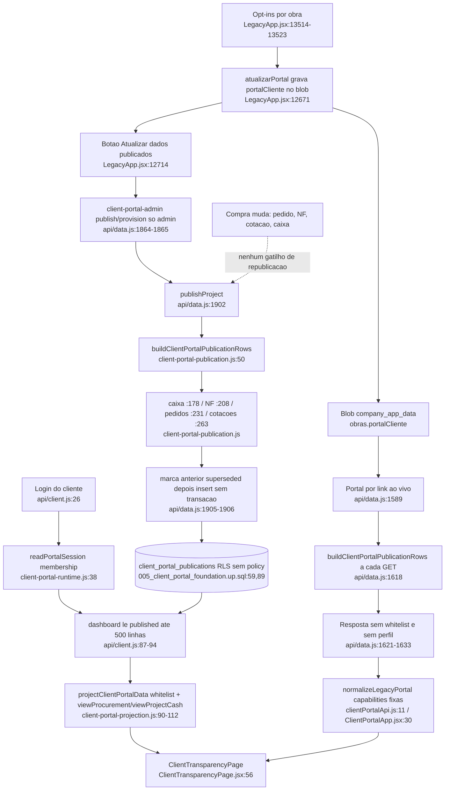

# F12 · portal-do-cliente-transparencia

Origem: subagente Flowchart da Fase 1 (leitura estática, nada executado). Caminhos relativos à raiz do repositório. Status das verificações do orquestrador no fim do arquivo.

Resumo do subagente: o opt-in por obra e a fronteira de campos estão corretos; foram achados (1) cotação cancelada publicada ao cliente (S2), (2) dois portais com frescor diferente (S4) e (3) publicação não atômica e sem republicação automática.

## (a) Fontes consultadas
`PATHFINDER-2026-10-26/00-features.md`; `server/client-portal-publication.js` 1-334; `server/client-portal-projection.js` 1-112; `server/client-portal-policy.js` 1-28; `server/client-portal-runtime.js` 1-60; `server/client-portal-inventory.js` 1-34; `api/client.js` 1-121; `api/data.js` 1580-1640, 1745-1804, 1855-1940 (pontos de `client_portal` por grep); `migrations/005_client_portal_foundation.up.sql` 1-93; `src/LegacyApp.jsx` 1490-1520, 12665-12735, 13440-13550 (e 17156 só por grep); `src/client-portal/services/clientPortalApi.js` 1-60, `pages/ClientTransparencyPage.jsx` 1-70, `app/ClientPortalApp.jsx` 1-32; para status: `src/domains/financeiro/invoice-commands.js` 15-44, `compras/purchase-order-commands.js` 640-700, `compras/purchase-cancellation-command.js` 84-134. Não lidos: docs do portal (não existem), testes `client-portal-*.test.js`, `src/api.js:217` (só grep), `ClientPortalRouter`/`ClientDashboard`.

## (b) Achados

### Caminho feliz
1. O admin liga os opt-ins na aba "portal" da obra (`LegacyApp.jsx:13514-13523`); cada caixa chama `atualizarPortal` (`:12671-12674`), que grava `obra.portalCliente.{publicarCaixaObra|NotasFiscais|Compras|Cotacoes}` no blob. Padrão `false` nos quatro (`:1503-1506`); cronograma, fotos e documentos são `!== false` (ligados por padrão).
2. "Atualizar dados publicados" (`publicarPortalSeguro`, `:12714-12722`) ou "Criar ou atualizar acesso" (`cadastrarAcessoPortal`, `:12694-12703`) chamam `client-portal-admin` em `api/data.js` (só `role==="admin"`, `:1865`); `publish` roda `publishProject` (`:1902-1908`); `provision` cria usuário/senha/membership e depois `publishProject` (`:1913-1932`). Roteador do cliente em `src/api.js:217`.
3. `publishProject` (`api/data.js:1902-1908`) monta `buildClientPortalPublicationRows({data:atual,...})` sobre o dataset completo filtrado por `obraId`; marca as linhas `published` da obra como `superseded` (`:1905`) e insere novas com `visibility:"project_users"`, `published_by`, `published_at=now` (`:1906`).
4. Login do cliente em `api/client.js:26-55` (e-mail e senha, limite de tentativas, sessão de 12 h, auditoria). Dashboard `api/client.js:87-109` lê `client_portal_publications` com `status="published"` e `range(0,499)` (`:94`), só se a membership cobre a obra (`:93`). `projectClientPortalData` (`client-portal-projection.js:90-112`) exige `viewProcurement` para pedidos, cotações e NFs (`:103-105`) e `viewProjectCash` para caixa (`:101-102`).
5. UI: `ClientTransparencyPage.jsx:56-70` (abas Caixa, Compras, Cotações, Notas fiscais).

### Campo × publicado

**Pedido** (`purchase_order`, `client-portal-publication.js:231-261`; whitelist `client-portal-projection.js:69`)

| Campo | Publicado | Arquivo:linha |
|---|---|---|
| número, data, previsão | sim | publication.js:251-253 |
| fornecedor (nome) | sim | publication.js:254 |
| status bruto (`clientStatus`) | sim | publication.js:255 |
| total (soma qtd×preço) | sim | publication.js:256 |
| item: descrição, unidade, qtd, qtdRecebida | sim | publication.js:240-244 |
| item: preço unitário | sim | publication.js:244 |
| pagamentos, conciliação/banco, NF vinculada, anexos, aceite/contrato/justificativa, frete, desconto, impostos, contato, CNPJ | não | ausentes do payload |

Rascunho e cancelados excluídos (`publication.js:233`); limite de 30, mais novos primeiro (`:234-235`).

**Cotação** (`quotation`, `publication.js:263-312`; whitelist `projection.js:70`)

| Campo | Publicado | Arquivo:linha |
|---|---|---|
| data, status bruto | sim | publication.js:298-299 |
| material, unidade, quantidade | sim | publication.js:300-302 |
| proposta: fornecedor, preço unitário (0 no mapa multi-itens), total, prazo, `selected` | sim | publication.js:286-289, 304-308 |
| justificativa da escolha, motivo de cancelamento, preços por item do mapa multi-itens, anexos, contato | não | ausentes |

Limite de 20 (`:267`). No mapa multi-itens `material` vira `"N itens · <material>"` (`:281`) e `unit` vira `"itens"`.

**Nota fiscal** (`invoice`, `publication.js:208-229`; whitelist `projection.js:68`): sim para tipo, número, emissão, vencimento, fornecedor, descrição, categoria, valor bruto e líquido e status bruto (`:217-226`); não para chave NF-e, CNPJ, retenções, divergências, 3 vias, pagamentos, conciliação, `pedidoId`. Excluídas `rejeitada`, `cancelado`, `estornado` (`:210`); limite de 30 (`:212`).

**Caixa da obra** (`cash_movement`, `cash_summary`, `publication.js:178-206`): sim para data, tipo, categoria, descrição, valor, saldo corrido e resumo (`:190-203`); não para origem do pagamento, `pedidoId`/`notaFiscalId`, banco, PIX, comprovante. Excluídos `cancelado` e `estornado` (`:180`). Saldo e totais sobre todos os movimentos ativos; o detalhe publica só os 40 mais recentes (`:205`).

Margem, custo interno, DRE e orçamento não são publicados em nenhum domínio de compras; o inventário os lista como proibidos (`client-portal-inventory.js:28`) e a whitelist (`projection.js:65-70`) barra campos extras na leitura autenticada.

### Hipóteses
- **S2: PARCIAL.** Cotação cancelada: CONFIRMADA. `active` (`publication.js:7`) só reconhece `cancelado`, `cancelled`, `estornado`, `reversed`; `cancelQuote` grava `"cancelada"` (`purchase-order-commands.js:658`); o filtro da cotação é só `active(item)` (`publication.js:265`). Cenário: o comprador cancela a COT-X de uma obra com `publicarCotacoes` ligado; na próxima publicação o cliente vê a cotação com `clientStatus:"cancelada"`, fornecedores e preços (o motivo não vai). Cotação `decidida` também é publicada (razoável); a UI só troca `_` por espaço (`ClientTransparencyPage.jsx:10`). NF: o servidor trata `cancelada`, `estornada`, `rejeitada` como inativas (`invoice-commands.js:26-28`) mas o portal só exclui `rejeitada` à mão (`publication.js:210`); latente porque o subagente não achou quem grave `cancelada`/`estornada` em `notasFiscais` (grep limitado a 15 linhas). Pedidos e caixa estão corretos (`purchase-cancellation-command.js:163`; `work-cash-commands.js:75`).
- **S3: CONFIRMADA no pedido, impacto monetário limitado.** `unit` vem de `entry.unidadeRef` com fallback para a unidade do material (`publication.js:241`); `quantity` de `entry.qtd` (`:242`) e `unitPrice` de `entry.precoUnit` (`:244`), sem conversão. O total por item é qtd×preço na mesma unidade, então o valor bate; a divergência só aparece se `qtdRecebida` estiver em outra unidade que `qtd` (depende de F6; não verificado).
- **S4: CONFIRMADA.** Portal por link (`api/data.js:1589-1633`, sem login) recalcula a cada requisição (`lerLinha` `:1590`, `buildClientPortalPublicationRows` `:1618`), com `publishedAt = portal.atualizadoEm || now`. Portal autenticado lê só `client_portal_publications`, que muda apenas em `publish`/`provision` (`:1910`, `:1930`); nenhum caminho de escrita de compras chama a publicação (grep: só `api/data.js:1618` e `:1904-1906`). Cenário: PC-10 entregue às 10h e NF lançada às 11h; o link mostra os dois na hora, o cliente com login só vê após um admin clicar em "Atualizar dados publicados". O inverso: desmarcar `publicarCompras` esconde no link na hora, mas no autenticado os dados ficam até o próximo `publish`. Assimetria de filtro: o link devolve só o primeiro `cash_summary` (`payloads("cash_summary")[0]`, `:1627`), não passa pela whitelist nem por capabilities do servidor; a UI do link injeta capabilities fixas no cliente (`ClientPortalApp.jsx:30`).

### Outros achados
- **`portalCliente.ativo` não governa o portal autenticado**: o link exige `portal.ativo` (`api/data.js:1597`), mas o dashboard de `api/client.js` confere só sessão e membership (`:92-93`) e `publishProject` também ignora `ativo`. "Desativar acesso" (`LegacyApp.jsx:13512`) não corta quem já tem login; só `revoke` corta (`api/data.js:1895-1897`).
- **Publicação não atômica** (`api/data.js:1905-1907`): o `update` para `superseded` não trata erro; se o `insert` falhar, o `throw` vem depois de a snapshot anterior ser marcada `superseded`, e o dashboard devolve 404 "Ainda não há um resumo publicado" (`client.js:99`). Duas publicações concorrentes podem deixar duas snapshots `published`; a migration não tem índice único parcial (`005...up.sql:83` é só índice de leitura).
- **Limite de 500 linhas no dashboard** (`client.js:94`): o teto teórico por obra (30+20+30+40+1 de compras e caixa, mais cronograma 50, medições 30, pagamentos 40, fotos 24, semanais 12, documentos 30) passa de 300 e costuma ficar abaixo de 500; se estourar, o corte é por `published_at desc` e silencioso.
- `version`, `replaces_id` e `reviewed_*` existem na tabela (`005...up.sql:68-75`) e não são usados; toda linha entra com `version=1` (`api/data.js:1906`).
- Decisões e alterações aprovadas, mensagens, equipe e suporte têm domínio em `DOMAINS` (`client.js:6-12`) e na projeção, mas a publicação do ERP nunca os gera.

## Transparência (o cliente vê custo, compra, fornecedor, entrega e pendência?)

| Pergunta | Resposta | Evidência |
|---|---|---|
| O que foi comprado? | Sim, itens e preço unitário, só com `publicarCompras`. | publication.js:237-246 |
| De quem? | Sim, nome do fornecedor no pedido, na cotação e na NF. | publication.js:221, 254, 285 |
| O que já foi entregue? | Sim, `qtdRecebida` por item. | publication.js:243 |
| O que falta? | Não é publicado; o cliente teria de subtrair. | ClientTransparencyPage.jsx:36 |
| Custo real da obra? | Parcial: só pedidos (limite 30), NFs (limite 30) e despesas de caixa publicadas; sem total de compras, comprometido, orçado × realizado nem pago. | publication.js:231-261 |
| Pagamentos ao fornecedor? | Não. | ausente |

- **Isolamento por obra: correto** na publicação (`String(item?.obraId)===obraId` em caixa `:180`, NF `:210`, pedidos `:233`, cotações `:265`) e na leitura (membership `client.js:92-93`, filtro `project_id` `:94`, e conferência por registro em `projection.js:7,9,41-42`). Risco residual: cotação sem `obraId` ou de mapa com várias obras (formato do `obraId` das cotações do mapa não verificado).
- **Vazamento por nome de material**: `descricaoRef` ou a descrição do catálogo vai livre ao cliente (`publication.js:240`), sem filtro de conteúdo.
- **Vazamento de valores sem opt-in**: nenhum valor monetário de compras sai com os quatro opt-ins desligados; resumo financeiro e medição dependem de `publicarFinanceiro` (`publication.js:142`).
- **Fornecedor preterido**: ligar `publicarCotacoes` mostra todas as propostas, com nomes e preços de todos os fornecedores consultados, inclusive os perdedores; o inventário diz "sem dados fiscais ou contato" (`inventory.js:23`), mas nomes e preços dos concorrentes saem.

## Efeitos colaterais e segurança
- Escritas: `client_portal_publications` (update para `superseded` e insert, `api/data.js:1905-1906`); `client_portal_users`, `client_portal_project_memberships`, `client_portal_audit_events` no provisionamento (`:1919-1931`); `client_portal_sessions` (`client.js:37`; `api/data.js:1897`); o dashboard grava `project_opened` (`client.js:103`) e, se a auditoria falhar, o `throw` derruba a leitura do cliente (503) mesmo com os dados disponíveis.
- `portalDb()` usa `SUPABASE_SERVICE_ROLE_KEY` (`runtime.js:7,18-21`); as cinco tabelas têm RLS ligada e nenhuma política para `anon`/`authenticated` (`005...up.sql:85-93`), coerente com a regra de segurança do projeto (grants da migration 019 não verificados).
- Sessão: token guardado como hash (`token_hash`), cookie próprio (`runtime.js:42`), limite de 8 tentativas em 5 min guardado em memória (`attempts = new Map()`, `runtime.js:10-11,28-30`), portanto não vale entre instâncias serverless nem cold starts.
- Link público (`api/data.js:1589`): fica antes do `auth-login`; token comparado com `timingSafeEqual`, com checagem de comprimento antes (`:1595`, irrelevante para UUID). Limite de tentativas para o token do link não foi encontrado no trecho lido (acima de `:1580` não foi lido).
- **Token do link na URL**: `linkNovoPortal` coloca `?token=` na URL (`LegacyApp.jsx:12678`) enquanto o comentário (`:12676-12677`) diz que o novo portal nunca recebe o token na URL; o token vai para histórico, logs de acesso e `Referer`. (A confirmar pelo orquestrador.)
- Senha inicial em texto claro no botão "Copiar convite" (`LegacyApp.jsx:13536`): escolha de produto, mas fica no clipboard e em mensagens.

## (c) Diagrama

## (e) Informação que se perde ou deixa de ser rastreável
- **Histórico do que foi publicado**: as linhas anteriores ficam `superseded` (não são apagadas), mas sem `version` real (sempre 1) nem `replaces_id` (`api/data.js:1906`); não dá para dizer qual versão o cliente viu num dia nem comparar duas snapshots.
- **Versão vista**: o evento `project_opened` guarda só `domainCount` (`client.js:103`), não qual snapshot nem quais linhas foram servidas.
- **Quem ligou/desligou cada opt-in e quando**: só existe `atualizadoEm` no `portalCliente` (`LegacyApp.jsx:12673`), sobrescrito a cada alteração, sem autor nem histórico.
- **Link ao vivo**: sem auditoria de acesso nem registro do que foi servido; a rota pública não grava nada.
- **Publicação**: `publish` não grava evento em `client_portal_audit_events` (só `access_provisioned` e `access_revoked`, `api/data.js:1898, 1931`).
- **Cancelamentos**: quando uma cotação some ou é cancelada, a linha antiga sai da snapshot seguinte sem rastro do que foi mostrado antes (embora exista em `superseded`).
- **Status bruto exposto**: `clientStatus` repassa o status interno (`cancelada`, `decidida`, `recebida`); o cliente vê vocabulário interno.

## (f) Dependências externas
Supabase (service role) para as tabelas do portal (migration `005`); `@supabase/supabase-js` (`runtime.js:2`); `src/domains/compras/quote-map.js` (`cotacaoMultiItens`, `decisoesDaCotacao`, `mapaDaCotacao`, usado em `publication.js:1`; único acoplamento do servidor com o domínio de compras, F3); variáveis `COMPANY_ID`, `SUPABASE_URL`, `SUPABASE_SERVICE_ROLE_KEY`, `NODE_ENV`; dados do blob: `obras`, `pedidos`, `cotacoes`, `notasFiscais`, `caixaObra`, `fornecedores`, `materiais` (F3, F4, F7, F8).

## (g) Confiança e lacunas
Alta: tabela de campos, S4, vazamento da cotação cancelada, `ativo` ignorado no autenticado, publicação não atômica. Média: S3 (não confirmado se `qtdRecebida` e `qtd` ficam em unidades diferentes após o recebimento) e NF cancelada (produtor do status `cancelada` não localizado). Não lidos: docs do portal (inexistentes), testes do portal, `ClientPortalRouter`/`ClientDashboard`, `LegacyApp.jsx:17156`, `api/data.js` antes de 1580, grants da migration 019. Nada executado.

## Verificação do orquestrador (a preencher)
- S2 (cotação cancelada publicada): confirmar por execução de `buildClientPortalPublicationRows` com uma cotação `cancelada`.
- Token do link em `?token=` (`LegacyApp.jsx:12678`): confirmar lendo o trecho.
- `ativo` ignorado pelo dashboard autenticado: confirmar lendo `api/client.js:87-109`.
