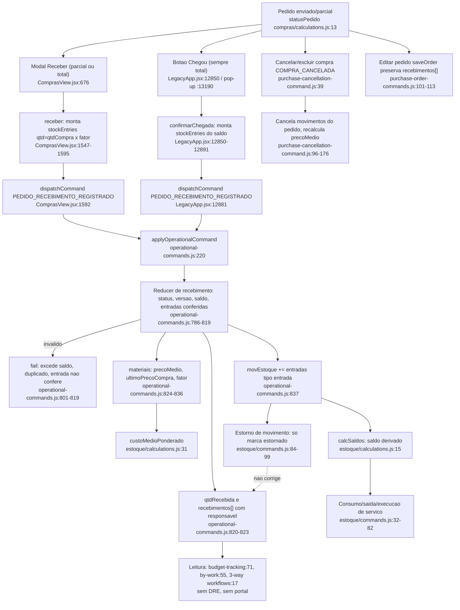

# F6 · recebimento-e-estoque

Origem: subagente Flowchart da Fase 1 (somente leitura; nada executado). Caminhos relativos à raiz do repositório.

## (a) Fontes consultadas
- `PATHFINDER-2026-10-26/00-features.md` 1-146
- `src/domains/sync/operational-commands.js` 150-229, 392-412, 740-842 (comando de recebimento 786-839; despacho do estoque 401)
- `src/domains/estoque/commands.js` 1-134; `estoque/calculations.js` 1-137
- `src/domains/estoque/components/EstoqueView.jsx` 225-340, 530-575 (o arquivo está em `domains/estoque/components`, não em `features`)
- `src/domains/compras/components/ComprasView.jsx` 660-755 (ModalRecebimento), 1535-1707 (receber, cancelar, excluir), 2340-2440 (cartão do pedido)
- `src/LegacyApp.jsx` 2375-2410, 2498-2515, 12625-12645, 12847-12898 (confirmarChegada), 13175-13253 (pop-up e modal "Chegou")
- `src/domains/compras/calculations.js` 1-60; `delivery-schedule.js` 1-116; `unit-conversion.js` 1-64
- `src/domains/compras/purchase-cancellation-command.js` 1-186; `purchase-order-commands.js` 55-245
- `docs/COMPRAS_UX_FLUXO.md` (só grep: linhas 5, 12, 18, 26, 40)
- `api/data.js:179, 245, 247` (papéis) e `server/operational-command-policy.js:121` (escopo por obra), só via grep
- Grep de `qtdRecebida`/`recebimentos`/`movEstoque` em `ledger.js`, `client-portal-publication.js`, `budget-tracking.js`, `workflows.js`, `payable-payment-commands.js`, `matching.js`, `dre-projection.js`
- Não lido: `api/data.js` (trecho completo), `ledger.js` inteiro, `client-portal-publication.js`, ModalRecebimento no ramo `dispatchCommand` do hook `usePurchaseSave`, testes.

## (b) Achados

### 1. Caminho feliz
- Pedido só recebe se não for `cancelado`/`rascunho` nem inativo (`operational-commands.js:790-792`). Papéis do comando: admin, compras, financeiro, engenheiro, engenheiro_auditor (`api/data.js:179`). Escopo por obra: `server/operational-command-policy.js:121`.
- Cliente monta `receivedQuantities` {itemId: qtd na unidade de COMPRA} e `stockEntries[]` (`ComprasView.jsx:1570-1584`; `LegacyApp.jsx:12858-12872`).
- Servidor (`operational-commands.js:795-819`):
  - força `tipo:"entrada"` (798);
  - exige `entries.length === requested.length`, sem id duplicado em `movEstoque` (800-801);
  - recusa excesso sobre o saldo do item (808), tolerância 1e-6;
  - confere que cada entrada bate com o pedido: `pedidoId`, `obraId`, `materialId` (812); `qtdCompra` igual à quantidade informada (814); `qtd = qtdCompra × fator` (817); `valorUnit = referenceUnitCostOf(item)` (818).
- Grava (820-838):
  - `item.qtdRecebida += qtd` e empurra em `item.recebimentos[]` {id (receiptId), data, qtd, precoUnit, responsavelId, responsavel, registradoEm} (822);
  - `pedido.version+1` (823);
  - anexa as entradas em `movEstoque` (837);
  - recalcula `materiais.precoMedio`, `ultimoPrecoCompra`, `ultimaUnidadeCompra`, `ultimoFatorConversao`, `ultimaReferenciaCompra` (825-836);
  - recibo de idempotência `operationalCommandReceipts` (838, appendReceipt 156-162, até 2000 itens).
- Status parcial/total é derivado, não gravado: `statusPedido` em `compras/calculations.js:13-18` (nenhum recebido = enviado; recebido ≥ total = recebido; senão parcial).
- Saldo disponível não é gravado: `calcSaldos` (`estoque/calculations.js:15-22`) soma sinal×qtd por obra|material, ignorando status cancelado/estornado.
- Consumo/saída (`estoque/commands.js`):
  - `MOVIMENTO_ESTOQUE_REGISTRADO` (32-55) recusa saída acima do saldo (43-46);
  - `EXECUCAO_SERVICO_REGISTRADA` (57-82) baixa pela composição e confere o saldo de cada insumo;
  - `MOVIMENTO_ESTOQUE_ESTORNADO` (84-99) exige motivo e marca `status:"estornado"`; não recalcula nada além disso (ver achado 6).
  - `ajuste` tem sinal +1 (`estoque/calculations.js:6`): não existe ajuste negativo.

### 2. DOIS CAMINHOS: mesmo comando, regras de UI diferentes
Os dois chamam o MESMO comando `OPERATIONAL_COMMAND.PURCHASE_RECEIPT_RECORDED` ("PEDIDO_RECEBIMENTO_REGISTRADO"): `ComprasView.jsx:1592` e `LegacyApp.jsx:12881`. A validação é única, no servidor (`operational-commands.js:786-839`). Diferenças, todas no cliente:

| Aspecto | Modal "Receber" (ComprasView) | Botão "Chegou" (LegacyApp, ObraDetalhe) |
|---|---|---|
| Quantidade | Editável por item; parcial permitido (`ComprasView.jsx:679-684, 1549-1564`) | Sempre TODO o saldo (`falta`) de todos os itens; parcial só pela aba Compras (`LegacyApp.jsx:12858-12860`; texto em 13245) |
| Trava de excesso | No cliente (`ComprasView.jsx:1560, 747`) e no servidor | Só no servidor |
| Bloqueia valor 0 | Sim: botão desabilitado se `valorTotal <= 0` (`ComprasView.jsx:747`) | Não |
| Data | `new Date().toISOString().slice(0,10)` (UTC, `ComprasView.jsx:1566`) | `today()` (`LegacyApp.jsx:12857`) |
| Descrição do movimento | `Pedido <nº> · <fornecedor>` (`ComprasView.jsx:1582`) | `Chegada confirmada - pedido <nº>` (`LegacyApp.jsx:12870`), sem fornecedor |
| Proteção contra clique duplo | `salvando` + fieldset disabled (`ComprasView.jsx:677-678, 699`) | Nenhuma (modal 13225-13253 sem estado de envio) |
| Quem vê | Pedidos `enviado`/`parcial` (`ComprasView.jsx:2415`) | `statusPedido` em enviado/parcial da obra, só se houver `update` (`LegacyApp.jsx:12632-12633, 13190`) |

- Em ambos: não há conferência de pagamento, foto, canhoto, nota fiscal nem observação. Responsável = `currentUser` via actorId/actorName, gravado só em `item.recebimentos[]` (`operational-commands.js:822`). A data vem do cliente (`entry.data`), sem validação de formato nem de período fechado no servidor. A idempotência é por `uid()` novo a cada clique, então a chave não protege contra duplo clique; o que protege é a versão do pedido e o saldo.
- Bug de rótulo no "Chegou": mostra `falta` (unidade de COMPRA) com `mat.unidade` (unidade de ESTOQUE) (`LegacyApp.jsx:13234, 13239`). Exemplo: "10 KG" quando são 10 sacos.

### 3. Recebimento independe de pagamento
- Confirmado: comentários em `ComprasView.jsx:1544-1546` e `LegacyApp.jsx:12855-12856`; o servidor não consulta pagamentos (786-839); `docs/COMPRAS_UX_FLUXO.md:12, 26`.
- Resíduo (S15): `pedidoLiberadoParaReceber` (`compras/calculations.js:51` = pago) só decide mostrar o botão "Saldo em aberto" (`ComprasView.jsx:2418`). O nome induz a erro.

### 4. Verificações pedidas
- **Nota fiscal**: NÃO é exigida. Nada no comando referencia `notasFiscais`. O vínculo com NF é feito depois, em F7, pelo 3-way match, que usa `qtdRecebida × precoUnit` (`financeiro/workflows.js:17`).
- **Alerta de divergência no recebimento**: NÃO existe. Há só o bloqueio duro de excesso (`operational-commands.js:808`); recebimento a menor fica "parcial" sem aviso. O atraso é calculado depois por `atrasoDoItem` (`delivery-schedule.js:50-63`); as remessas só alimentam atraso e pontualidade; `dataQueAlcancou` (36-47) usa `recebimentos[].data`.
- **`materiais.precoMedio`**: SIM, atualizado em `operational-commands.js:831`: `custoMedioPonderado([...movEstoque,...entries], id)` (`estoque/calculations.js:31-40`), média ponderada das entradas ativas de TODAS as obras, na unidade do cadastro; se for null, cai para o preço canônico da compra.
- **`materiais.ultimoPrecoCompra`**: SIM (`operational-commands.js:832`, `precoUnit/fator`). Também `ultimaUnidadeCompra` (833), `ultimoFatorConversao` (834), `ultimaReferenciaCompra` (835).
- Limitação: com 2 itens do mesmo material no pedido, só o primeiro item recebido define o preço/fator (827-829).
- **Conversão de unidade** (`compras/unit-conversion.js`):
  - o fator é 1 se a unidade de compra for igual à de referência; senão `fatorConversao > 0` ou 0 (12-18);
  - quantidade de estoque = qtdCompra × fator (`referenceQuantityOf`, 20-21);
  - custo de estoque = precoUnit / fator (`referenceUnitCostOf`, 25-28);
  - o servidor revalida as duas (`operational-commands.js:813-818`), então o navegador não consegue inflar o estoque nem o custo.
- Brecha menor: se `entry.qtd` ou `entry.valorUnit` vierem nulos, o servidor não os preenche (817-818 só validam quando `!= null`). A entrada ficaria sem `qtd` e contaria 0 no saldo. Os dois fluxos reais sempre enviam esses campos.
- Um pedido legado com fator 0 inválido fica sem como receber (`qtd` esperado = qtdCompra×1 ≠ 0). A criação já barra isso em `hasValidUnitConversion` (`purchase-order-commands.js:95-97`).

### 5. Efeitos colaterais, DRE, portal e conciliação
- Coleções escritas: `pedidos[].itens[].qtdRecebida`, `pedidos[].itens[].recebimentos[]`, `pedidos[].version`, `movEstoque[]`, `materiais[]` (5 campos), `operationalCommandReceipts`.
- DRE/razão: o recebimento NÃO gera fato financeiro. Grep de `qtdRecebida|movEstoque` em `ledger.js` e `server/dre-projection.js` não retornou nada de recebimento de compras (só `recebimentosDaMedicao`, medição de cliente). O custo no DRE vem de NF (F10).
- "Recebido" aparece em: `budget-tracking.js:71` (orçado × recebido por etapa, `valorDoItem(i, materiais, i.qtdRecebida)`), `recebidoPedido`/`pendentePedido` (`compras/calculations.js:37-39`), `by-work.js:55` ("a receber"), e o consumo aplicado (`LegacyApp.jsx:11653, 11808`).
- Portal do cliente: nenhuma referência a `qtdRecebida`/`movEstoque` no grep de `client-portal-publication.js`. O recebimento não é publicado (confiança média, arquivo não lido inteiro).
- Conciliação: sem relação. As ocorrências de `recebimentos` em `conciliacao/*` são de medições e contratos de cliente.
- `valorEmObra = saldo × material.precoMedio` (`EstoqueView.jsx:234-237`): usa o custo médio GLOBAL, não o da obra.

### 6. Estorno, edição e cancelamento (prioridade pedida)
- **(6.1) Estorno pelo Estoque NÃO desfaz o recebimento.** A aba Movimentos oferece "excluir" em TODA linha, inclusive entradas de pedido (`EstoqueView.jsx:563` → `excluirMov` 320-332 → `estoque/commands.js:84-99`). O comando só marca o movimento como estornado: não toca `pedidos[].itens[].qtdRecebida` nem `recebimentos[]`, não recalcula `materiais.precoMedio` e não verifica saldo negativo (diferente do cancelamento, que verifica).
  - Consequências: o pedido continua "recebido"/"parcial" sem estoque; o saldo pode ficar negativo se já foi consumido; o `precoMedio` fica velho até o próximo recebimento; o pedido não pode mais receber (já está "recebido") nem ser cancelado pelo botão.
  - Agravante: a mensagem em `ComprasView.jsx:1613` manda "Estorne pelo Estoque antes", mas esse estorno não libera o cancelamento, que checa `qtdRecebida > 0` (1611-1614). Fica um impasse na UI.
- **(6.2)** Cancelar pedido (botão): bloqueado no cliente se houver qualquer `qtdRecebida` (`ComprasView.jsx:1611-1614`). O caminho "Excluir definitivamente" (1652-1681) chama o mesmo `COMPRA_CANCELADA` sem essa trava.
- **(6.3)** No servidor, `COMPRA_CANCELADA` (`purchase-cancellation-command.js:39-185`):
  - cancela os movimentos do pedido (`movementOfOrder`, 18-23; vínculo por `pedidoId` ou, nos legados, pela descrição "Pedido <nº> ·"), com status "cancelado", motivo, quem e quando (96-100);
  - recusa se o material já foi consumido e o saldo ficaria negativo (101-103);
  - recalcula `precoMedio` pelas entradas restantes (170-176); se não restar nenhuma, mantém o valor cadastrado;
  - NÃO desfaz `ultimoPrecoCompra`, `ultimaUnidadeCompra`, `ultimoFatorConversao` nem `ultimaReferenciaCompra`;
  - mantém `itens[].qtdRecebida` e `recebimentos[]` no pedido cancelado (preservados) e grava `impactoCancelamento.recebimentos` (contagem, 156) e `movimentosEstoque` (157). O pedido cancelado ainda mostra "recebido" nos itens, mas `statusPedido` devolve "cancelado".
- **(6.4)** Editar pedido (`saveOrder`, `purchase-order-commands.js:182-245`): `normalizeItems` preserva `qtdRecebida` e `recebimentos` do item anterior (101-108), não deixa a qtd cair abaixo do recebido (103) nem remover item recebido (110-113), e exige motivo + registra em `ajustes[]` (195-197, 222-227). Mas permite mudar `precoUnit`, `unidadeCompra` e `fatorConversao` DEPOIS de recebido (o `...raw` na linha 105 passa tudo):
  - o `movEstoque` já gravado mantém o valor/fator antigo, e `recebidoPedido` (`calculations.js:37-38`) passa a valer qtdRecebida × preço NOVO, divergindo do custo de estoque e dos `recebimentos[].precoUnit`;
  - um fator alterado depois de receber desalinha a próxima entrada (e o custo médio) em relação às anteriores.
  - Lacuna: não foi visto se a UI bloqueia essa edição.

## (c) Fluxograma

## (d) Veredito
- O núcleo é sólido: um único comando no servidor, com validação dura de saldo, conversão de unidade e custo recalculados no servidor, idempotência, versionamento otimista, saldo derivado (não gravado) e cancelamento em cascata com bloqueio de estoque negativo.
- Os dois caminhos de recebimento são equivalentes quanto à regra de negócio. O "Chegou" é só um atalho de recebimento total, sem proteção de clique duplo e com rótulo de unidade errado.
- Problemas reais:
  1. estorno pelo Estoque que não reverte o pedido nem o `precoMedio`, e permite saldo negativo (impasse com o botão Cancelar);
  2. edição de preço/fator após o recebimento sem reconciliação;
  3. nenhuma divergência ou conferência (NF, canhoto, foto) no ato de receber;
  4. `ultimo*` do material não é revertido no cancelamento.

## (e) Informação que se perde ou deixa de ser rastreável
- **Quem recebeu e quando**: guardados em `recebimentos[].responsavelId/responsavel/registradoEm` (`operational-commands.js:822`), mas NÃO no `movEstoque` (a entrada não leva o ator; só `receiptId`). Quem olha só o estoque não vê o responsável. A `data` do recebimento é a informada pelo cliente.
- **Quanto**: `qtd` está em unidade de compra no pedido e em unidade canônica no estoque; `qtdCompra`, `unidadeCompra` e `fatorConversao` ficam no movimento, mas o normalizador de recebimentos (`LegacyApp.jsx:2389-2393`) não guarda fator nem unidade.
- **Em qual remessa**: nada liga um recebimento a uma `remessa` programada (`delivery-schedule.js`). O vínculo é só por acumulado (`dataQueAlcancou`, 36-47), então uma entrega parcial não se associa a uma remessa específica.
- Observações, divergências, fotos, canhoto e número de NF: não existem campos no recebimento. O normalizador (`LegacyApp.jsx:2389-2393`) descartaria qualquer campo extra.
- Recebimento a menor: não é registrado como divergência, apenas "parcial".
- Edição: `recebimentos[]` é preservado, mas o preço atual do item pode divergir de `recebimentos[].precoUnit`. O `ajustes[]` registra o total anterior/novo, não o efeito no estoque.
- Cancelamento: `recebimentos[]` e `qtdRecebida` ficam no pedido cancelado, os movimentos viram "cancelado" com motivo e autor (rastreável, o melhor caso). Perde-se o `ultimoPrecoCompra`/`ultimaUnidadeCompra`/`ultimoFatorConversao` anteriores (sobrescritos e não revertidos).
- Estorno manual de movimento: motivo e autor ficam no movimento, mas nada marca o pedido, então o rastro entre pedido e estoque se rompe.

## (f) Dependências externas
- Internas (domínios): `estoque/calculations.js` e `commands.js`; `compras/unit-conversion.js`, `delivery-schedule.js`, `purchase-order-commands.js`, `purchase-cancellation-command.js`; financeiro (`active` do `ledger.js`; `isDateInClosedPeriod` no cancelamento); `sync/operational-commands.js` como reducer único (navegador + `api/data.js`).
- Servidor: `api/data.js:179` (papéis), `server/operational-command-policy.js:121` (escopo por obra), recibos de idempotência na linha do blob `company_app_data`.
- Nenhuma API externa (fiscal, ERP de terceiros, storage de foto) participa do recebimento.
- Leitura derivada: F7 (3-way em `financeiro/workflows.js:17`), F11 (`budget-tracking.js:71`, `by-work.js:55`), F13 (suprimentos usa `movEstoque`), F5 (pontualidade do fornecedor via `recebimentos[].data`).

## (g) Confiança e lacunas
- Alta: comando de recebimento, comparação dos dois caminhos, conversão de unidade, efeitos no estoque, cancelamento e edição (código lido linha a linha).
- Média: "sem efeito no DRE e no portal" (grep, não leitura integral).
- Não verificado: (1) se a UI de edição de pedido bloqueia preço/fator após o recebimento; (2) o ramo do hook `usePurchaseSave` e o tratamento de falha de rede e reenvio; (3) a normalização de `movEstoque` em `LegacyApp.jsx` após a linha 2515; (4) testes (`operational-commands.test.js:231-294`, `purchase-cancellation-command.test.js`) para ver se algum caso cobre o estorno manual de entrada de pedido; (5) o leitor `suprimentos/calculations.js` do estoque livre (F13).
- Hipótese não confirmada por execução: o impasse de 6.1 foi deduzido do código.

## Verificação do orquestrador (a preencher)
- 6.1 (estorno manual de entrada de pedido deixa o pedido "recebido"): reproduzir por execução com `applyOperationalCommand` + `applyStockCommand`.
- 6.4 (edição de preço/fator após recebimento): reproduzir por execução.
- Rótulo de unidade no "Chegou" (`LegacyApp.jsx:13234,13239`): confirmar lendo o código.
