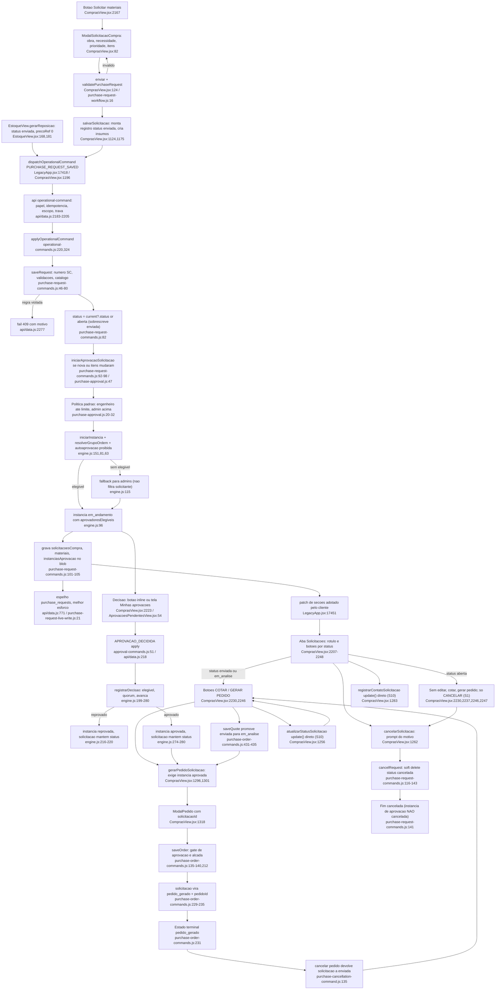

# F1 · solicitacao-e-aprovacao

Solicitação de compra e motor de alçada (Fase 1, somente leitura; nada executado). Cobre da solicitação até o pedido gerado; DRE, extrato, portal e escolha do fornecedor aparecem só como dependências.

**Principal achado:** S1 está CONFIRMADA e é grave. O servidor grava toda solicitação nova como `"aberta"`. A tela e os consumidores só reconhecem `"enviada"` e `"em_analise"`. Por isso a solicitação nova não pode ser editada, cotada nem virar pedido pela aba Solicitações.

## (a) Fontes consultadas
`00-features.md` 1-146; `purchase-request-commands.js` 1-158; `purchase-approval.js` 1-88; `purchase-request-workflow.js` 1-41; `workspace.js` 1-82; `purchase-request-commands.test.js` 1-206; `purchase-order-commands.js` 100-280, 370-455; `purchase-cancellation-command.js` (grep: 128, 135, 182); `aprovacoes/approval-commands.js` 1-68; `arcd-engine.js` 1-42; `engine.js` 1-346; `policies.js` 1-98; `permissions.js` 1-11; `aprovacoes/calculations.js` (grep operadores 7-45); `AprovacoesPendentesView.jsx` 1-87; `ComprasView.jsx` 60-300, 840-880, 1085-1345, 2150-2340; `unit-conversion.js` (grep 20-37); `EstoqueView.jsx` 155-224; `sync/operational-commands.js` 215-345; `LegacyApp.jsx` 2010-2104, 11555-11595, 17418-17467; `api/data.js` 765-835, 2183-2301 (+ grep papéis 218-220); `server/purchase-request-live-write.js` 1-32; `server/operational-command-policy.js` (grep 41-42, 99, 133-158); `migrations/010_create_purchase_requests_live.up.sql` 1-51.
Só por grep: consumidores de status em `LegacyApp.jsx` (4015, 8344, 8375, 11561, 11582, 17812), `calculations.js:152`, `executive-summary.js:45,124`, `PurchaseWorkspace.jsx`, `integration/purchase-quote-order-live-write.test.js:264-283`.

## (b) Achados concretos

### b1. Caminho feliz, passo a passo

**1. Abertura.** O botão "SOLICITAR MATERIAIS PARA A OBRA" está em `ComprasView.jsx:2167`. Chama `abrirNovaSolicitacao` (corpo não lido) e abre `ModalSolicitacaoCompra` (`:82`). Campos: obra, `necessidade` (data), `prioridade` (normal ou urgente), `observacao` (justificativa obrigatória se urgente, `:276`), itens, unidade de compra e fator, e etapa do orçamento (`orcNivel1Id`). Os itens vêm do catálogo (`:89`), da base SINAPI/ORSE (`:184`) ou são próprios (`:191`, com `precoRef:0`). O botão "Formalizar e enviar para Compras" (`:280`) chama `enviar` (`:124`), que revalida com `validatePurchaseRequest` (`purchase-request-workflow.js:16`): obra, `necessidade`, observação se urgente, ao menos um item com descrição, unidade e quantidade > 0, e fator se a unidade de compra diferir da de referência.

**2. Montagem no cliente.** `salvarSolicitacao` (`ComprasView.jsx:1124`): normaliza os itens (:1127); procura o material por id, código ou descrição (`localizarMaterialSolicitado`, :1108); se não acha, cria o insumo com `criadoVia:"solicitacao_compra"` e `solicitacaoOrigemId` (:1142-1149); monta o registro com `status:anterior?.status||"enviada"` (:1175), `numero:""` para nova (:1165) e `formalizadoEm/Por` (:1172-1174); envia `PURCHASE_REQUEST_SAVED` (:1196) com `expectedVersion` (:1198) e `payload:{request, catalogMaterials}` (:1200). Os `catalogMaterials` são só os insumos com `solicitacaoOrigemId` igual à solicitação (:1191).

**3. Despacho.** `dispatchOperationalCommand` (`LegacyApp.jsx:17418`) espera a fila de salvamento esvaziar (:17423) e chama `executarComandoOperacional`. No servidor, `api/data.js:2183` confere papel (:2185), chave idempotente (:2187) e escopo de obra (:2188). Papéis que salvam ou cancelam solicitação: `admin, compras, engenheiro, engenheiro_auditor` (`api/data.js:219-220`). Com `POSTGRES_URL_NON_POOLING` roda sob trava (:2197-2205); sem, laço de até 6 tentativas (:2275-2276). A resposta é um patch de seções que o cliente adota (`LegacyApp.jsx:17451-17456`).

**4. Reducer.** `applyOperationalCommand` (`operational-commands.js:220`) → `applyPurchaseRequestCommand` (:324). Em `saveRequest` (`purchase-request-commands.js:46`): número `SC-nnnn` do servidor só se vier vazio (:51-52, `proximoNumeroSolicitacao`, `calculations.js:33`). Recusas, em ordem: solicitação cancelada (:56); com `pedidoId` ou `pedido_gerado` (:59); obra inexistente (:62); versão divergente (:63); criação com versão ≠ 0 (:66); validação (:67); conversão de unidade (:69); número duplicado (:72). Catálogo (`normalizeCatalogMaterials`, :17): recusa insumo de outra solicitação (:27); grava o insumo com `solicitacaoOrigemId` (:32-34); exige que todo item aponte para insumo persistido (:78). **Status gravado:** `status:current?.status||"aberta"` (:82). Auditoria embutida: `version+1`, `atualizadoPor/Em/ById`, `criadoPor/Em/ById` (:82-86).

**5. Aprovação nasce no servidor.** Para solicitação nova, ou quando os itens mudam (`itemsChanged`, :40-44), chama `iniciarAprovacaoSolicitacao` (:93). O `payload.approvalInstance` do navegador é ignorado (:87-88; teste `.test.js:40-45`). Se os itens mudaram, a instância anterior vira `"substituida"` (:95-97). Mudar só a observação não reinicia a aprovação (teste :183-195).

**6. Alçada** (`purchase-approval.js`). Limite padrão R$ 5.000 (:12), sobrescrevível por `configAprovacao.limiteEngenheiroCompra` (:15-18). A política padrão tem duas etapas com a mesma `ordem:1`, paralelas e mutuamente exclusivas (:20-32): `engenheiro-obra` (tipo `responsavelObra`, `valorTotal <= limite`); `administrador` (`valorTotal > limite`). Só entra se não houver política própria ativa para `solicitacaoCompra` (:34-51); fica só no snapshot da instância (:60-63). Valor: `valorEstimadoSolicitacao` = soma de `quantidade × precoRef × fator` por item (:37; `unit-conversion.js:33`). O contexto leva `valorTotal`, `obraId`, `categoria:"material"`, `solicitanteId` e `urgencia` (:40-43).

**7. Eleição de aprovadores** (`engine.js`, `arcd-engine.js`). `iniciarInstancia` (`engine.js:151`) escolhe a política de maior prioridade ativa, vigente e com condições batendo (`policies.js:19-25`), e congela um snapshot (:30). `resolverGrupoOrdem` (:81), por etapa: avalia condições (:87), a que não bate fica `"pulada"`; resolve aprovadores — `responsavelObra` é o usuário ativo igual a `obra.engineerId` (`arcd-engine.js:17-23`), `administrador` são os usuários ativos com `role==="admin"` (:35-36); aplica delegações (`engine.js:52`) e a autoaprovação `"proibida"`, que remove o solicitante (:63-77); sem elegível, a ação padrão `enviar_administrador` manda para todos os admins (:115-117). Resultado: instância `"em_andamento"` com `aprovadoresElegiveis`, ou `"aprovada"` se nenhuma etapa ficou ativa (:145). A instância recebe `contexto`, `valorAprovado` e `limiteEngenheiro` (`purchase-approval.js:58-59`); a solicitação recebe `aprovacaoInstanciaId` (`purchase-request-commands.js:100`). Testes: até 5.000 vai ao engenheiro, acima ao admin, e o engenheiro não aprova a própria solicitação (`.test.js:166-181`).

**8. Decisão de aprovação.** Entradas: botões inline Aprovar/Reprovar (`ComprasView.jsx:2223-2229` → `decidirAprovacao`, :1228) e a tela "Minhas aprovações" (`AprovacoesPendentesView.jsx:54`, `LegacyApp.jsx:18351`). Comando `APROVACAO_DECIDIDA`; papéis permitidos: `admin, compras, financeiro, engenheiro, engenheiro_auditor, rh, diretoria` (`api/data.js:218`) — o controle real é a elegibilidade, não o papel. `applyApprovalCommand` (`approval-commands.js:51`): o aprovador é sempre `command.actorId` (:63); exige justificativa ao reprovar (:58); `registrarDecisao` (`engine.js:199`) recusa se a etapa não está `em_andamento` ou se o usuário não é elegível (:209-211); reprovação encerra como `"reprovada"` (:216-220); aprovação aplica o quórum (:226-228) e avança; sem mais etapas pendentes vira `"aprovada"` (:274-280). **A decisão não altera `solicitacao.status`**: a aprovação é uma segunda máquina de estados, em `instanciasAprovacao`. Escritas de auditoria: `decisoesAprovacao` (:214) e `auditoriaAprovacao` (:219, :279).

**9. Do aprovado ao pedido gerado** (F3/F4; aqui só o vínculo). `gerarPedidoSolicitacao` (`ComprasView.jsx:1296`) exige `podeProcessar`; se a instância não está `"aprovada"`, bloqueia (:1301-1305); abre `ModalPedido` com `solicitacaoId` (:1318). `saveOrder` (`purchase-order-commands.js:182`) valida: pedido novo exige instância `aprovada` (:135-140); uma solicitação gera um único pedido ativo, exceto irmãos do mesmo mapa (:141-146); a alçada usa o total real do pedido (:211-215, `pedidoDentroDaAlcada`, `purchase-approval.js:84-88`). Estado terminal em :229-235: `status:"pedido_gerado"`, `pedidoId`, `analisadoEm/Por` e `pedidoIds` com mapa de cotação. Acima do limite, `aprovadaAcimaDaAlcada` exige a etapa de administrador concluída (`purchase-approval.js:74-80`).

**10. Cancelamento da solicitação.** `cancelarSolicitacao` (`ComprasView.jsx:1262`) pede o motivo por `window.prompt` (:1263) e despacha `PURCHASE_REQUEST_CANCELLED` (:1269). `cancelRequest` (`purchase-request-commands.js:116`) recusa se não existe, já cancelada, com `pedidoId` ou versão divergente (:120-133); grava `status:"cancelada"`, `canceladoEm/Por/PorId`, `motivoCancelamento` (:136-140). O botão aparece se o status não é `pedido_gerado` nem `cancelada` e o usuário é Compras ou o solicitante (`ComprasView.jsx:2247`). Cancelar o pedido devolve a solicitação a `status:"enviada"`, zera `pedidoId` e `analisadoEm/Por` (`purchase-cancellation-command.js:128-135`): é o **único caminho** que coloca `"enviada"` em uma solicitação nova.

### b2. Mapa de status e quem LÊ cada um

| Status | Quem grava | Quem lê (arquivo:linha) |
|---|---|---|
| `"enviada"` | UI `ComprasView.jsx:1175` e `EstoqueView.jsx:181`, ambos sobrescritos por `purchase-request-commands.js:82` (o servidor só preserva em edição). Também `purchase-cancellation-command.js:135` e o normalizador `LegacyApp.jsx:2033` (só para status vazio). | `ComprasView.jsx:857` (contador), `:2208` (rótulo), `:2230`, `:2237`, `:2238`, `:2239`, `:2246` (botões); `workspace.js:50`; `calculations.js:152` (KPI); `LegacyApp.jsx:4015`, `:8344`, `:11561` (SLA), `:11582` (consolidação), `:17812` (alerta de Compras); `executive-summary.js:45,124`; `purchase-order-commands.js:432` (promove para `em_analise`) |
| `"aberta"` | `purchase-request-commands.js:82`, só em solicitação nova | Nenhum consumidor testa o literal. Cai no rótulo cru em `ComprasView.jsx:2208` e no texto "Em análise · preparar cotação" de `workspace.js:50`. |
| `"em_analise"` | `purchase-order-commands.js:432` (saveQuote, só se estava `enviada`) e `ComprasView.jsx:1257` (update direto) | `ComprasView.jsx:2208`, `:2230`, `:2237`, `:2239`, `:2246`; `LegacyApp.jsx:11561`, `:11582`; `workspace.js:50` (por exclusão) |
| `"pedido_gerado"` | `purchase-order-commands.js:231` | `purchase-request-commands.js:59`, `workspace.js:41`, `ComprasView.jsx:991`, `:2247` |
| `"cancelada"` | `purchase-request-commands.js:136` | `purchase-request-commands.js:56`, `purchase-order-commands.js:132`, `workspace.js:41`, `ComprasView.jsx:991` |

Status da instância de aprovação (`em_andamento`, `aprovada`, `reprovada`, `bloqueada`, `substituida`, `cancelada`) é lido em `workspace.js:42-49`, `ComprasView.jsx:1223`, `:1301`, `:2214-2218`, `purchase-order-commands.js:136`, `purchase-approval.js:75`, `AprovacoesPendentesView.jsx:41`.

### b3. Efeitos colaterais
- **Blob `company_app_data`.** O comando de salvar escreve em `solicitacoesCompra` (registro novo, `version`, `aprovacaoInstanciaId`, autoria), `materiais` (insumos com `solicitacaoOrigemId`, `purchase-request-commands.js:32-34`), `instanciasAprovacao` e `auditoriaAprovacao`. A decisão escreve em `decisoesAprovacao` e `auditoriaAprovacao`. `appendReceipt` (idempotência) em `operational-commands.js:329` (corpo não lido). Auditoria do servidor: `salvarComAuditoria` com `action:"operational_solicitacao_compra_salva"` (`api/data.js:2264`).
- **Espelho Supabase.** `sincronizarComprasAlteradas` compara antes e depois (`api/data.js:820-832`) e chama `sincronizarSolicitacaoCompraAoVivo` (:771), upsert em `purchase_requests` via `buildPurchaseRequestLiveRow` (`purchase-request-live-write.js:21`). Colunas relacionais: número, obra, `needed_by`, prioridade, observação e `source_version`; o resto, incluindo `status` e itens, só em `payload` jsonb. Melhor esforço: a falha só gera `console.error` (`api/data.js:780-782`). FK `(company_id, project_id)` para `core_projects` (migração 010, linhas 38-39): se a obra não estiver espelhada ali, o espelho falha em silêncio (inferência de leitura). A aprovação (`instanciasAprovacao`) **não é espelhada**.
- **Insumos no catálogo.** Criados no cliente (`ComprasView.jsx:1142-1149`) e persistidos pelo servidor (`purchase-request-commands.js:75`); marcados como de propriedade daquela solicitação e não sobrescritos por outra (:27).
- **Efeitos posteriores.** `saveQuote` altera a solicitação: `cotacaoIds`, `analisadoEm/Por` e `enviada→em_analise` (`purchase-order-commands.js:431-435`). `saveOrder` marca `pedido_gerado` (:229-235).

### b4. Outros achados com evidência
- **A1. Solicitação com valor zero cai na etapa do engenheiro.** Itens "somente a esta solicitação" saem com `precoRef:0` (`ComprasView.jsx:191`), e a reposição de estoque também (`EstoqueView.jsx:187`). O `valorTotal` fica 0 e a etapa do engenheiro é a ativa (`purchase-approval.js:27`). O pedido é conferido pelo total real (`purchase-order-commands.js:212`): um não-admin que lance pedido acima de R$ 5.000 é recusado, pois não há etapa de admin concluída (`purchase-approval.js:74-80`). A rede de proteção funciona, mas o aviso chega só no pedido, tarde (`purchase-order-commands.js:213-214`).
- **A2. Cancelar a solicitação não cancela a instância de aprovação.** `cancelRequest` mexe só em `solicitacoesCompra` (`purchase-request-commands.js:141-142`). `AprovacoesPendentesView.jsx:41` lista toda instância `em_andamento` sem checar o status da entidade: o aprovador continua vendo a solicitação cancelada e pode aprová-la; o rótulo (:21-26) não indica o cancelamento.
- **A3. O solicitante vem do cliente.** `iniciarAprovacaoSolicitacao` recebe `solicitanteId: saved.solicitanteId||actor.id` (`purchase-request-commands.js:93`). `saved` herda `...raw` (:82), e o cliente define `solicitanteId` (`ComprasView.jsx:1168`). Um cliente adulterado poderia declarar outra pessoa como solicitante e escapar da regra "não aprova a própria". Sem teste.
- **A4. O fallback de admin não filtra o solicitante.** A autoaprovação filtra só a lista primária (`engine.js:93`); o fallback `administradores` (:115) não passa por ela. Se o solicitante é o único admin e a etapa é a de admin, ele fica elegível para aprovar a própria solicitação (inferência, sem teste). Sem admin ativo, a etapa fica `em_andamento` com lista vazia e ninguém decide.
- **A5. A aprovação pode ficar parada.** Reprovada é terminal (`engine.js:216-220`), e a solicitação mantém o status. Só mudar os itens gera nova instância (`purchase-request-commands.js:92`). Como a UI esconde "EDITAR" para `aberta` (`ComprasView.jsx:2237`), uma solicitação nova reprovada só pode ser cancelada.
- **A6. O limite configurável não é gravado nem preservado.** Só `purchase-approval.js:16` lê `configAprovacao.limiteEngenheiroCompra`; nenhuma tela o grava. O normalizador do cliente reescreve `configAprovacao` mantendo só `comportamentoSemPolitica` (`LegacyApp.jsx:2100`): se algum fluxo salvar o objeto normalizado, o limite se perde. O comentário "Ajustável em configAprovacao" (`purchase-approval.js:11`) não tem tela correspondente.
- **A7. Numeração na reposição de estoque.** O comentário diz "numeração recalculada contra o estado mais fresco do servidor" (`EstoqueView.jsx:166`), mas o cliente já manda `numero: SC-${length+1}` (:195), e o servidor só numera se vier vazio (`purchase-request-commands.js:51`). Com cancelamentos ou lacunas pode colidir ("Já existe uma solicitação com este número", :72).
- **A8. Edição pode usar cópia atrasada.** `solicitacaoFinal` sai do `data` do render (`ComprasView.jsx:1190`) e mantém `cotacaoIds`, `contatos`, `analisadoEm` de `anterior` (:1176-1178). O `expectedVersion` vem do estado fresco (:1194). `{...current,...raw}` (`purchase-request-commands.js:82`) pode sobrescrever `cotacaoIds` ou `contatos` mais novos com valores antigos, sem erro de versão.
- **A9. Escopo de obra possivelmente contornável (hipótese não verificada).** O escopo é resolvido pela obra **gravada** (`purchase-request-commands.js:150`), mas `saveRequest` grava `raw.obraId` (:53, :82). O modal permite trocar a obra na edição (`ComprasView.jsx:113`). `validateOperationalCommandScope` (`operational-command-policy.js:133+`) não foi lida por completo.

### b5. Veredito sobre S1 (status inicial): CONFIRMADA
O servidor só força `"aberta"` em solicitação nova. Edições preservam o status existente.

Cadeia que decide o valor final:
1. `ComprasView.jsx:1175`: a UI manda `status:"enviada"`. `EstoqueView.jsx:181` também.
2. `purchase-request-commands.js:82`: `{...current,...raw,id,obraId,status:current?.status||"aberta",...}`. Em solicitação nova `current` é indefinido: o status vira `"aberta"`, o `"enviada"` da UI é descartado.
3. `api/data.js:2275-2288` (ou :2198 sob trava) grava e responde com patch de seções.
4. `LegacyApp.jsx:17451-17456`: o cliente adota o patch do servidor.
5. `LegacyApp.jsx:2033`: o normalizador mantém `"aberta"` (só troca status vazio).

Consumidores afetados por `"aberta"`:

| Consumidor | Linha | Efeito |
|---|---|---|
| Rótulo do cartão | `ComprasView.jsx:2208` | Mostra "aberta" cru, em cinza |
| Editar solicitação | `ComprasView.jsx:2237` | Botão some |
| Marcar em análise | `ComprasView.jsx:2238` | Botão some |
| Cotar item / cotar todos | `ComprasView.jsx:2230` | Botões somem |
| Cotar por WhatsApp | `ComprasView.jsx:2239` | Botão some |
| Gerar pedido | `ComprasView.jsx:2246` | Botão some |
| Contador de pendentes | `ComprasView.jsx:857`, `LegacyApp.jsx:8344` | Não conta |
| KPI de solicitações | `calculations.js:152` | Não conta |
| Alerta de Compras | `LegacyApp.jsx:17812` | Não acende |
| SLA | `LegacyApp.jsx:11561` | Retorna `null`, sem "SLA estourado" |
| Consolidação multi-obra | `LegacyApp.jsx:11582` | Solicitação ignorada |
| Lista de solicitações | `LegacyApp.jsx:4015` | Ignorada |
| Resumo executivo | `executive-summary.js:45,124` | Não conta |
| Fila de trabalho | `workspace.js:41-50` | **Aparece**, com "Em análise · preparar cotação" |
| Cancelamento | `ComprasView.jsx:2247` | **Continua disponível** |

Impacto: a solicitação nova aparece na Fila de trabalho, mas na aba Solicitações o único botão que sobra é CANCELAR. A promoção `enviada→em_analise` na cotação (`purchase-order-commands.js:432`) também não dispara.

Por que não foi pego: o teste do reducer nunca verifica `status` (`purchase-request-commands.test.js:33-46`); o teste de integração usa fixture já `"enviada"` (`integration/purchase-quote-order-live-write.test.js:264`); o e2e simula o servidor (`e2e/purchase-workspace.spec.js:48`).

Dados de produção não verificados. Solicitações antigas ainda com `"enviada"` continuam funcionando, o que pode ter mascarado o problema.

Teste mínimo que reproduziria: aplicar `applyPurchaseRequestCommand(base(), command({payload:{request:{...command().payload.request, status:"enviada"}}}))` e afirmar `status === "enviada"` (hoje retorna `"aberta"`); e `buildPurchaseWorkspace` com a aprovação concluída deveria ter `detail === "Aguardando análise de Compras"` (`workspace.js:50`). A correção é decisão de produto: gravar `"enviada"` (:82) ou ensinar todos os consumidores a aceitar `"aberta"`.

### b6. Veredito sobre S10 (parte solicitações): PARCIAL
- O cancelamento já foi movido para comando (`ComprasView.jsx:1245-1278`).
- Restam duas escritas diretas por `update()`: `atualizarStatusSolicitacao` (:1256-1260), sem comando, versão nem ator; `registrarContatoSolicitacao` (:1283-1294), sem comando nem versão.
- `atualizarStatusSolicitacao` só aparece com `status==="enviada"` (:2238), então para solicitação nova é inalcançável (efeito de S1).
- Essas escritas entram pela rota genérica de salvamento (relacionado a S17).
- `saveQuote` não verifica a aprovação da solicitação: `instanciaDaSolicitacao`, `aprovacao` e `pedidoDentroDaAlcada` só aparecem nos gates de pedido (`purchase-order-commands.js:136`, :212, :508). A cotação pode existir antes da aprovação, e a UI também não bloqueia (`ComprasView.jsx:1323-1336`).
- `EstoqueView.jsx:201` ainda usa `update()` com `data` do render depois do comando. Risco de sobrescrita, não verificado.

## (c) Fluxograma

## (d) Veredito das hipóteses

| ID | Veredito | Evidência |
|---|---|---|
| **S1** | **CONFIRMADA** | `purchase-request-commands.js:82`. Consumidores em b5. Só a criação cai em `"aberta"`. |
| **S10** (solicitações) | **PARCIAL** | Cancelamento já é comando (`ComprasView.jsx:1262`). Restam `atualizarStatusSolicitacao` (:1256) e `registrarContatoSolicitacao` (:1283). `saveQuote` sem gate de aprovação (b6). |
| S13 | Aplica-se à solicitação | O espelho `purchase_requests` é melhor esforço e depende de `POSTGRES_URL_NON_POOLING` (`api/data.js:2197`, :771-782). No laço sem essa variável (:2275-2292) não há chamada de sincronização. |
| S17 | Aplica-se parcialmente | Os `update()` diretos de b6 entram pelo salvamento genérico, onde `validateProcurementChain` não roda. |

## (e) Informação que se perde ou deixa de ser rastreável
- **Prioridade.** Fica na solicitação, no selo "URGENTE" (`ComprasView.jsx:2217`), no SLA (`LegacyApp.jsx:11565`) e como `urgencia` no contexto da aprovação (`purchase-approval.js:42`). **Não chega** ao pedido (`ComprasView.jsx:1318-1319`) nem à cotação (:1334).
- **Justificativa de urgência.** É o mesmo campo `observacao` (`ComprasView.jsx:276`; `purchase-request-workflow.js:20-21`). Vai ao pedido só como texto em `obs` (:1319), sem marcar que era justificativa de urgência.
- **Observação por item (`item.observacao`).** O modal não tem campo para ela (`ComprasView.jsx:237-273`). A reposição grava "Saldo x / mínimo y" nesse campo (`EstoqueView.jsx:188`). O cartão não a exibe (`ComprasView.jsx:2230`), e `gerarPedidoSolicitacao` (:1309-1313) e `abrirCotacaoDaSolicitacao` (:1329-1333) não a copiam.
- **Necessidade (data).** Vira `previsao` do pedido (`ComprasView.jsx:1318`). Na cotação, só é lida depois, pelo `solicitacaoId`.
- **Categoria do novo insumo.** O modal "Cadastrar no catálogo" coleta categoria e preço (`ComprasView.jsx:158-167`), mas o item enviado não leva a categoria, e `salvarSolicitacao` cria o insumo com `categoria:"outros"` (:1145-1146). A escolha do usuário se perde.
- **Anexos.** A solicitação não tem campo de anexo (`ComprasView.jsx:82-285`).
- **Motivo da reprovação.** Fica em `decisoesAprovacao` e `auditoriaAprovacao`, mas **não aparece** no cartão da solicitação, que mostra só "REPROVADA" (`ComprasView.jsx:2214-2218`).
- **Justificativa ao aprovar.** O botão Aprovar inline não envia justificativa (`ComprasView.jsx:2226`). Só a tela "Minhas aprovações" permite (`AprovacoesPendentesView.jsx:62`).
- **Campos preenchidos pelo cliente e não confiáveis.** `solicitanteId`, `solicitanteNome`, `formalizadoEm`, `formalizadoPorId`, `formalizadoPor` (`ComprasView.jsx:1168-1174`). O servidor os mantém via `...raw` (`purchase-request-commands.js:82`) e grava a autoria própria só em `criadoPor*` e `atualizadoPor*` (:84-86).
- **Campos que o cliente pode sobrescrever com valor atrasado.** `cotacaoIds`, `contatos`, `analisadoEm`, `analisadoPor` (A8).
- **Quem aprovou não consta na solicitação.** Está só em `decisoesAprovacao`.
- **Espelho relacional.** `purchase_requests` não tem coluna de status, itens, aprovador nem valor. Consultas por status exigem `payload->>'status'` (`purchase-request-live-write.js:21-32`).
- **Valor aprovado.** `valorAprovado` guarda o valor da época (`purchase-approval.js:59`). A tela de aprovação recalcula o valor pelos itens atuais (`AprovacoesPendentesView.jsx:24`), que pode divergir após edição.

## (f) Dependências externas
F3 `cotacao-e-escolha-fornecedor` (botão COTAR abre `setCotModal`, `ComprasView.jsx:1334`; `saveQuote` altera a solicitação, `purchase-order-commands.js:431-435`; `decideQuoteMap` gera pedidos por `saveOrder`, :508, :533). F4 `pedido-envio-aceite-cancelamento` (`saveOrder` usa `instanciaDaSolicitacao` e `pedidoDentroDaAlcada`, :6, :135, :212; o cancelamento de pedido devolve a solicitação a `enviada`, `purchase-cancellation-command.js:128-135`). F14 `catalogo-materiais-e-bases-referencia` (pesquisa SINAPI/ORSE `pesquisarInsumosReferencia`, `ComprasView.jsx:73`; catálogo `materiais`; conversão de unidade; F1 grava novos insumos). Estoque (`EstoqueView.gerarReposicao` gera solicitações, :168-205). Orçamento (`getPlanningBudget` e `niveisUmOrcamento` vinculam a etapa, `ComprasView.jsx:104-106`). F11 (`buildPurchaseWorkspace`, `workspace.js:24`). Usuários e obras (`obra.engineerId` e `usuarios.role`, `arcd-engine.js:17-36`). Controladoria (`executive-summary.js:45,124` conta `status==="enviada"`). F10/F9/F12: F1 não escreve neles diretamente; a solicitação não tem valor financeiro, só `precoRef`; o vínculo vem pelo pedido gerado (F4), que carrega `solicitacaoId`.

## (g) Confiança e lacunas
- Alta: S1 (valor gravado, consumidores afetados, ausência de qualquer mapeamento `aberta→enviada`); alçada, eleição de aprovadores, comandos e reducer; fluxo de decisão e cancelamento; espelho `purchase_requests`.
- Média: A3 e A4 (inferências de leitura, sem teste); A2 claro no código, sem teste.
- Hipótese não verificada: A9 (mover a solicitação de obra na edição) — falta ler `validateOperationalCommandScope` por completo.
- Não verificado: dados de produção (existência de solicitações `"aberta"`); corpo de `abrirNovaSolicitacao`, `appendReceipt` e `conversionFactorOf`; se algum fluxo salva o `configAprovacao` normalizado (A6); telas de política de aprovação; `api/data.js` fora dos trechos citados (inclusive a rota genérica `save`); o clique "Analisar solicitação" em `PurchaseWorkspace.jsx`; histórico git (por que `"aberta"` foi escolhido); `executive-summary.js` além das duas linhas.

## Verificação do orquestrador (a preencher)
- S1 por execução: ver `src/domains/compras/fluxo-compra-ponta-a-ponta-2.test.js`. Verificar no espelho `purchase_requests` (somente leitura) quantas solicitações têm `payload->>'status'` = 'aberta'.
