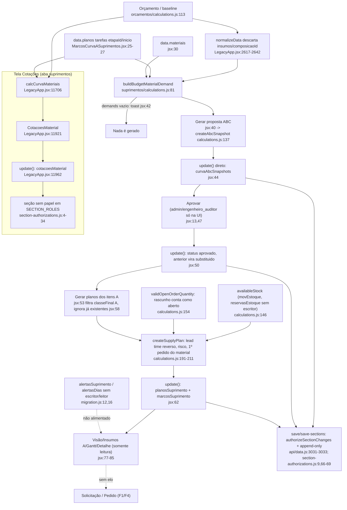

# F13 · suprimentos-curva-abc-e-planos

Fase 1 (somente leitura; nada executado). `jsx` abrevia `src/domains/suprimentos/components/MarcosCurvaASuprimentos.jsx`; `calculations.js` abrevia `src/domains/suprimentos/calculations.js`.

Resumo: o motor de suprimentos tem testes, mas o pipeline parece não produzir nada com dados reais. A causa é que `normalizeData` descarta os campos que o motor exige em cada item do orçamento (A1). Isso vem da leitura do código; não foi executado contra dado real.

Mapeamento das prioridades do usuário: a F13 não tem elo com solicitação, pedido, DRE, extrato ou portal (só lê `pedidos` e `movEstoque`). Quanto à escolha do fornecedor, a F13 só copia o fornecedor do primeiro pedido que achar; quem sugere "melhor fornecedor" é a tela "Cotações", fora do fluxo de compra.

## (a) Fontes consultadas
`00-features.md` 1-146; `suprimentos/calculations.js` 1-229; `MarcosCurvaASuprimentos.jsx` 1-88; `suprimentos/migration.js` 1-20; `suprimentos/calculations.test.js` 1-28; `estoque/calculations.js` 1-138; `orcamentos/calculations.js` 85-144; `planning/engine/budget/activity-budget-links.js` 1-32; `server/section-authorizations.js` 1-295; `LegacyApp.jsx` 213, 264, 1296-1315 (DEFAULT), 1400-1427 (`normalizeData`), 2570-2655, 2688-2702 (`cotacoesMaterial`), 10154, 13134, 17038 (menus), 11660-12230 (`calcCurvaMateriais`, `ModalCotacaoWhatsApp`, `CotacoesMaterial`), 17340-17408 (`update`), 18364, 18387; `api/data.js` 3022-3037; `OrcamentoView.jsx` 2070-2109 (ABC de insumos do orçamento); `navigation/erp-navigation.js` 12, 15; `administracao/abas-acesso.js` 6-9; `docs/BLUEPRINT_CONCORRENCIA_TRAVA.md` 2430-2446. Buscas no repositório: `alertasSuprimento`, `reservasEstoque`, `planosSuprimento`, `marcosSuprimento`, `curvaAbcSnapshots`, `cotacoesMaterial`, `composicaoId`, `curvaAEstrategica`, `validateActivityBudgetLinks`.

## (b) Achados concretos

### 1. Caminho "feliz" como está escrito
1. A aba `plan_suprimentos` ("Marcos e Curva A") monta `LazyMarcosCurvaASuprimentos` em `LegacyApp.jsx:18364`. O componente recebe `data`, `update`, `showToast` e `currentUser`. `obraIdFixo` nunca é passado, então a obra vem de um seletor.
2. Em `jsx:26`, `getPlanningBudget` (`orcamentos/calculations.js:113-126`) escolhe a fonte do orçamento nesta ordem: baseline ativa de controle (`source:"baseline"`); versão ligada ao plano (`"planejamento"`); rascunho mais recente (`"rascunho"`). Nada exige baseline aprovada. A tela só mostra "baseline aprovada" ou "(rascunho)" (linha 75).
3. `buildBudgetMaterialDemand` (`calculations.js:81-117`) agrega a demanda por material: só vínculo explícito por id ou código; quantidade = `item.quantidade × coeficiente`; preço = preço do insumo ou `material.precoMedio`; tarefas ligadas por `tasks.etapaId === item.etapaId`, com `tasks = data.planos[obra].tarefas` (`jsx:27`).
4. "Gerar proposta ABC" (`jsx:40-46`) chama `createAbcSnapshot` (`calculations.js:137`) e `classifyAbc` (`calculations.js:119-135`). Limites 80/95; A se o acumulado antes do item for menor que 80. `classeFinal` vira A se `forcadoParaA` ou `estrategico`. O snapshot nasce `status:"proposta"`, `version:1`, gravado com `update({...data, curvaAbcSnapshots:[...]})` (`jsx:44`).
5. "Aprovar" (`jsx:47-52`) só libera o botão se `canApprove` (`jsx:13`: papel `admin` ou `engenheiro_auditor`). O snapshot vira `aprovado` com `approvedAt`, `approvedById`, `approvedBy` e `version+1`; o aprovado anterior vira `substituido`, com `replacedAt` e `replacedBySnapshotId`.
6. "Gerar planos dos itens A" (`jsx:53-64`) cria um plano por item A que tenha `materialId` e ainda não tenha plano naquele snapshot (`existing`, `jsx:58`). Para cada um: `createSupplyPlan` (`calculations.js:191-212`) calcula `dataNecessidade` como o menor `inicio` entre as tarefas consumidoras (192); estoque livre por `availableStock` (`calculations.js:146`) e pedidos abertos por `validOpenOrderQuantity` (:154); `quantidadeAComprar = max(0, qtd + segurança − livre − aberto)` (196); cronograma reverso em 6 etapas por `reverseSupplySchedule` (:159) com o perfil de lead time do `<select>` (`jsx:24, 78`) e o calendário útil; risco por `calculateSupplyRisk` (:177): `critico` se folga ≤ 0 ou sem data; `alto` se folga ≤ 5 ou sem fornecedor ou sem pedido; `medio`; `baixo`. Além do plano, `jsx:61` cria um marco por etapa em `marcosSuprimento`.
7. **O comprador não tem ação a partir daqui.** As visões "Visão geral", "Insumos A", "Gantt", "Detalhe" e "Configuração" (`jsx:66, 77-85`) são só leitura. Não há botão nem comando para criar solicitação, cotação ou pedido a partir de um plano. Os únicos campos de pedido nos planos são cópia no momento da geração: `pedidoIds`, `fornecedorId`, `dataCompromissada`.

### 2. Alertas
`alertasSuprimento` e `alertasDias:[30,15,7,3,1]` existem só em dados padrão e migração (`calculations.js:68`, `migration.js:12,16`, `LegacyApp.jsx:1313`). Nenhum código lê `alertasDias`, nenhum escreve em `alertasSuprimento`, e nenhuma notificação é gerada. O único "alerta" visível é o rótulo de risco no plano. Os "alertas" da tela Cotações são outra coisa: pesquisa de preço vencida (item 4).

### 3. Pontos críticos do pipeline

**A1. O pipeline parece estar vazio com dados reais (achado mais importante).**
- `analyticalInputs` (`calculations.js:72-77`) só aceita estas formas de item: o próprio item com `materialId` ou `insumoId`; `item.insumos`; `item.analitico`; `item.composicao.itens`; `item.composicaoAnalitica`.
- `normalizeData` (`LegacyApp.jsx:2617-2642`) reconstrói cada item do orçamento com lista fixa de campos, e nenhum é desses: `id`, `etapaId`, `tipo`, `codigo`, `fonte`, `descricao`, `unidade`, `quantidade`, `precoUnit`, `bdi`, `precoRef`, `composicao`, `codigoNaoEncontrado`, `baseData`, `baseUf`, `detailUrl`.
- `composicao` é uma string JSON (`composicaoSerializadaMigrada`, `LegacyApp.jsx:1419-1423`), então `.itens` dá `undefined`. `composicaoId` não é escrito por nenhum código além do próprio motor. `update()` também roda `normalizeData(base)` antes de salvar (`LegacyApp.jsx:17399`).
- Efeito: `demands = []` e a tela cai em "O orçamento ainda não tem insumos analíticos com vínculos explícitos" (`jsx:42`).
- O teste (`calculations.test.js:12`) passa porque monta `insumos:[{materialId, coef}]` à mão, num formato que o orçamento real não grava.
- Confiança alta pela leitura do código; não confirmado com dado de produção (linha gzip não inspecionável). Se alguma importação gravar `insumos` no item, a normalização ainda o descartaria no próximo `update`.

**A2. Já existem três "curvas ABC" independentes:**

| Curva | Onde | Base |
|---|---|---|
| Orçamento | `OrcamentoView.jsx:2019-2109` (`abcInsumos`) | insumos abertos das bases SINAPI/ORSE |
| Tela "Cotações" | `LegacyApp.jsx:11706-11794` (`calcCurvaMateriais`) | itens de serviço do orçamento, por `codigo` |
| Estoque | `estoque/calculations.js:80-99` e `110-137` | consumo real |

A da tela Cotações classifica com `pct <= 80` (inclusive); a do motor F13 usa `before < limiteA`: o mesmo item pode cair em classes diferentes. A F13 é a única que tem snapshot e aprovação. `forcadoParaA` / `curvaAEstrategica` / `motivoCriticidade` só existem em `calculations.js:100,130`. Não há tela nem escritor: o "A estratégico" é inalcançável pela UI.

**A3. Vínculo com o cronograma.** A necessidade vem do plano legado `data.planos[].tarefas` (`jsx:25,27`), ligado por `etapaId` da tarefa = `etapaId` do item do orçamento. Todo insumo de um item herda todas as tarefas da etapa. A "memória" fica em `plano.memoriaNecessidade` (`calculations.js:206`). `validateActivityBudgetLinks` (`planning/engine/budget/activity-budget-links.js:10`) é só leitura, não toca no orçamento nem em suprimentos, e só é usada em `planning-engine.test.js:68`. Atividades do motor novo (`scheduleActivities`) não são consumidas pela F13. Os marcos não alteram a baseline do cronograma (mensagem em `jsx:63`). Se `inicio` da tarefa mudar depois, o plano não se move (ver S9, recálculo).

**A4. Aprovação só é protegida no navegador.** `canApprove` é o único controle (`jsx:13`). No servidor, `SECTION_ROLES.curvaAbcSnapshots` aceita `admin`, `engenheiro` e `engenheiro_auditor` (`section-authorizations.js:9`). `validateNoPhysicalDeletes` só bloqueia exclusão física das coleções append-only (`section-authorizations.js:66-79, 176-180`). Não existe validação equivalente a `validateBudgetBaselinePolicy` (`section-authorizations.js:215`) para snapshots: um `engenheiro` consegue gravar `status:"aprovado"` por `save-sections` ou `save`. O servidor também não impede editar `itens` de um snapshot já aprovado.

**A5. Estoque.** `availableStock` (`calculations.js:145-152`) reimplementa o sinal em `movementSign`, com a mesma tabela de `SINAL_MOV` (`estoque/calculations.js:9`). Os status ignorados diferem: F13 `cancelado/cancelada/estornado/rejeitado/rejeitada/arquivado` (`calculations.js:8`); estoque só `cancelado/cancelada/estornado/estornada` (`estoque/calculations.js:11`). O mesmo movimento pode contar num lado e não no outro (`status:"estornada"` conta no motor F13; `"rejeitado"` ou `"arquivado"` contam no cálculo do estoque). `reservasEstoque` só é lido (`jsx:59`), nunca escrito.

### 4. A tela "Cotações" do menu lateral é outra coisa
Evidência: `LegacyApp.jsx:18387` (aba `suprimentos`), `erp-navigation.js:15` (`cmp, suprimentos, est, fornecedores`), `LegacyApp.jsx:11917-11921`, `BLUEPRINT_CONCORRENCIA_TRAVA.md:2433-2443`.

| | Tela "Cotações" (`CotacoesMaterial`) | Cotação de compra (F3, aba "Cotar") |
|---|---|---|
| Coleção | `data.cotacoesMaterial` (normalizada em `LegacyApp.jsx:2692`) | `data.cotacoes` (`ComprasView.jsx:943, 981`) |
| Chave | `codigo` do item do orçamento (maiúsculo) | `solicitacaoId`, `materialId`, `propostas[]` |
| Escrita | `update()` direto (`LegacyApp.jsx:11962`) | `applyOperationalCommand` (`purchase-order-commands.js`) |
| Registro | 1 preço por fornecedor e data (`id, codigo, preco, data, fornecedorId/Nome, obs`) | mapa de cotação com decisão que gera pedido |
| Liga a pedido | não | sim |

- A tela "Cotações" calcula "curva de necessidade" (data de compra = início da etapa − 21/14/7 dias por classe, `LegacyApp.jsx:11697, 11756`) e a comparação base × melhor cotação. Dá "Sugestão: fornecedor X" (`LegacyApp.jsx:12105`) e alerta de pesquisa vencida (A 30d, B 60d, C 90d; `LegacyApp.jsx:11699, 11781-11792`).
- `cotacoesMaterial` não é lida por `ComprasView`, nem pela F3, nem pelo portal (grep: só `LegacyApp.jsx`). O botão "Cotar urgentes" abre o `ModalCotacaoWhatsApp`, que não grava nada (`LegacyApp.jsx:11972-11988`). O texto manda "registrar os preços em Cotações ou Suprimentos" (`LegacyApp.jsx:11891`), mas o registro é manual e não alimenta `data.cotacoes`.
- Sobreposição de conceito, não de dados: duas curvas ABC com regras de data diferentes (21/14/7 dias fixos × lead time por perfil); duas leituras de "quando comprar"; o preço cotado numa tela nunca chega à outra nem ao pedido.
- **Permissão:** `cotacoesMaterial` não existe em `SECTION_ROLES` (`section-authorizations.js:4-34`, nem em `api/`). `authorizeSectionChanges` retorna "A seção cotacoesMaterial não pode ser alterada por esta rota" para quem não é admin (linhas 51-52; chamada em `api/data.js:3031`). A aba `suprimentos` é liberada para `compras`, `engenheiro` e `engenheiro_auditor` (`abas-acesso.js:7-9`). O perfil `compras` provavelmente não consegue salvar uma cotação nessa tela (só leitura do código; sem teste 403 para esta seção).

## (c) Fluxograma

## (d) Veredito das hipóteses
**S9** (suprimentos desconectado):
- Grava por `update()`, sem comando, versão e auditoria: **CONFIRMADA.** `jsx:44, 50, 62, 65` chamam `update({...data,...})`. O `update` (`LegacyApp.jsx:17340-17408`) faz merge otimista e enfileira o save do dataset inteiro, sem `applyOperationalCommand`. O servidor guarda a trilha de auditoria da mutação (comentário em `LegacyApp.jsx:17397`), mas o domínio não grava evento próprio. `version` é um número no registro, incrementado só na aprovação do snapshot.
- `alertasSuprimento` e `reservasEstoque` sem escritor: **CONFIRMADA.** Referências só em `migration.js`, DEFAULT (`LegacyApp.jsx:1313-1314`), `section-authorizations.js:9, 69`, `server/data-projection.js` e leitura em `jsx:59`.
- Plano calculado uma vez e não recalculado: **CONFIRMADA.** `generatePlans` ignora materiais que já têm plano no snapshot (`jsx:58, 60`). Estoque, pedidos abertos, risco, folga e `dataNecessidade` ficam congelados em `createSupplyPlan` (`calculations.js:202-211`). Não há ação de recálculo; é preciso aprovar outro snapshot.
- `availableStock` duplica sinal e status do estoque: **CONFIRMADA, e divergente** (A5).
- `validOpenOrderQuantity` conta rascunho como aberto: **CONFIRMADA.** O filtro (`calculations.js:155`) só exclui `cancelado/cancelada/estornado/rejeitado/rejeitada/arquivado`. Rascunho, "enviado" e "aguardando aceite" entram, sem tratar conversão de unidade. O recebido parcial é descontado (`qtdRecebida`, linha 157).
- Plano liga só ao primeiro pedido do material: **CONFIRMADA.** `calculations.js:198` pega `[0]`; `pedidoIds` é só `[order.id]` (210). Previsão, fornecedor e `hasOrder` vêm desse pedido, enquanto a quantidade aberta soma todos.

Achados novos: **A1** (demanda vazia com dados reais); **A4** (aprovação sem política no servidor); marcos (`marcosSuprimento`) gravados e nunca lidos (o Gantt usa `item.etapas` do plano, `jsx:83`); **S17** se aplica (a F13 usa `save`/`save-sections`, `api/data.js:3031-3033`); **S13** (as 6 coleções estão na seção de `compras` em `data-projection.js:16`, sem espelho relacional). Demais hipóteses: fora do escopo.

## (e) Informação que se perde ou deixa de ser rastreável
- **Histórico de planos:** ao aprovar novo snapshot, os planos do antigo continuam no array, mas deixam de ser exibidos (filtro por `activeSnapshot.id`, `jsx:33`). Sem comparativo "plano antigo × novo" nem motivo da troca.
- **Recálculo:** estoque, pedido e risco ficam congelados na geração. A tela mostra "risco atual" que pode estar desatualizado, sem data de cálculo além de `createdAt`/`updatedAt`.
- **Aprovação:** guarda `approvedAt/ById/By`, sem motivo ou comentário, e o servidor não confere quem aprovou (A4). A proposta substituída guarda `replacedAt` e `replacedBySnapshotId`, mas não quem a substituiu.
- **Fonte do orçamento:** `baselineVersionId` fica `""` quando a fonte é rascunho, e a aprovação aceita isso. Um snapshot aprovado pode vir de um orçamento que depois muda.
- **Pendências de vínculo:** `pendencias` (material sem id, tarefa sem etapa) existem no item do snapshot, mas só entram na contagem "vínculos pendentes"; itens sem `materialId` nunca recebem plano (`jsx:59`).
- **Alertas de prazo:** nada é registrado nem enviado (`alertasSuprimento` vazio).
- **Cotação de material:** preço cotado fica só em `cotacoesMaterial`, sem ligação com solicitação, pedido ou fornecedor cadastrado quando o usuário digita nome livre (`LegacyApp.jsx:11959`). A "economia potencial" nunca é confrontada com o preço efetivamente pago.
- **Tarefa que muda de data:** o plano não registra a data de necessidade antiga.

## (f) Dependências externas
Navegador: `globalThis.crypto.randomUUID` (`jsx:9`), `Intl.DateTimeFormat`. Projeto: `getPlanningBudget`, `data.planos` (cronograma legado), `data.materiais`, `data.movEstoque`, `data.pedidos`, `data.fornecedores`. Persistência: `update()` → fila de save → `api/data.js` (`save` e `save-sections`), `section-authorizations.js`. Papéis: `abas-acesso.js:6-9`. Pacotes: só React; sem IA. SINAPI/ORSE: a F13 não os lê diretamente; dependem de o orçamento trazer a analítica, que a normalização remove (A1).

## (g) Confiança e lacunas
- Alta: fluxo da F13, ausência de elo com compras, S9, diferença entre as telas de cotação.
- Média: A1 (leitura estática; não verificado se alguma tela de orçamento grava `insumos`/`composicaoId` por fora do `normalizeData`; busca em `src` não achou escritor); o 403 para `cotacoesMaterial` (só `api/data.js:3022-3037` lido; outras 2 chamadas por grep, 2848 e 2921; `save-sections` completo não lido).
- Não lido: `docs/MATRIZ_MODULOS_10_10.md:83` (só grep); `ComprasView` além das linhas citadas; `server/data-projection.js` além do grep; `LegacyApp.jsx` entre 11660 e `orcamentoDaObra`.
- Para o coordenador decidir: se a curva ABC de insumos do `OrcamentoView.jsx:2019` passa a ser a fonte da F13 ou se o motor ganha adaptador; se `cotacoesMaterial` vira histórico de preço da F3/F14.

## Verificação do orquestrador (a preencher)
- A1: executar `buildBudgetMaterialDemand` sobre um item que passou por `normalizeData` (fixture mínima) e ver se `demands` fica vazio.
