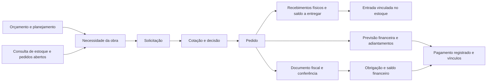

# MARCELL — pesquisa para o piloto de Compras e Financeiro

Data: 01/11/2026. Etapa: preparação anterior à implementação. Escopo autorizado: piloto local, sem deploy. Este documento consolida as decisões da entrevista e a pesquisa; não declara funcionalidades implementadas.

## Direção confirmada pelo usuário

- Preservar MARCELL e a logo; lateral azul-marinho ajustável, conteúdo claro, azul para ações, dourado reservado à marca. Mesma linguagem visual em todos os módulos.
- Experimentar IBM Plex Sans, uma família, poucos pesos, números tabulares; listas compactas por espaçamento, sem reduzir a legibilidade. Formulários com mais respiro e alvos adequados para toque.
- Gestão à vista: atrasos e impedimentos reais, responsável, próxima ação e valores relevantes. Resumo compacto; relatórios e explicações extensas em áreas próprias e Ajuda.
- Tabela como entrada, Kanban como alternativa. Compras por etapa; Financeiro por prazo, separando pagar e receber.
- Nome abre ficha. Ação frequente junto ao registro, inclusive Desligar no RH. Ícones isolados apenas para funções universais com nome acessível.
- Painel lateral para consulta rápida e ações curtas; página dedicada para edição extensa; no celular a ficha ocupa a tela. Preservar filtros, busca e posição ao retornar.
- Arrastar só inicia transições válidas e abre o formulário necessário; nunca confirma sozinho pagamento, recebimento ou aprovação.

## Como a pesquisa foi feita

Fontes primárias de Sienge, Vobi e TOTVS para o domínio; SAP Fiori e Microsoft Business Central para hierarquia de interação; IBM para tipografia. As recomendações abaixo são adaptações para a MARCELL, não regras universais dos fornecedores. Documentação pública não equivale a testar uma conta autenticada desses produtos.

Leitura do código consolidado em `C:/dev/releases/marcell-sidebar-20261101`, commit publicado `963e5a39` com documentação posterior em `abc6d185`. O checkout principal está em outra linha de trabalho e contém alterações locais; não deve substituir essa base nem ser publicado em bloco.

## Evidências e decisões derivadas

| Fonte oficial | Evidência consultada | Adaptação proposta para MARCELL |
| --- | --- | --- |
| [Sienge — pedido de compra](https://ajuda.sienge.com.br/support/solutions/articles/153000199240) | O pedido identifica obra, comprador, fornecedor, itens, entrega e condições; pode aproveitar solicitação, cotação ou itens avulsos e tem previsão financeira. | Conservar origem, responsável e datas no registro. Distinguir prazo de entrega de vencimento financeiro; não exigir uma sequência única para representar toda compra. |
| [Sienge — adiantamento vinculado ao pedido](https://ajuda.sienge.com.br/support/solutions/articles/153000199032-como-posso-controlar-um-pagamento-antecipado-para-um-fornecedor-em-um-pedido-) | Pagamento antecipado pode preceder recebimento e ter vínculo com o pedido, inclusive com baixas parciais. | Exibir adiantamentos e saldo, evitando registrar novamente o mesmo pagamento pela nota. Pagamento não conclui entrega. |
| [Vobi — orçamento](https://ajuda.vobi.com.br/pt-br/articles/4667307-como-criar-um-orcamento-na-vobi) | A estrutura do orçamento serve de referência para planejamento, medições e análise financeira. | Mostrar obra e etapa como contexto do registro, sem exigir que o operador procure essa relação em outro módulo. |
| [Vobi — planejamento](https://ajuda.vobi.com.br/pt-br/articles/9833043-como-utilizar-o-planejamento-de-obra-na-vobi) | Planejamento reutiliza níveis e itens do orçamento, com datas, durações e dependências. | Ligar a necessidade de material à atividade e à data necessária. Não confundir data de solicitar, prazo do fornecedor e início da atividade. |
| [Vobi — panorama de compras](https://ajuda.vobi.com.br/pt-br/articles/8896514-como-utilizar-o-panorama-de-compras-da-vobi) | A consulta relaciona itens orçados, em compra e comprados para acompanhar desvios. | Separar a fila de execução da análise de orçado versus comprado. Manter acesso da pendência ao item e à origem do valor. |
| [Vobi — gestão financeira](https://ajuda.vobi.com.br/pt-br/articles/6570935-fortaleca-a-saude-do-seu-negocio-com-a-gestao-financeira-da-vobi) | A documentação distingue finanças dos projetos/obras e da empresa e descreve acesso por permissões. | Conservar o recorte de obra/empresa e as permissões existentes; não misturar totais nem expor dados ao mudar de visualização. |
| [TOTVS — construção, obras e projetos](https://www.totvs.com/construcao/totvs-construcao-obras-e-projetos/) | Integra orçamento, planejamento, compras, estoque, execução e medições. | Projetar o fluxo entre áreas: a próxima ação precisa levar ao registro certo, conservando a obra, em vez de apenas abrir outro módulo. |
| [TOTVS — faturamento direto no contrato](https://centraldeatendimento.totvs.com/hc/pt-br/articles/39414166572567-TOTVS-Constru%C3%A7%C3%A3o-Obras-e-Projetos-TCOP-Como-%C3%A9-calculado-o-saldo-de-Faturamento-Direto-no-Contrato) | Nesse processo específico, pedidos pendentes podem reservar saldo antes da nota; o faturamento altera a composição desse valor. | Distinguir compromisso e documento reconhecido. Não somar pedido e nota vinculada como se fossem duas compras. Não importar para MARCELL a regra de faturamento direto sem escopo próprio. |
| [SAP — posição das ações](https://www.sap.com/design-system/fiori-design-web/v1-145/foundations/best-practices/global-patterns/action-placement) | Ações ficam próximas de seu objeto e são organizadas conforme o alcance: página, conteúdo ou registro. | Criação no cabeçalho, filtros e visão na barra da lista, próxima ação na linha/cartão, confirmação junto do formulário. Preservar a decisão anterior de evitar cabeçalhos fixos que encubram conteúdo. |
| [Microsoft — ações no Business Central](https://learn.microsoft.com/en-us/dynamics365/business-central/dev-itpro/developer/devenv-actions-overview) | Distingue processamento, criação, navegação e relatórios; a organização depende dos processos reais. | Separar abrir ficha de executar comando. Não usar uma sequência de botões iguais para funções de natureza diferente. |
| [SAP — densidade](https://www.sap.com/design-system/fiori-design-web/v1-145/foundations/visual/cozy-compact) | Modo compacto reduz dimensões e espaçamentos conservando o tamanho da fonte; toque recebe áreas maiores. | Usar tokens de densidade compartilhados e preservar os alvos de toque do contrato MARCELL. Não copiar dimensões do SAP que conflitem com esse contrato. |
| [IBM — Plex](https://www.ibm.com/design/language/typography/typeface/) | A família possui pesos, estilos e cobertura de idiomas; a IBM direciona ao repositório oficial e informa as licenças. | Testar Sans nos pesos regular, médio e semibold, com português, moeda, datas e códigos. Verificar licença e entrega local antes de incorporar a fonte. |

## Modelo de trabalho para construção civil

### Contexto e responsabilidade

A organização proposta é empresa → obra → etapa/serviço do orçamento → item ou registro operacional. Obra/etapa explicam onde o custo se aplica; categoria financeira explica sua natureza. Uma não substitui a outra. Identificar a versão do orçamento quando essa informação existir; evitar vínculo inferido apenas por descrição ou valor.

O processo cruza funções: Engenharia informa necessidade e data; Compras negocia e formaliza; responsável na obra confere o recebido; Financeiro confere documentos, obrigações e movimentações; aprovadores decidem conforme a política vigente. Essas são responsabilidades funcionais propostas. Se não houver pessoa atribuída na base, mostrar que a atribuição falta, sem inventar um responsável nominal.

### Compras: um processo com situações independentes

O desenho mostra relações usuais; não impõe ordem temporal entre nota, entrega e pagamento. Aprovação tem situação própria, sem ser considerada concedida por uma movimentação operacional. Preservar as regras atuais de permissões e os avisos que permitem continuar; não criar novas travas por analogia com outro ERP.

Entrega parcial conserva saldo a receber; quitação conserva a informação de material pendente. Cancelamento mantém histórico e exige revisar impactos nos registros relacionados. Devolução e estorno devem seguir operações existentes, nunca desaparecer por arrastar um cartão para trás. Materiais e serviços de terceiros têm conferências distintas: medir serviço não é receber material.

### Financeiro: quatro perguntas diferentes

| Pergunta | Informação necessária | Evitar |
| --- | --- | --- |
| Quanto planejamos gastar? | Orçamento e previsão de custo final | Tratar estimativa como pagamento |
| Quanto já está contratado ou comprado? | Compromissos ainda não reconhecidos nos documentos pertinentes | Somar pedido e nota vinculada duas vezes |
| Quanto devemos ou temos a receber? | Obrigações, parcelas, valores liquidados e saldo em aberto | Confundir saldo de título com saldo bancário |
| Quanto efetivamente entrou ou saiu? | Movimentações confirmadas e sua conciliação | Achar que anexar comprovante ou planejar parcela movimenta dinheiro |

Competência, vencimento e data de pagamento/recebimento precisam de rótulos distintos. Medição física, medição contratual, documento e liquidação não são sinônimos. Preservar cálculos e seletores canônicos existentes; a revisão visual não autoriza alterar reconhecimento contábil ou fiscal.

## Hierarquia proposta das telas

1. Contexto: módulo, obra/empresa e período; ação principal pertinente ao perfil.
2. Situação: resumo compacto de atrasos, próximos prazos e pendências reais, com contagem e valor do mesmo recorte.
3. Trabalho: busca, filtros, Tabela/Kanban e registros. A visão muda a representação, não o conjunto consultado.
4. Registro: identificação clicável, assunto, prazo identificado, situação, responsável disponível e próxima ação permitida. Valores e unidades permanecem legíveis.
5. Detalhe rápido: identidade, origem, histórico e ações curtas. Edição extensa em página própria, com retorno ao contexto anterior.
6. Análises, detalhes pouco frequentes e Ajuda sem ocupar a primeira visão.

Compras: a tabela abre por padrão; o Kanban é alternativo e trabalha com etapas. Situações de recebimento, fiscal e pagamento aparecem separadas no detalhe/cartão; “Concluído” deve explicar qual parte foi concluída. Propostas e solicitações não devem ganhar fornecedor fictício para caber em um agrupamento.

Financeiro: escolher A pagar ou A receber, depois os mesmos registros em tabela ou quadro. Grupos sem sobreposição: Vencidos (< hoje), Hoje (= hoje), Próximos 7 dias (amanhã até hoje + 7) e Depois (> hoje + 7). Preservar a consulta Sem vencimento como exceção visível; esses registros não podem desaparecer. Usar a data do negócio conforme o padrão atual e conferir virada do dia no fuso adotado pelo app.

No quadro financeiro, uma coluna de prazo é uma projeção da data, não uma etapa de aprovação. Arrastar não deve mudar vencimento silenciosamente nem marcar pago. Eventual reagendamento precisa abrir a ação existente de revisão de prazo, quando permitida; sem essa ação válida, o cartão é apenas consultável. Sempre oferecer alternativa ao arraste por botão/teclado, inclusive no celular.

## Skills de escrita e contrato de linguagem

Busca executada com `find-skills`, usando `npx skills find "ux writing" --owner anthropics`. Selecionada [ux-copy](https://www.skills.sh/anthropics/knowledge-work-plugins/ux-copy), de `anthropics/knowledge-work-plugins`: aproximadamente 4,8 mil instalações no catálogo na consulta, com origem e repositório verificados. Instalada em `C:/Users/hygor/.codex/skills/ux-copy`; leitura feita nesta preparação. A descoberta automática será possível no próximo turno.

Complemento: `impeccable/reference/clarify.md`, já disponível. `copy-editing` foi consultada, mas seu foco de marketing não será usado como guia principal da operação. Impeccable e shadcn continuam obrigatórias na implementação; não se propõe trocar a biblioteca do app.

Voz: português brasileiro, profissional e direto, compreensível para quem conhece a obra e está aprendendo o ERP. A mensagem deve indicar ação, objeto e consequência. Não inventar causa de erro, sucesso, prazo de processamento, integração bancária ou envio ao fornecedor.

| Situação | Padrão proposto | Cuidado |
| --- | --- | --- |
| Lançar pagamento ocorrido | Registrar pagamento | Não afirmar que o ERP enviou dinheiro ao banco |
| Confirmar entrada financeira | Registrar recebimento | Não confundir com recebimento físico |
| Conferir material entregue | Receber materiais | Quantidade real e saldo restante; permitir parcial pelo fluxo existente |
| Consultar detalhes | Nome/código clicável; no detalhe, identificação explícita | Não repetir Ficha e o mesmo nome como dois comandos iguais |
| Alterar formulário | Salvar alterações | Escolher arquivo ou abrir edição não significa gravar |
| Confirmar recebimento parcial | Exemplo: “Registrados 6 de 10 sacos. Restam 4.” | Texto somente após confirmação real, com unidade correta |
| Falha de gravação | Exemplo: “Não foi possível salvar. Seus dados continuam no formulário. Tente novamente.” | Prometer preservação apenas quando verificada |
| Sem resultado por filtro | “Nenhum registro encontrado com estes filtros.” + ação de revisar filtros | Distinguir de falta de permissão ou falha de carregamento |
| Termo técnico | Explicar EAP, competência, adiantamento e conciliação no contexto | Não substituir conceitos diferentes por uma palavra genérica |
| Estado operacional | Em aprovação, entrega parcial, pagamento parcial etc. | Evitar um único status sugerindo que tudo foi resolvido |

Os exemplos são propostas, ainda não textos aplicados. Rótulos como Enviar pedido exigem conferir o efeito real: preparar mensagem, abrir um canal, registrar um envio e enviar efetivamente são resultados diferentes.

## O que já existe e o que precisa de revisão no código MARCELL

| Local lido | Constatação estática | Consequência para o piloto |
| --- | --- | --- |
| `src/domains/compras/components/ComprasView.jsx` — `kanbanCompras` | Já há quadro; a coluna de pedidos depende do recebimento, e o pagamento aparece no cartão. O recorte usa `obraAtual` nessa projeção. | Reaproveitar e verificar paridade com o recorte da fila; não criar outro cadastro ou estado de compra. |
| Mesmo arquivo — `moverCardKanban` | Transições abrem editores/decisão/recebimento; não confirmam sozinhas. Há uma mensagem exigindo duas propostas em uma condição que testa ausência de ofertas. | Preservar confirmações; revisar mensagem contra a regra real, sem supor que duas propostas sejam sempre obrigatórias. |
| Mesmo arquivo — `abrirRegistroFluxo` | Um pedido da fila pode abrir edição/recebimento; outros registros navegam para a área correspondente. | Distinguir abrir ficha de executar próxima ação, com a mesma semântica na tabela e no quadro. |
| `src/features/financeiro/FinanceToday.jsx` | Já há filas e resolução da próxima ação; inclui o rótulo Ver memorial. | Reutilizar as ações permitidas e avaliar “Detalhamento do valor” conforme o conteúdo efetivamente aberto. |
| `src/domains/financeiro/workspace.js` — `todayQueues` | Hoje separa pagar/receber; Vencidos e Próximos 7 dias misturam direções; há Sem vencimento. Não existe Depois nessa fila específica. | Acrescentar direção como recorte consistente e cobrir todos os prazos, sem alterar o ledger nem ocultar os sem data. |
| `src/domains/compras/workflow-advisories.js` | Compra, recebimento, documento, pagamento e estoque têm estados próprios; avisos não autorizam nem bloqueiam operações. | Mostrar pendências com honestidade: aviso operacional não é necessariamente impedimento. |
| `src/design-system/foundations.js`, `themes/themeRegistry.js`, `tokens/density.css`, `copy.js` | Base compartilhada para escala, temas, densidade e textos genéricos já existe. | Aplicar a nova direção nesses pontos, evitando novas exceções locais. |

São achados por leitura de código, não uma nova auditoria visual nem constatação de falha reproduzida no navegador. A inspeção visual faz parte da implementação posterior.

## Sequência do piloto e critérios verificáveis

| Etapa | Entrega | Critério de aceite |
| --- | --- | --- |
| P0 — preparação | Esta pesquisa, decisões, fluxo, glossário inicial e lacunas | Fontes rastreáveis; regras atuais preservadas; nenhuma alteração operacional |
| P1 — fundação | Fonte, paleta, hierarquia, densidade, estados e navegação compartilhados | Desktop/celular, contraste, foco, zoom e nomes longos; nenhuma família de botão por módulo |
| P2 — visões de trabalho | Tabela/Kanban com o mesmo recorte; Financeiro por direção e prazo | Mesmos IDs, contagens e valores entre visões; filtros e seleção conservados; Sem vencimento visível |
| P3 — ficha e ação | Consulta lateral, ação explícita, edição extensa e retorno | Nome não grava; cancelar não grava; busca, filtros e posição retornam; teclado/touch sem depender de arraste |
| P4 — exceções e linguagem | Parciais, adiantamentos, permissões, falhas e textos finais | Sem pagamento/recebimento duplicado; avisos não viram travas; erros preservam rascunho conforme contrato |
| P5 — revisão local | Navegador, testes proporcionais, Ajuda e manual | Fixtures sem gravação real, desktop/celular; manual sincronizado; build e gate de bundle atuais aprovados |

Cenários obrigatórios: entrega parcial com saldo a pagar; pedido pago sem entrega; nota posterior ao adiantamento; solicitação sem fornecedor; cotação com decisão parcial; recebimento acima do pedido com aviso existente; vencido parcialmente liquidado; título sem data; mesma descrição em duas obras; falta de pessoa responsável; permissão restrita; sessão expirada; falha de gravação; retorno do detalhe mantendo consulta; mudança de tabela para Kanban com o mesmo filtro.

Gestão à vista não significa tornar todo item colorido ou carregar todas as linhas de uma base extensa. Manter totais do recorte, paginação/contagem claras e prioridade visível; validar desempenho com volume realista e não alegar nota 9,5 sem evidência de uso. Medir localização da pendência, acesso à ficha e conclusão correta de tarefa, registrando erros e retornos desnecessários.

## Estado desta etapa

P0 concluída. O piloto continua autorizado para execução local. Nesta preparação foram adicionados somente este documento e a skill do usuário; nenhuma tela, regra de negócio, API, dado ou configuração de deploy foi alterada. Ajuda/manual foram lidos como referência; não há mudança de instruções ao operador nesta etapa documental. A atualização das orientações e a geração do manual acompanham P1–P5 conforme os controles efetivamente modificados.
